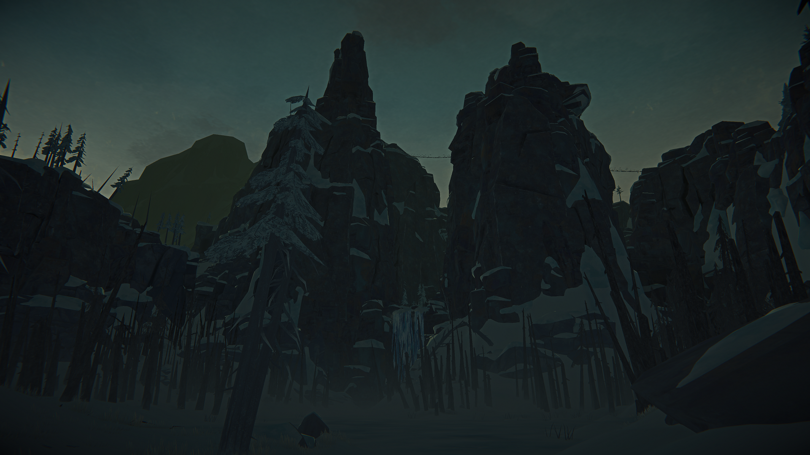
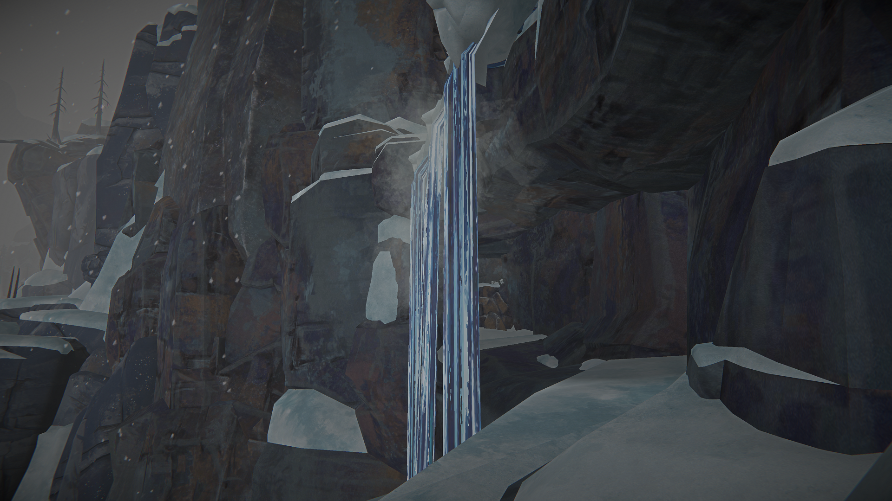

# Broad Falls

**Categories:** Landmarks, Locations, Locations in Ash Canyon, Outdoor locations, Waterfalls · **Source:** [Fandom](https://thelongdark.fandom.com/wiki/Broad_Falls)

**Broad Falls**

| Property | Details |
| --- | --- |
|  | [BroadFallsCloseup 1080p](../assets/BroadFallsCloseup_1080p.png) |
| **Location** |  |
|  | [Broad Falls Location](../assets/Broad_Falls_Location.png) |
| Region | [Ash Canyon](./Ash%20Canyon.md) |
| **General** |  |
| Type | Landmark |
|  | Has no shelter |

**Broad Falls** is a rather wide waterfall located a short distance west of the [Angler's Den](./Angler%27s%20Den.md) in [Ash Canyon](./Ash%20Canyon.md). There isn't much to find here, aside from a few [stones](./Stone.md) lying near the base of the falls. A [Fire Barrel](./Fire%20Barrel.md) spawns about halfway between here and Angler's Den, and a [Frozen Corpse](./Frozen%20Corpse.md) and [backpack](./Backpack.md) may be found along the path going behind the falls leading upriver.

## Gallery

_Broad Falls as seen from [Angler's Den](./Angler%27s%20Den.md) at nightfall_

