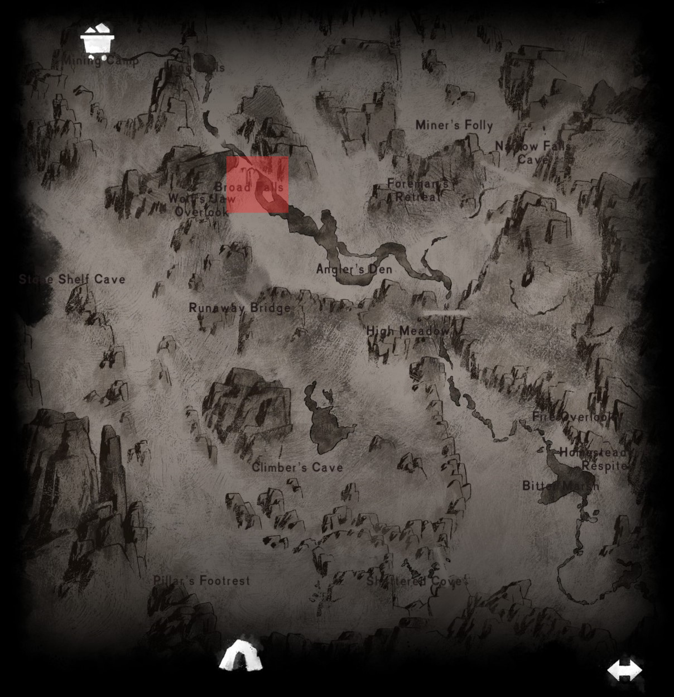

# Broad Falls

**Broad Falls**

| Property | Details |
| --- | --- |
|  |  / *BroadFallsCloseup\_1080p.png* |
| **Location** |  |
|  |  / *Broad\_Falls\_Location.png* |
| Region | [Ash Canyon](./Ash%20Canyon.md)\|- |
| Type | Landmark\|- |
