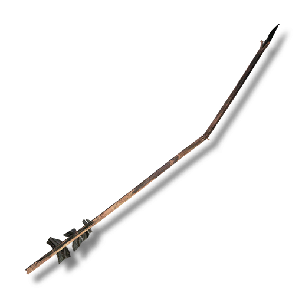
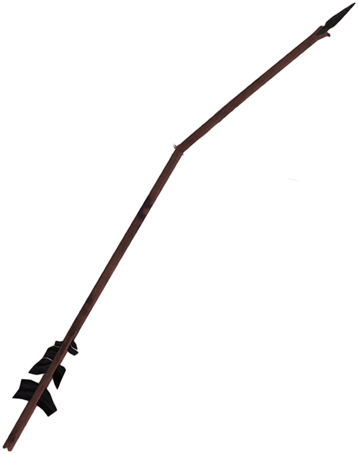

# Broken Arrow

<table class="infobox">
<caption>Broken Arrow</caption>
<colgroup>
<col style="width: 50%" />
<col style="width: 50%" />
</colgroup>
<tbody>
<tr>
<td colspan="2"><figure>

<figcaption>Broken_Arrow_icon.png</figcaption>
</figure></td>
</tr>
<tr>
<td colspan="2" class="section">
<strong>General</strong>
</td>
</tr>
<tr>
<td>
Item Type
</td>
<td>
Tool|-
</td>
</tr>
<tr>
<td>
Weight
</td>
<td>
0.15 kg(0.33 lbs)
</td>
</tr>
<tr>
<td>
Harvest
</td>
<td>
1 × <a href="./Arrowhead.md" class="wikilink" title="Arrowhead">Arrowhead</a> 2 × <a href="./Crow%20Feather.md" class="wikilink" title="Crow Feather">Crow Feather</a>
</td>
</tr>
</tbody>
</table>

<table>
<colgroup>
<col style="width: 33%" />
<col style="width: 33%" />
<col style="width: 33%" />
</colgroup>
<tbody>
<tr>
<td style="vertical-align: top; font-size: 3em; color: #5d5980; padding-right: 10px">
“
</td>
<td>
A broken arrow. The arrow-head and some of the feathers may be salvageable.

&#10;

In-game description

</td>
<td style="vertical-align: bottom; font-size: 3em; color: #5d5980; padding-left: 10px">
”
</td>
</tr>
</tbody>
</table>

A **Broken Arrow** is a tool that is produced when a <a href="./Simple%20Arrow.md" class="wikilink" title="Simple Arrow">Simple Arrow</a> becomes too badly damaged. It can occasionally be found in the game world, often embedded in the carcasses of hunted <a href="./Deer.md" class="wikilink" title="Deer">Deer</a> near <a href="./Frozen%20Corpse.md" class="wikilink" title="Frozen Corpses">Frozen Corpses</a>.

## Overview

Harvesting a Broken Arrow yields 2 <a href="./Crow%20Feather.md" class="wikilink" title="Crow Feathers">Crow Feathers</a> and 1 <a href="./Arrowhead.md" class="wikilink" title="Arrowhead">Arrowhead</a>, one less feather than harvesting a useable arrow. Therefore, harvesting an arrow before it breaks does conserve one feather at the cost of one less use per Arrow Shaft. It has no other use than to be broken down.

## Location

Broken arrows can be found in a few places, some locations of note include:

- On or next to <a href="./Deer%20Carcass.md" class="wikilink" title="animal carcasses">animal carcasses</a>
- Outside of <a href="./Hunter%27s%20Blinds.md" class="wikilink" title="Hunting Blinds">Hunting Blinds</a>

## Gallery

<table class="gallery">
<colgroup>
<col style="width: 50%" />
<col style="width: 50%" />
</colgroup>
<tbody>
<tr>
<td><figure>
[Missing image: Different_Arrow_Types.jpg]
<figcaption>All Arrow types, with Fire Hardened Arrows on the left and Simple Arrows on the right.</figcaption>
</figure></td>
<td><figure>

<figcaption>Old model.</figcaption>
</figure></td>
</tr>
</tbody>
</table>

**Lua execution error in Module:Navbox function navbox**

<a href="ru:%D0%A1%D0%BB%D0%BE%D0%BC%D0%B0%D0%BD%D0%BD%D0%B0%D1%8F_%D1%81%D1%82%D1%80%D0%B5%D0%BB%D0%B0" class="wikilink" title="ru:Сломанная стрела">ru:Сломанная стрела</a>

