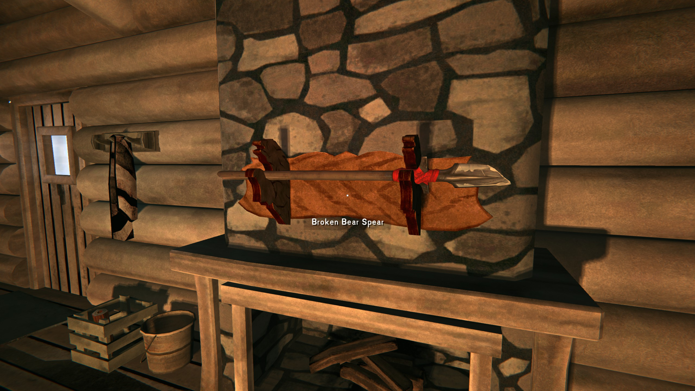
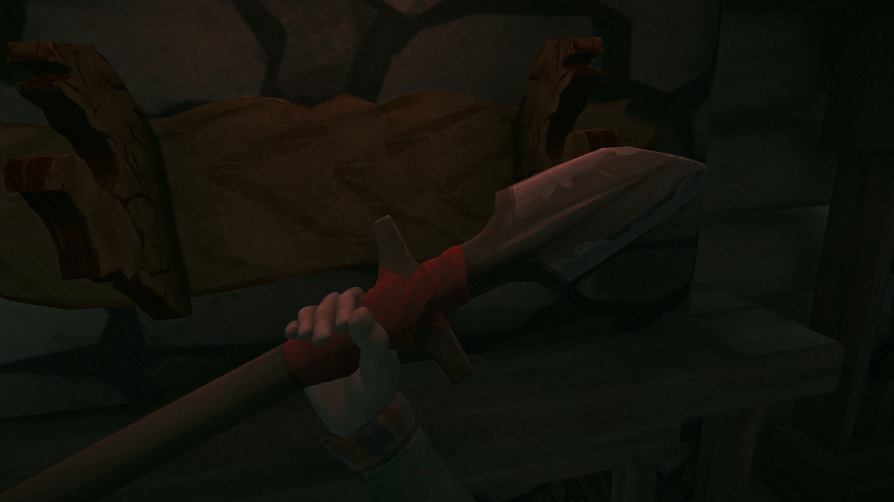

# Broken Bear Spear

**Categories:** Pages with update history, Tools · **Source:** [Fandom](https://thelongdark.fandom.com/wiki/Broken_Bear_Spear)

**Broken Bear Spear**

| Property | Details |
| --- | --- |
| | [Broken Bear Spear icon](../assets/Broken_Bear_Spear_icon.png) |
| Release | [17 December 2018](./The%20Long%20Dark%20%E2%80%94%20Changelog%20%E2%80%94%20Archive%201.md#1-00-wintermute-1-0-launch-update-predux-release) |
| Wintermute | [Episode 2](./Episode%202%20-%20Luminance%20Fugue.md) - [The Best Defense](./The%20Best%20Defense.md) |
| **Properties** | |
| Item type | [Tools](./Tools.md) |
| Equipable | No |
| Stackable | No |
| Examine | A broken spearhead attached to a salvageable maple shaft. |
| **Values** | |
| Weight | 3.75 kg (8.25 lbs) |
| **Actions** | |
| Backpack | Examine |
| On ground | Take It, Leave It |

> “**Damn...looks like one little detail got missed in the trapper's "legend" of the old bear: The spear didn't survive the fight. Must be something I can use to fix it at the old machine shed.**”
>
> — Mackenzie

**Broken Bear Spear** is a [Tools](./Tools.md) item found in [Episode 2: Luminance Fugue](./Episode%202%20-%20Luminance%20Fugue.md) of [Wintermute](./Wintermute.md).

## Overview

It is found hanging over the [Fireplace](./Fireplace.md) in the [Hunting Lodge](./Hunting%20Lodge.md), and must be repaired with a [Spear Head](./Spear%20Head.md) crafted at a [Forge](./Forge.md) in order to restore it to a usable [Bear Spear](./Bear%20Spear.md). It is one of the few key items to have weight, weighing 3.75 kg, and is found in the [Collectibles](./Collectibles.md) tab, likely so it cannot be dropped and lost.

## Survival Mode

It can be spawned via Console Commands in Survival Mode, but cannot be found otherwise.

Despite being unable to be broken down in Wintermute, a harvest option is present. Harvesting the Broken Bear Spear generates 1 [Cured Maple Sapling](./Cured%20Maple%20Sapling.md) and 1 [Scrap Metal](./Scrap%20Metal.md).

## Update history

\* UPDATE **17 December 2018 ([Update](./The%20Long%20Dark%20%E2%80%94%20Changelog%20%E2%80%94%20Archive%201.md#1-41-wintermute-redux-update)):**

- Added to game.
