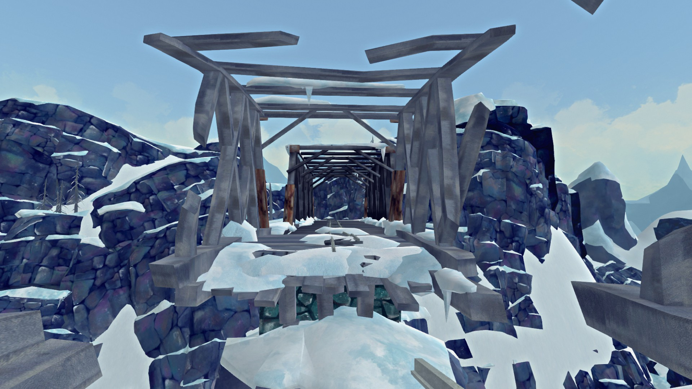
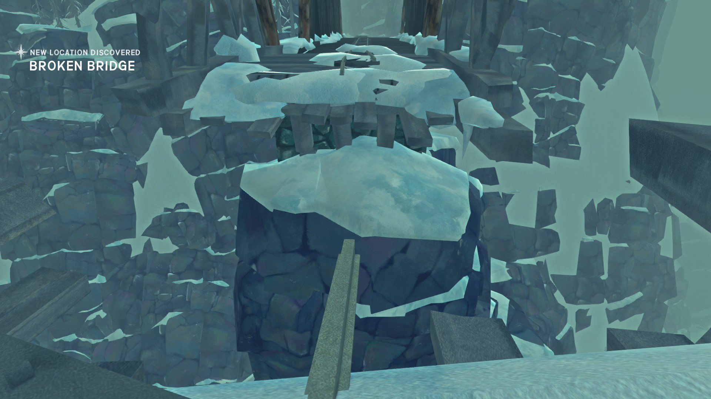
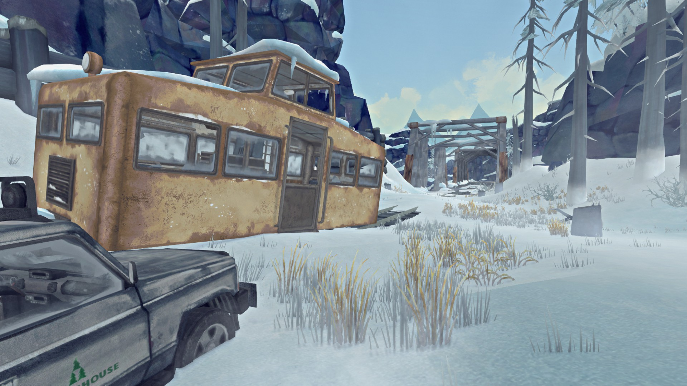
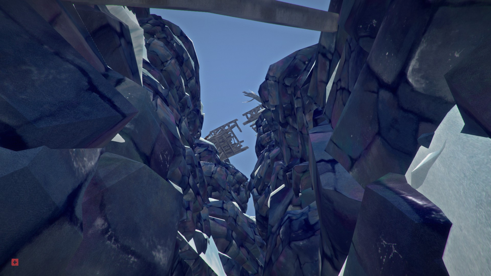

# Broken Bridge \(Broken Railroad location\)

**Categories:** Landmarks, Locations, Locations in Broken Railroad, Outdoor locations, Sheltered locations · **Source:** [Fandom](https://thelongdark.fandom.com/wiki/Broken_Bridge_%28Broken_Railroad_location%29)

**Broken Bridge**

[Broken bridge3](../assets/Broken_bridge3.jpg)

**Location**

[Broken Bridge Location (Railroad)](../assets/Broken_Bridge_Location_%28Railroad%29.png)

**Region:** [Broken Railroad](./Broken%20Railroad.md)

**General**

**Type:** Landmark

## Overview

The bridge is an unremarkable, completely destroyed railroad bridge in the region, with a [Truck](./Truck.md), [Train Shuttle](./Train%20Shuttle.md), [Rabbit Grove](./Rabbit%20Grove.md), and dead bodies with some loot can be found near the starting area of the bridge.

If players purchase the [Tales from the Far Territory](./Tales%20from%20the%20Far%20Territory.md) expansion, however, the bridge is converted into a partially destroyed bridge, with a section of railroad allowing access to the other side as a path towards the [Far Range Branch Line](./Far%20Range%20Branch%20Line.md). On the bridge itself is another Truck and a dead body with a [Backpack](./Backpack.md).

A ravine lies below the bridge with a [Mementos](./Mementos.md) pointing to it. Climbing down below reveals a [Supply Bin](./Supply%20Bin.md) with various supplies, with the [Rope Climbing](./Rope%20Climbing.md) section to access the ravine found west of the frozen pond behind the [Maintenance Yard](./Maintenance%20Yard.md).

## Trivia

- The bridge was originally nothing but a broken in half railroad bridge since the debut of the Broken Railroad [Region](./Region.md). The addition of the Tales from the Far Territory Expansion patched the game to include an unstable railroad footpath, finally making the bridge crossable.
  - The bridge is still broken in various [Challenges](./Challenge.md) however, even with the Expansion installed.

## Gallery

