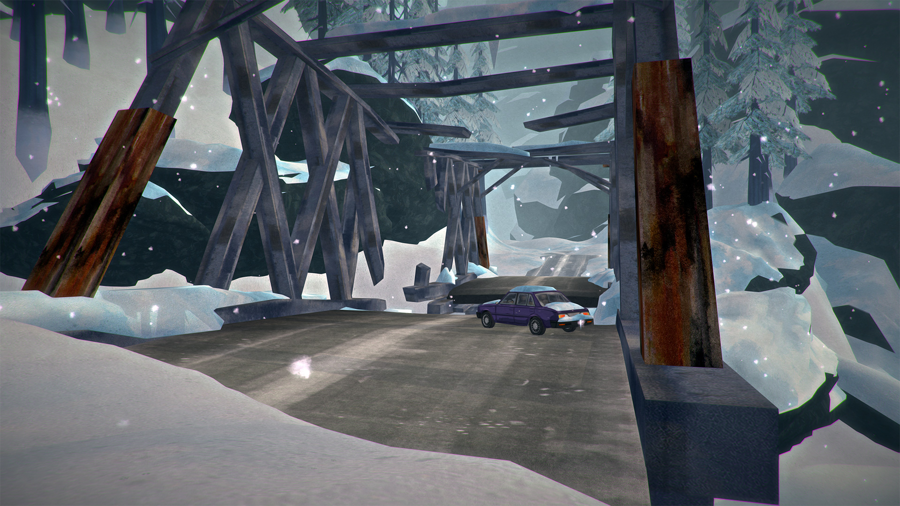

# Broken Bridge \(Desolation Point location\)

**Broken Bridge (Desolation Point location)**

| Property | Details |
| --- | --- |
|  |  / *Broken\_Bridge.jpg* |
| **Location** |  |
|  |  / *Broken\_Bridge\_(Desolation\_Point\_location)\_Location.png* |
| Region | [Desolation Point](./Desolation%20Point.md)\|- |
| Type | Landmark\|- |
