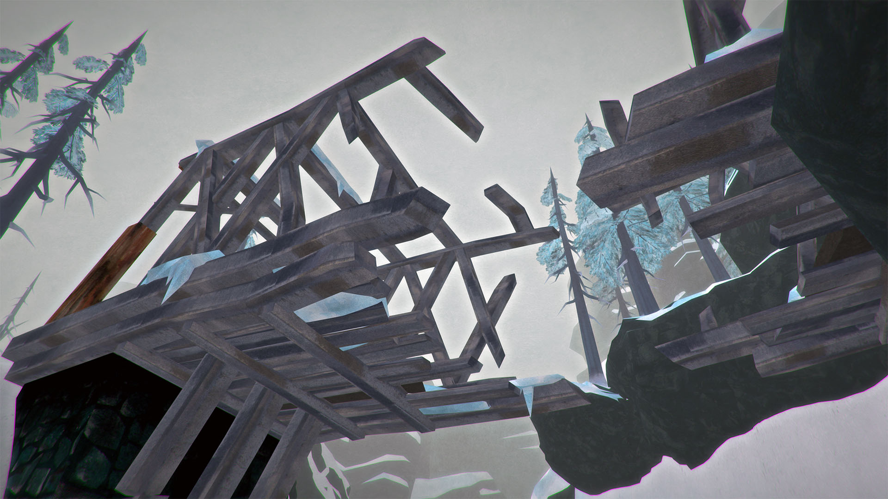

# Broken Bridge \(Desolation Point location\)

**Categories:** Landmarks, Locations, Locations in Desolation Point, Outdoor locations · **Source:** [Fandom](https://thelongdark.fandom.com/wiki/Broken_Bridge_%28Desolation_Point_location%29)

**Broken Bridge (Desolation Point location)**

| Property | Details |
| --- | --- |
| | [Broken Bridge](../assets/Broken_Bridge.jpg) |
| **Location** | |
| | [Broken Bridge (Desolation Point location) Location](../assets/Broken_Bridge_%28Desolation_Point_location%29_Location.png) |
| Region | [Desolation Point](./Desolation%20Point.md) |
| **General** | |
| Type | Landmark |
| | Has no shelter |

_See also [Broken Bridge (disambiguation)](./Broken%20Bridge%20%28disambiguation%29.md)._

**Broken Bridge** is one of two bridges in [Desolation Point](./Desolation%20Point.md).

## Overview

Broken Bridge, as its name implies, is destroyed and impassable. It serves as one of the ends of the region.

A [frozen corpse](./Frozen%20Corpse.md) may be found under the bridge, and a [car](./Car.md) on the bridge. [Green Birch Sapling](./Green%20Birch%20Sapling.md) and a [small cave](./Cave%20%28Desolation%20Point%20location%29.md) can be found nearby. A [bear](./Bear.md) and a [moose](./Moose.md) spawn a little ways from the bridge providing good hunting opportunities.

From [Episode 3](./Episode%203%20-%20Crossroads%20Elegy.md) of [Wintermute](./Wintermute.md) past this bridge might be [Perseverence Mills](./Perseverance%20Mills.md).

For players who have installed [The Long Development](./The%20Long%20Development.md), this bridge currently serves as accessing point to 1st modded region [Precarious Causeway](./Precarious%20Causeway.md).

## Gallery

