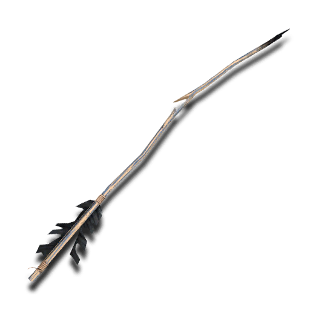
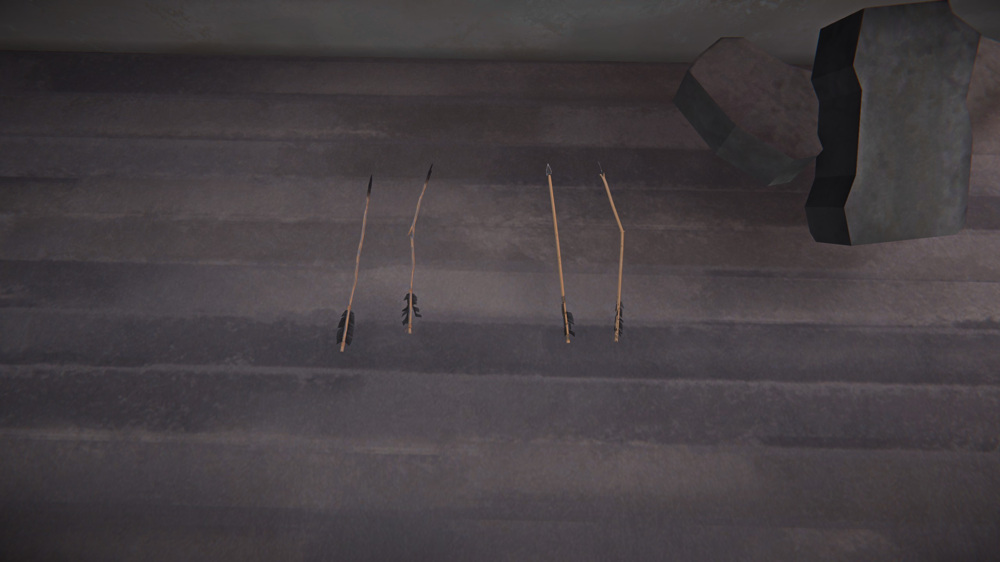

# Broken Fire Hardened Arrow

**Categories:** Pages with update history, Tools · **Source:** [Fandom](https://thelongdark.fandom.com/wiki/Broken_Fire_Hardened_Arrow)

**Broken Fire Hardened Arrow**

_Broken\_Fire\_Hardened\_Arrow\_icon.png_

**Release:** [30 March 2023](./The%20Long%20Dark%20%E2%80%94%20Changelog.md#2.10)

**Wintermute:** No

**Properties**

**Item type:** [Tools](./Tools.md)\|-

**Stackable:** Yes

**Values**

**Weight:** 0.15 kg (0.33 lbs)

**Advanced data**

**Item key:** GAMEPLAY\_BrokenArrowHardened

> “**A broken Fire Hardened Arrow. Harvesting these crude weapons may yield some feathers, but nothing more.**”

## Overview

A **Broken Fire Hardened Arrow** a broken version of a [Fire Hardened Arrow](./Fire%20Hardened%20Arrow.md) that has become too badly damaged to function. Unlike [Broken Arrows](./Broken%20Arrow.md), Broken Fire Hardened Arrows are not found in the game world. They can be harvested for 1 [Crow Feather](./Crow%20Feather.md) in 5 minutes. Curiously, they weigh 0.05 Kg more than their unbroken counterparts.

_All Arrow types, with Fire Hardened Arrows on the left and Simple Arrows on the right._

## Update history

- UPDATE **30 March 2023 ([Update](./The%20Long%20Dark%20%E2%80%94%20Changelog.md#2.10)):**
  - Added to game.
