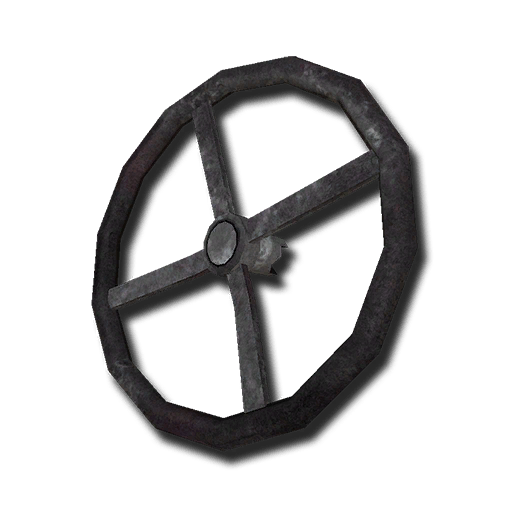

# Broken Hatch Wheel

**Categories:** DLC Content, Tools · **Source:** [Fandom](https://thelongdark.fandom.com/wiki/Broken_Hatch_Wheel)

**DLC-Exclusive content.** This content requires the [Tales from the Far Territory](./Tales%20from%20the%20Far%20Territory.md) addon to be installed before it can be seen or used in regular gameplay.

 **Broken Hatch Wheel**  **Release:** [2 December 2024](./The%20Long%20Dark%20%E2%80%94%20Changelog.md#2.33) **Wintermute:** No **Properties** **Item type:** [Tools](./Tools.md)\\|- **Stackable:** No **Examine:** A piece of Joplin's Bunker, Wyatt's final resting place. **Values** **Weight:** 0.00 kg (0 lbs) **Broken Hatch Wheel** is an item found during [Sutherland's Tale](./Sutherland%27s%20Tale.md).

## Overview

It is found after returning [Wyatt's Skeleton](./Wyatt%27s%20Skeleton.md) and then destroying [Prepper's Abandoned Cache](./Prepper%27s%20Abandoned%20Cache.md). It must be placed in the [Trade Drop Box](./Trade%20Drop%20Box.md) as the 5th Special Request to Sutherland to advance his questline.

It cannot be dropped or placed in a container, so it cannot be lost.

## Update History
