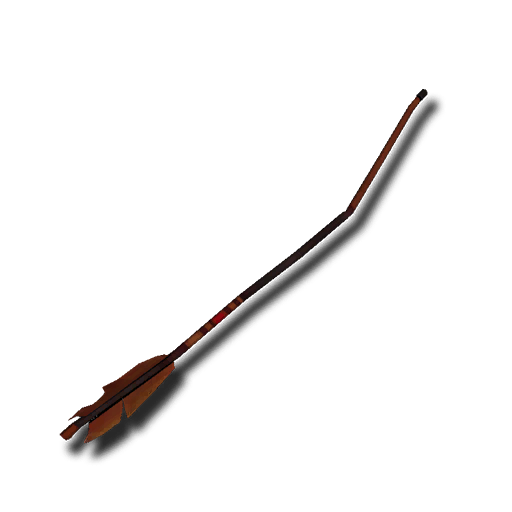

# Broken Manufactured Arrow

<table>
<colgroup>
<col style="width: 33%" />
<col style="width: 33%" />
<col style="width: 33%" />
</colgroup>
<tbody>
<tr>
<td width="40px"><figure>
[Missing image: Ptarmigan_icon.png]
<figcaption>Ptarmigan_icon.png</figcaption>
</figure></td>
<td>
<strong>DLC-Exclusive content.</strong> 

This content requires the <a href="./Tales%20from%20the%20Far%20Territory.md" class="wikilink" title="Tales from the Far Territory">Tales from the Far Territory</a> addon to be installed before it can be seen or used in regular gameplay.

</td>
<td>
|}

<table class="infobox">
<caption>Broken Manufactured Arrow</caption>
<colgroup>
<col style="width: 50%" />
<col style="width: 50%" />
</colgroup>
<tbody>
<tr>
<td colspan="2"><figure>

<figcaption>Broken_Manufactured_Arrow_icon.png</figcaption>
</figure></td>
</tr>
<tr>
<td>
Release
</td>
<td>
<a href="./The%20Long%20Dark%20%E2%80%94%20Changelog.md#2.33" class="wikilink" title="2 December 2024">2 December 2024</a>
</td>
</tr>
<tr>
<td>
Wintermute
</td>
<td>
No
</td>
</tr>
<tr>
<td colspan="2" class="section">
<strong>Properties</strong>
</td>
</tr>
<tr>
<td>
Item type
</td>
<td>
<a href="./Tools.md" class="wikilink" title="Tools">Tools</a>|-
</td>
</tr>
<tr>
<td>
Stackable
</td>
<td>
No
</td>
</tr>
<tr>
<td>
Examine
</td>
<td>
A broken Manufactured Arrow. Cannot be harvested.
</td>
</tr>
<tr>
<td colspan="2" class="section">
<strong>Values</strong>
</td>
</tr>
<tr>
<td>
Weight
</td>
<td>
0.15 kg (0.33 lbs)
</td>
</tr>
</tbody>
</table>

<strong>Broken Manufactured Arrow</strong> is a <a href="./Tools.md" class="wikilink" title="Tools">Tools</a> item in <em><a href="./The%20Long%20Dark.md" class="wikilink" title="The Long Dark">The Long Dark</a></em>.

<h2 id="Overview">Overview</h2>

It is only acquired after a <a href="./Manufactured%20Arrow.md" class="wikilink" title="Manufactured Arrow">Manufactured Arrow</a> finally breaks at low Condition, and cannot be harvested.

The steel arrowhead is missing, and it cannot be harvested for <a href="./Crow%20Feather.md" class="wikilink" title="Crow Feathers">Crow Feathers</a> (since it was never made with any), so it is by all means a useless item.

<h2 id="Update_history">Update history</h2>

<strong>Template:update historyLua execution error in Module:Navbox function navbox</strong>
</td>
</tr>
</tbody>
</table>

