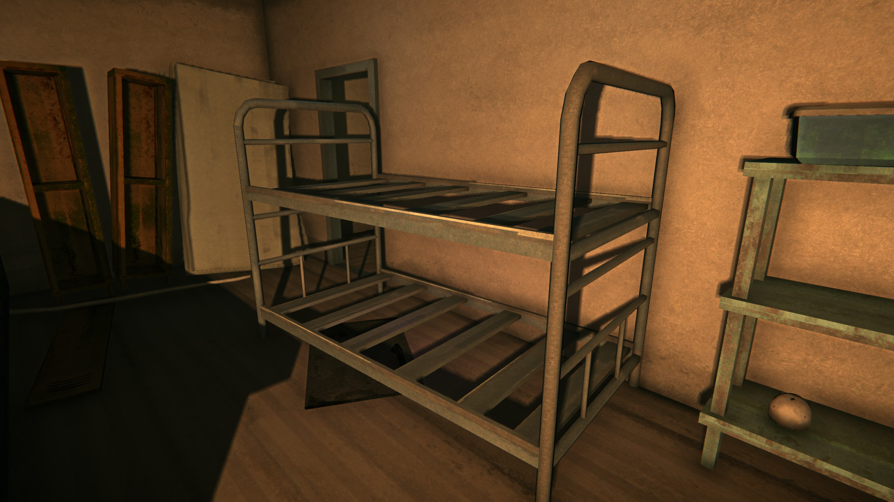

# Broken Metal Bed Frame

**Broken Metal Bed Frame**

| Property | Details |
| --- | --- |
|  |  / *Broken\_Metal\_Bed\_Frame.jpg* |
| **General** |  |
| Item Type |  |
| Wintermute | Yes\|} / The **Broken Metal Bed Frame** is an intractable stationary object in *[The Long Dark](./The%20Long%20Dark.md)*. Often found in cabins or trailers, they may be broken down using a [Hacksaw](./Hacksaw.md) for [Scrap Metal](./Scrap%20Metal.md). Many can be found in [Desolation Point](./Desolation%20Point.md), inside [The Riken](./The%20Riken.md) and the worker bunkhouses near [Hibernia Processing](./Hibernia%20Processing.md). Broken Metal Bed Frames are distinguished by being either overturned or empty and without a bed mattress. / \| Object \| Scrap Metal \| Time \| Calories \| Condition (of Hacksaw) \| / \| --- \| --- \| --- \| --- \| --- \| / \| Broken Metal Bed Frame \| 8 \| 3 hours \| 375 \| -5% \| / **Lua execution error in Module:Navbox function navbox** |
| Object | Scrap Metal / Time / Calories / Condition (of Hacksaw) |
| Broken Metal Bed Frame | 8 / 3 hours / 375 / -5% |
