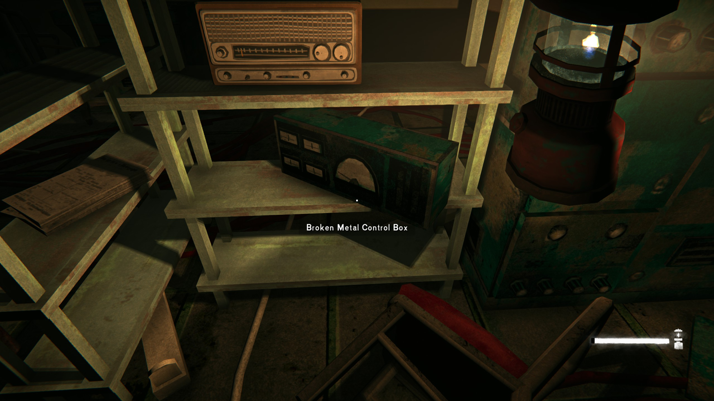

# Broken Metal Control Box

**Categories:** Interactable Objects · **Source:** [Fandom](https://thelongdark.fandom.com/wiki/Broken_Metal_Control_Box)

**Broken Metal Control Box**

**General**

Item Type

Item

Wintermute

A **Broken Metal Control Box** is a harvestable Interactable Object found in many highly industrial areas of the Island. It can be harvested with a [Hacksaw](./Hacksaw.md) for [Scrap Metal](./Scrap%20Metal.md). Large ones provide 2 Scrap Metal in 30 minutes, small ones provide 1 Scrap Metal in 15 minutes.

The large Control Boxes share the same model as a [Switch Box](./Switch%20Box.md).

| Object | Scrap Metal | Time | Calories | Condition (of Hacksaw) |
| --- | --- | --- | --- | --- |
| Small Box | 1 | 15 minutes |  | -5% |
| Large Box | 2 | 30 minutes |  | -5% |
