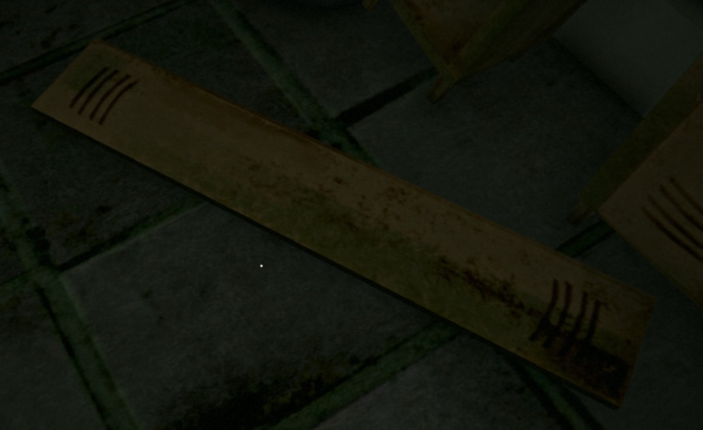

# Broken Metal Door

**Broken Metal Door**

| Property | Details |
| --- | --- |
| \[\[File: / \| Column 1 \| / \| --- \| / \|  / *20190302005444\_1.jpg* \| | 250px\]\] |
|  |  / *20190302005444\_1.jpg* |
| **General** |  |
| Item Type | Item |
| Wintermute | No |
| **Statistics** |  |
| Harvest | 2 × [Scrap Metal](./Scrap%20Metal.md) |

The **Broken Metal Door**is a detached locker door that can be found mainly in industrial indoor environments. Using a [Hacksaw](./Hacksaw.md), the player can harvest the door for two [Scrap Metal](./Scrap%20Metal.md) pieces in 45 minutes.

| Object | Scrap Metal | Time | Calories | Condition (of Hacksaw) |
| --- | --- | --- | --- | --- |
| Broken Metal Door | 2 | 45 minutes |  | -5% |

**Lua execution error in Module:Navbox function navbox** [ru:Мебель и другие предметы под разбор#Металлолом](ru:%D0%9C%D0%B5%D0%B1%D0%B5%D0%BB%D1%8C_%D0%B8_%D0%B4%D1%80%D1%83%D0%B3%D0%B8%D0%B5_%D0%BF%D1%80%D0%B5%D0%B4%D0%BC%D0%B5%D1%82%D1%8B_%D0%BF%D0%BE%D0%B4_%D1%80%D0%B0%D0%B7%D0%B1%D0%BE%D1%80#%D0%9C%D0%B5%D1%82%D0%B0%D0%BB%D0%BB%D0%BE%D0%BB%D0%BE%D0%BC)
