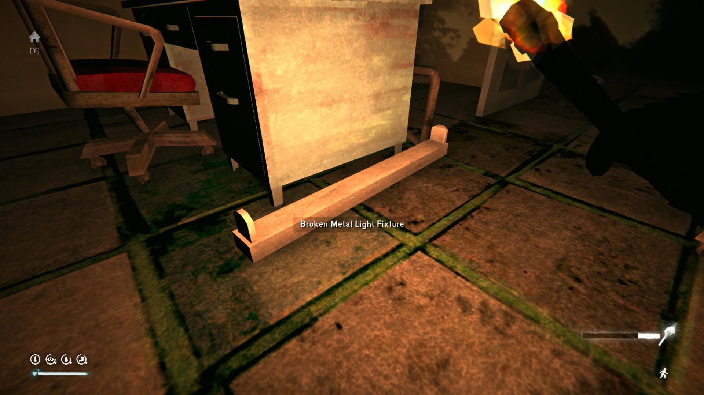

# Broken Metal Light Fixture

**Categories:** Interactable Objects · **Source:** [Fandom](https://thelongdark.fandom.com/wiki/Broken_Metal_Light_Fixture)

**Broken Metal Light Fixture**

| Property | Details |
| --- | --- |
|  |  / _BrokenMetalLightFixture.jpg_ |
| **General** |  |
| Item Type | Item |
| Wintermute |  |
| Renewable | No |
| **Statistics** |  |
| Harvest | 45 minutes 2 x [Scrap Metal](./Scrap%20Metal.md) |

The **Broken Metal Light Fixture** is a harvestable item from in many industrial areas of the Island, most notably in the [Carter Dam](./Carter%20Hydro%20Dam.md). It can be harvested with a [Hacksaw](./Hacksaw.md).

Yields 2 [Scrap Metal](./Scrap%20Metal.md) in 45 minutes.

| Object | Scrap Metal | Time | Calories | Condition (of Hacksaw) |
| --- | --- | --- | --- | --- |
| Broken Metal Light Fixture | 2 | 45 minutes | 188 | -5% |
