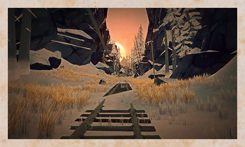
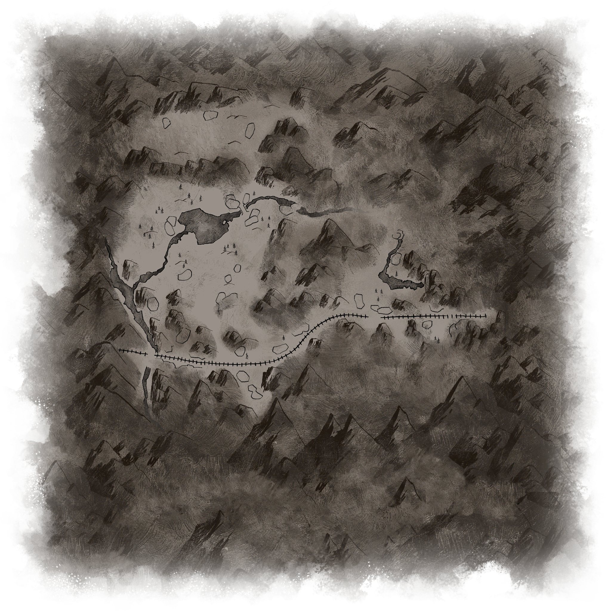
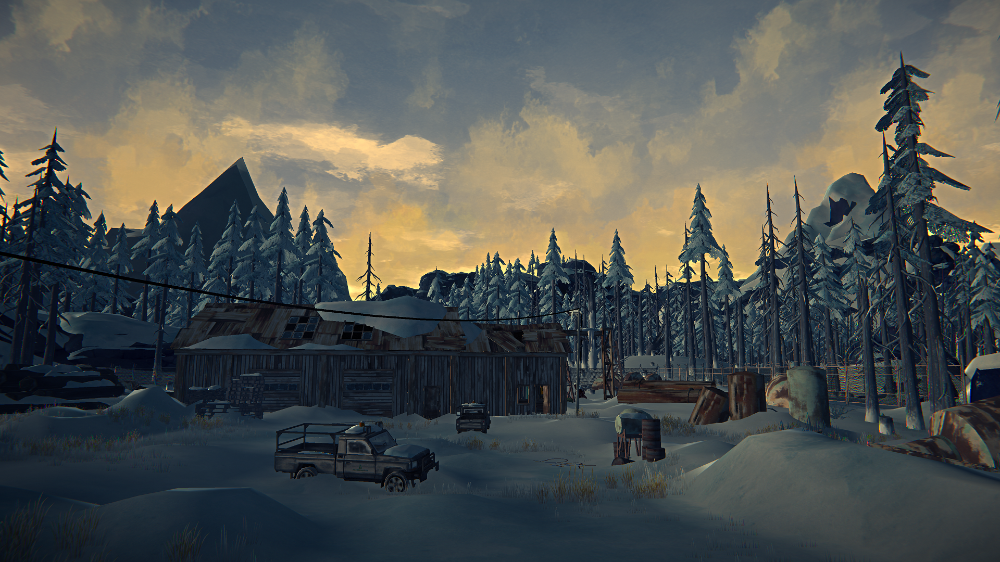

# Broken Railroad

**Contents**

- [Overview](#Overview)
- [Food sources](#Food_sources)
- [Locations](#Locations)
- [Trivia](#Trivia)
- [Gallery](#Gallery)
- [Maps](#Maps)

<table class="infobox">
<caption>Broken Railroad</caption>
<colgroup>
<col style="width: 50%" />
<col style="width: 50%" />
</colgroup>
<tbody>
<tr>
<td colspan="2"><figure>

<figcaption>Broken_railway_titlecard_small.png</figcaption>
</figure></td>
</tr>
<tr>
<td colspan="2" class="section">
<strong>Location on <a href="./Great%20Bear%20Island.md" class="wikilink" title="Great Bear Island">Great Bear Island</a></strong>
</td>
</tr>
<tr>
<td colspan="2"><figure>
[Missing image: Broken_Railroad_Location.png]
<figcaption>Broken_Railroad_Location.png</figcaption>
</figure></td>
</tr>
<tr>
<td colspan="2"><figure>

<figcaption>Broken_Railroad_region_map.png</figcaption>
</figure></td>
</tr>
<tr>
<td colspan="2" class="section">
<strong>Details</strong>
</td>
</tr>
<tr>
<td>
Description
</td>
<td>
An old <a href="./Breyerhouse.md" class="wikilink" title="Breyerhouse">Breyerhouse</a> maintenance yard with the <a href="./Trans-Island%20Railway%20Line.md" class="wikilink" title="Trans-Island Railway Line">Trans-Island Railway Line</a> running through the mountain.
</td>
</tr>
<tr>
<td>
Connecting Regions
</td>
<td>
<a href="./Forlorn%20Muskeg.md" class="wikilink" title="Forlorn Muskeg">Forlorn Muskeg</a> <a href="./Transfer%20Pass.md" class="wikilink" title="Transfer Pass">Transfer Pass</a> (through <a href="./Far%20Range%20Branch%20Line.md" class="wikilink" title="Far Range Branch Line">Far Range Branch Line</a>)
</td>
</tr>
<tr>
<td>
Difficulty
</td>
<td>
Intermediate
</td>
</tr>
<tr>
<td>
Interloper Region Spawn
</td>
<td>
Yes
</td>
</tr>
<tr>
<td>
Locations
</td>
<td>
10
</td>
</tr>
<tr>
<td>
Hazards and Survivability
</td>
<td>
Although the weather is fairly mild, many predators roam the region.
</td>
</tr>
<tr>
<td>
Date Added
</td>
<td>
Aug 2017
</td>
</tr>
</tbody>
</table>

<table>
<colgroup>
<col style="width: 33%" />
<col style="width: 33%" />
<col style="width: 33%" />
</colgroup>
<tbody>
<tr>
<td style="vertical-align: top; font-size: 3em; color: #5d5980; padding-right: 10px">
“
</td>
<td>
For intermediate players. Previous seismic activity means this section of the <a href="./Trans-Island%20Railway%20Line.md" class="wikilink" title="Trans-Island Railway Line">Trans-Island Railway Line</a> is dramatically interrupted. Be careful you don't become lost in its many twisting routes. Connects to Forlorn Muskeg and the Far Territory.

&#10;

- In game description

</td>
<td style="vertical-align: bottom; font-size: 3em; color: #5d5980; padding-left: 10px">
”
</td>
</tr>
</tbody>
</table>

**Broken Railroad** is the 7th <a href="./Region.md" class="wikilink" title="region">region</a> to be added to *The Long Dark*. It is one of 3 regions visited during the course of <a href="./Episode%202%20-%20Luminance%20Fugue.md" class="wikilink" title="Episode 2: Luminance Fugue">Episode 2: Luminance Fugue</a>.

## Overview

Broken Railroad is described as a section of the Trans-Island Railway Line that was ravaged by earthquakes prior to the <a href="./First%20Flare.md" class="wikilink" title="First Flare">First Flare</a>, making navigation rather difficult. The region is connected to <a href="./Forlorn%20Muskeg.md" class="wikilink" title="Forlorn Muskeg">Forlorn Muskeg</a>. It is a relatively small region with mild weather, but is home to many <a href="./Wildlife.md" class="wikilink" title="predators">predators</a>: 6-8 <a href="./Wolf.md" class="wikilink" title="wolves">wolves</a> and a <a href="./Bear.md" class="wikilink" title="Bear">Bear</a>, which can be difficult to avoid in the narrow, hilly, and heavily forested region. Beware that the (only) bear cave in this region is NOT marked with bones, unlike other bear caves.

A <a href="./Forge.md" class="wikilink" title="Forge">Forge</a> is located inside the <a href="./Maintenance%20Yard.md" class="wikilink" title="Maintenance Yard,">Maintenance Yard,</a> which allows the forging of improvised tools and arrowheads. Abundant loot can be found inside the Maintenance Shed and the <a href="./Hunting%20Lodge.md" class="wikilink" title="Hunting Lodge">Hunting Lodge</a> nearby. The outside office in the <a href="./Maintenance%20Yard.md" class="wikilink" title="Maintenance Yard">Maintenance Yard</a> has a bed and behaves like a <a href="./Warm%20Cave.md" class="wikilink" title="Warm Cave">Warm Cave</a>, making it one of the few outdoor locations with indoor warmth insulation for preventing <a href="./Cabin%20Fever.md" class="wikilink" title="Cabin Fever">Cabin Fever</a>.

This region will connect to the <a href="./Far%20Range%20Branch%20Line.md" class="wikilink" title="Far Range Branch Line">Far Range Branch Line</a> and <a href="./Transfer%20Pass.md" class="wikilink" title="Transfer Pass">Transfer Pass</a> regions, if players have purchased the <a href="./Tales%20from%20the%20Far%20Territory.md" class="wikilink" title="Tales from the Far Territory">Tales from the Far Territory</a> DLC.

## Food sources

Broken Railroad, similar to <a href="./Desolation%20Point.md" class="wikilink" title="Desolation Point">Desolation Point</a> is a very small region that is quite isolated from the rest of Great Bear Island. It has several rabbit groves scattered throughout, but is very limited in game, with only 2-4 <a href="./Deer.md" class="wikilink" title="Deer">Deer</a> spawning west of the <a href="./Maintenance%20Yard.md" class="wikilink" title="Maintenance Yard">Maintenance Yard</a>. <a href="./Ice%20Fishing.md" class="wikilink" title="Ice Fishing">Ice Fishing</a> is possible in the pond behind the Yard by using Free Form Ice Holes, though care must be taken not to attack the nearby Bear or Wolves. If planning to stay here for an extended time on Stalker or Interloper, it is wise to get cooking to Level 5 as soon as possible, which will enable the player to hunt wolves and the bear and provide ample food. 4-5 <a href="./Deer%20Carcass.md" class="wikilink" title="Deer Carcass">Deer Carcass</a> can spawn throughout the region.

## Locations

Broken Railroad is a relatively small map, but does feature a number of key locations:

- <a href="./Broken%20Bridge%20%28Broken%20Railroad%20location%29.md" class="wikilink" title="Broken Bridge">Broken Bridge</a>
- <a href="./Hunter%27s%20Blind.md" class="wikilink" title="Hunter&#39;s Blind">Hunter's Blind</a>
- <a href="./Hunting%20Lodge.md" class="wikilink" title="Hunting Lodge">Hunting Lodge</a>
- <a href="./Landslide.md" class="wikilink" title="Landslide">Landslide</a>
- <a href="./Maintenance%20Yard.md" class="wikilink" title="Maintenance Shed">Maintenance Shed</a>
- <a href="./Maintenance%20Yard.md" class="wikilink" title="Maintenance Yard">Maintenance Yard</a>
- <a href="./Locomotive%20Engine.md" class="wikilink" title="Locomotive Engine">Locomotive Engine</a>
- <a href="./Rickety%20Foot%20Bridge.md" class="wikilink" title="Rickety Foot Bridge">Rickety Foot Bridge</a>
- To Forlorn Muskeg (Transition to <a href="./Forlorn%20Muskeg.md" class="wikilink" title="Forlorn Muskeg">Forlorn Muskeg</a>)
- To Far Range Branch Line (Transition to <a href="./Far%20Range%20Branch%20Line.md" class="wikilink" title="Far Range Branch Line">Far Range Branch Line</a>) (Only available with <a href="./Tales%20from%20the%20Far%20Territory.md" class="wikilink" title="Tales from the Far Territory">Tales from the Far Territory</a>)

## Trivia

- Prior to Rugged Sentinel, the winding path and footbridge was inaccessible except by scaling the rocks.
- A Rope Climbing anchor point (initially with no deployed <a href="./Mountaineering%20Rope.md" class="wikilink" title="mountaineering rope">mountaineering rope</a>) leads into a ravine along the western side of the region where the stream terminates. An abundance of items may be found below, including: hunting rifle, rifle ammunition, <a href="./Frozen%20Corpse.md" class="wikilink" title="Frozen Corpse">Frozen Corpse</a>, <a href="./Wolf%20Carcass.md" class="wikilink" title="Wolf Carcass">Wolf Carcass</a>, 2 Deer Carcasses and cattails. Beneath the Broken Bridge is a bin likely containing wood, food or fire starting tools. The climb back out is long, requiring high fatigue, resting at the ledge mid-climb, sleeping in a <a href="./Bedroll.md" class="wikilink" title="Bedroll">Bedroll</a>, or using an <a href="./Emergency%20Stim.md" class="wikilink" title="Emergency Stim">Emergency Stim</a> to complete the climb.
- This region shares some characteristics with <a href="./Desolation%20Point.md" class="wikilink" title="Desolation Point">Desolation Point</a>, including its small size, intermediate difficulty level, high predator density, and presence of a forge.

## Gallery

<table class="gallery">
<colgroup>
<col style="width: 25%" />
<col style="width: 25%" />
<col style="width: 25%" />
<col style="width: 25%" />
</colgroup>
<tbody>
<tr>
<td><figure>
[Missing image: Broken_railroad_hidden_bridge.jpg]
<figcaption>Previously inaccessible, Rickety Bridge</figcaption>
</figure></td>
<td><figure>

<figcaption>Broken_railroad_titlecard_new.png</figcaption>
</figure></td>
<td><figure>

<figcaption>The sun rises over the Maintenance Yard.</figcaption>
</figure></td>
<td><figure>

<figcaption>The Aurora Borealis over the Hunting Lodge.</figcaption>
</figure></td>
</tr>
<tr>
<td><figure>
[Missing image: Hunting_lodge.jpg]
<figcaption>Hunting_lodge.jpg</figcaption>
</figure></td>
<td></td>
<td></td>
<td></td>
</tr>
</tbody>
</table>

## Maps

<table class="gallery">
<colgroup>
<col style="width: 33%" />
<col style="width: 33%" />
<col style="width: 33%" />
</colgroup>
<tbody>
<tr>
<td><figure>
[Missing image: 3255435617_preview_BRR_default.jpg]
<figcaption>Broken Railroad map v2.35</figcaption>
</figure></td>
<td><figure>
[Missing image: BRR_loper.jpg]
<figcaption>Broken Railroad map v2.35 (Interloper-Misery)</figcaption>
</figure></td>
<td><figure>

<figcaption>Broken Railroad map v1.83</figcaption>
</figure></td>
</tr>
</tbody>
</table>

**Lua execution error in Module:Navbox function navbox** **Lua execution error in Module:Navbox function navbox**

<a href="es:v%C3%ADa_destrozada" class="wikilink" title="es:vía destrozada">es:vía destrozada</a> <a href="fr:Voie_Ferr%C3%A9e_D%C3%A9truite" class="wikilink" title="fr:Voie Ferrée Détruite">fr:Voie Ferrée Détruite</a> <a href="ru:%D0%A0%D0%B0%D0%B7%D0%B1%D0%B8%D1%82%D0%B0%D1%8F_%D0%B6%D0%B5%D0%BB%D0%B5%D0%B7%D0%BD%D0%B0%D1%8F_%D0%B4%D0%BE%D1%80%D0%BE%D0%B3%D0%B0" class="wikilink" title="ru:Разбитая железная дорога">ru:Разбитая железная дорога</a>

