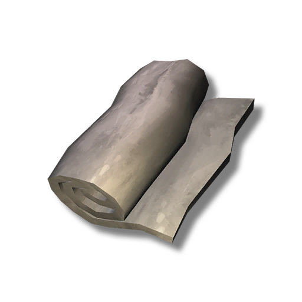
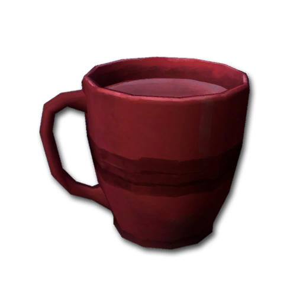

# Broken Ribs

**Contents**

- [Overview](#Overview)
- [Treatment](#Treatment)
- [Recovery Strategies](#Recovery_Strategies)
- [Trivia](#Trivia)

<table class="infobox">
<caption>Broken Ribs</caption>
<colgroup>
<col style="width: 50%" />
<col style="width: 50%" />
</colgroup>
<tbody>
<tr>
<td colspan="2"><figure>
[Missing image: Broken_Ribs_icon.png]
<figcaption>Broken_Ribs_icon.png</figcaption>
</figure></td>
</tr>
<tr>
<td>
Release
</td>
<td>
<a href="./The%20Long%20Dark%20%E2%80%94%20Changelog.md#1.16" class="wikilink" title="7 December 2017">7 December 2017</a>
</td>
</tr>
<tr>
<td>
Update
</td>
<td>
1.16
</td>
</tr>
<tr>
<td colspan="2" class="section">
<strong>Properties</strong>
</td>
</tr>
<tr>
<td>
Category
</td>
<td>
<a href="./Afflictions.md" class="wikilink" title="Afflictions">Afflictions</a>
</td>
</tr>
<tr>
<td>
Description
</td>
<td>
One or more of your ribs are broken. You cannot climb, and your mobility will be reduced until this injury heals.
</td>
</tr>
<tr>
<td>
Caused By
</td>
<td>
<a href="./Moose.md" class="wikilink" title="Moose">Moose</a> <a href="./Struggle.md" class="wikilink" title="Struggle">Struggle</a>
</td>
</tr>
<tr>
<td>
Effect
</td>
<td>
Negative
</td>
</tr>
<tr>
<td>
Type
</td>
<td>
Injury
</td>
</tr>
<tr>
<td>
Affliction Duration
</td>
<td>
Until Treated + Recovery Time
</td>
</tr>
<tr>
<td colspan="2" class="section">
<strong>Treatment</strong>
</td>
</tr>
<tr>
<td>
Treatment
</td>
<td>
2 x  <a href="./Bandage.md" class="wikilink" title="Bandage">Bandage</a> and 4 x  <a href="./Painkillers.md" class="wikilink" title="Painkillers">Painkillers</a>
</td>
</tr>
<tr>
<td>
Alternate Treatment
</td>
<td>
2 x  <a href="./Bandage.md" class="wikilink" title="Bandage">Bandage</a> and 2 x  <a href="./Rose%20Hip%20Tea.md" class="wikilink" title="Rose Hip Tea">Rose Hip Tea</a>
</td>
</tr>
<tr>
<td>
Recovery Time
</td>
<td>
120 Hours
</td>
</tr>
</tbody>
</table>

**Broken Ribs** is an <a href="./Afflictions.md" class="wikilink" title="Affliction">Affliction</a> only acquired from a <a href="./Moose.md" class="wikilink" title="Moose">Moose</a> <a href="./Struggle.md" class="wikilink" title="Struggle">Struggle</a>.

## Overview

|  |  |  |
|----|----|----|
| “ | One or more of your ribs are broken. You cannot climb, and your mobility will be reduced until this injury heals. | ” |

Broken Ribs negatively affects the player in the following ways until healed:

- <a href="./Stamina.md" class="wikilink" title="Stamina">Stamina</a> is reduced by 50%.
- <a href="./Encumbrance.md" class="wikilink" title="Carrying Capacity">Carrying Capacity</a> reduced by 25% (-7.51kg).
- Additionally, it's impossible to use <a href="./Rope%20Climbing.md" class="wikilink" title="Rope Climbing">Rope Climbing</a> sections until this Affliction has healed (this can be temporarily bypassed by using an <a href="./Emergency%20Stim.md" class="wikilink" title="Emergency Stim">Emergency Stim</a>).

Broken Ribs does not alter movement speed, as the survivor can still sprint (despite the fact that this would be agonizing to experience). Broken Ribs can be a concern if the player is trampled by a Moose in a location that cannot be escaped without using a Climbing Rope should the player not have an Emergency Stim/supplies to treat the Affliction.

Should the player use a Stim in order to climb a rope, the lost carrying capacity is not temporarily restored by the stim: only the ability to climb is granted, hence the player should drop sufficient weight to be unencumbered even with Broken Ribs before using the Stim.

## Treatment

Healing Broken Ribs requires a treatment of 2 <a href="./Bandage.md" class="wikilink" title="Bandages">Bandages</a> and 4 <a href="./Painkillers.md" class="wikilink" title="Painkillers">Painkillers</a> (or 2 cups of <a href="./Rose%20Hip%20Tea.md" class="wikilink" title="Rose Hip Tea">Rose Hip Tea</a>), followed by a Recovery Time of 120 hours (5 days). Recovery Time **WILL** count down for the Affliction even if medical treatment is not performed, but will never fully heal.

- Wearing a <a href="./Ballistic%20Vest.md" class="wikilink" title="Ballistic Vest">Ballistic Vest</a> during a Moose Struggle will lower the Recovery Time of Broken Ribs by 30% (-36 hours).
- It is possible to acquire multiple Broken Ribs at once, and each instance of the Affliction must be treated separately. While having extra Broken Ribs does not further hinder the player's carrying capacity or stamina, they take incrementally longer to heal.
- Acquiring a new instance of Broken Ribs (regardless of whether or not the first was healed) will increase the Recovery Time by an additional 48 hours.
  - The second Instance requires a Recovery Time of 168 hours (7 days), the third takes 216 hours (9 days), etc., with the maximum Recovery Time being 991 hours (41 days).
- It is possible to have a maximum of 28 Broken Ribs Afflictions at once.

## Recovery Strategies

One method to quickly pass time is to purposely contract <a href="./Hypothermia.md" class="wikilink" title="Hypothermia">Hypothermia</a> to quickly lose <a href="./Fatigue.md" class="wikilink" title="Fatigue">Fatigue</a>, allowing the player to Sleep for longer periods of time. Any Condition lost from the affliction will be quickly healed while sleeping.

## Trivia

<a href="./Episode%204%20-%20Fury%2C%20Then%20Silence.md" class="wikilink" title="Episode 4: Fury, then Silence">Episode 4: Fury, then Silence</a> begins with <a href="./Will%20Mackenzie.md" class="wikilink" title="Will Mackenzie">Will Mackenzie</a> falling off a large cliff during the <a href="./Prologue.md" class="wikilink" title="Prologue">Prologue</a>, resulting in him acquiring the Broken Ribs affliction. This Affliction is scripted and is healed during the next mission. Mackenzie is scripted to acquire another case of Broken Ribs after the Prison explodes in the mission <a href="./Donner%20%28mission%29.md" class="wikilink" title="Donner">Donner</a>, and is to date the only other way to acquire the Broken Ribs affliction aside from Moose attacks.**Lua execution error in Module:Navbox function navbox**<a href="ru:%D0%A1%D0%BB%D0%BE%D0%BC%D0%B0%D0%BD%D0%BD%D0%BE%D0%B5_%D1%80%D0%B5%D0%B1%D1%80%D0%BE" class="wikilink" title="ru:Сломанное ребро">ru:Сломанное ребро</a>

