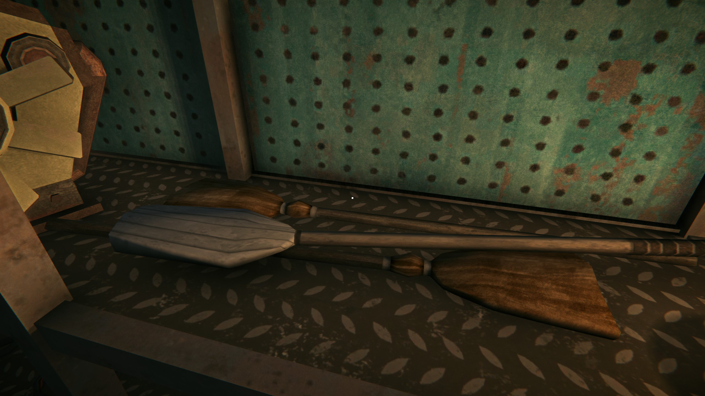

# Broom

**Categories:** Interactable Objects · **Source:** [Fandom](https://thelongdark.fandom.com/wiki/Broom)

**Broom**

| Property | Details |
| --- | --- |
|  |  / _Broom.jpg_ |
| **General** |  |
| Item Type | Item |
| Wintermute | No |
| **Statistics** |  |
| Harvest | 1 x [Reclaimed Wood](./Reclaimed%20Wood.md) |

A **Broom** is a wooden cleaning instrument, but in-game, the broom's only use is to be harvested.

Brooms are generally found indoors inside houses or public building bathrooms, and can have either white or brown bristles.

A Broom yields 1 piece of [Reclaimed Wood](./Reclaimed%20Wood.md) and requires a [Hatchet](./Hatchet.md) and 8 minutes to harvest.

| Object | Reclaimed Wood | Time | Calories | Condition of Tool |
| --- | --- | --- | --- | --- |
| Broom | 1 | 8 minutes | 22 | -2% Hatchet |
| Broom | 1 | 10 minutes | 29 | -3% Improvised Hatchet |
| Broom | 1 | 11 minutes | 34 | -0.5% Heavy Hammer |
