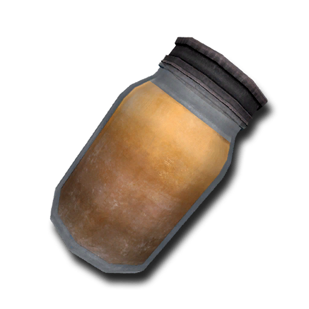

# Broth

**Categories:** DLC Content, Food And Drink, Pages with update history · **Source:** [Fandom](https://thelongdark.fandom.com/wiki/Broth)

**Contents**

- [Overview](#overview)
- [Recipe](#recipe)
- [Products](#products)
- [Update history](#update-history)

_Ptarmigan\_icon.png_

**DLC-Exclusive content.** / This content requires the [Tales from the Far Territory](./Tales%20from%20the%20Far%20Territory.md) addon to be installed before it can be seen or used in regular gameplay.

_Broth\_icon.png_

**Release:** [21 June 2023](./The%20Long%20Dark%20%E2%80%94%20Changelog.md#2.17)

**Wintermute:** No

**Renewable:** Yes

**Properties**

**Item type:** [Food And Drink](./Food%20And%20Drink.md)

**Stackable:** No

**Examine:** A wholesome broth. Savory.

**Values**

**Calories:** 680 (850) kcal

**Hydration:** 5.0%

**Weight:** 0.80 kg (1.76 lbs)

**Decay Rate**

**Inside:** 0.667% per day

**Outside:** 0.167% per day

**Advanced data**

**Item key:** GAMEPLAY\_Broth

**Template:pic link plain**[Cooking](./Cooking.md)**

-

56 minutes

**Requirements**

**Required level:** **Template:pic link plain** 1

**Facility:** **Template:iconlink**

**Tool:** **Template:iconlink**

**Materials**

**Template:iconlink plain**

**Item:** [Ptarmigan (Raw)](./Ptarmigan%20%28Raw%29.md)

**Quantity:** 1.00 kg

**Template:iconlink plain**

[Water (Potable)](./Water%20%28Potable%29.md)

1.50 L

**Template:iconlink plain**

[Salt](./Salt.md)

0.01 kg

Item

Skills

Materials

 [Last Resort Soup](./Last%20Resort%20Soup.md)

None

- 2 × [Potato](./Potato.md) / - 0.40 L × [Broth](./Broth.md) / - 0.01 kg × [Salt](./Salt.md)

 [Porter's Soup](./Porter%27s%20Soup.md)

None

- 2 × [Carrot](./Carrot.md) / - 6 × [Cat Tail Stalk](./Cat%20Tail%20Stalk.md) / - 0.50 kg × [Ptarmigan (Raw)](./Ptarmigan%20%28Raw%29.md) / - 0.40 L × [Broth](./Broth.md) / - 0.01 kg × [Salt](./Salt.md)

 [Ptarmigan Stew](./Ptarmigan%20Stew.md)

None

- 0.50 kg × [Ptarmigan (Raw)](./Ptarmigan%20%28Raw%29.md) / - 0.20 L × [Broth](./Broth.md) / - 0.05 kg × [Old Mill Flour](./Old%20Mill%20Flour.md)

 [Rabbit Stew](./Rabbit%20Stew.md)

None

- 0.50 kg × [Rabbit (Raw)](./Rabbit%20%28Raw%29.md) / - 0.20 L × [Broth](./Broth.md) / - 0.05 kg × [Old Mill Flour](./Old%20Mill%20Flour.md)

 [Ranger Stew](./Ranger%20Stew.md)

None

- 0.50 kg × [Venison (Raw)](./Venison%20%28Raw%29.md) / - 0.50 kg × [Rabbit (Raw)](./Rabbit%20%28Raw%29.md) / - 1 × [Potato](./Potato.md) / - 0.20 kg × [Carrot](./Carrot.md) / - 0.40 L × [Broth](./Broth.md) / - 0.05 kg × [Old Mill Flour](./Old%20Mill%20Flour.md)

 [Thomson Family Stew](./Thomson%20Family%20Stew.md)

None

- 0.30 kg × [Canned Corn](./Canned%20Corn.md) / - 0.40 kg × [Carrot](./Carrot.md) / - 2 × [Potato](./Potato.md) / - 2 × [Reishi Mushroom](./Reishi%20Mushroom.md) / - 0.40 L × [Broth](./Broth.md) / - 0.05 kg × [Old Mill Flour](./Old%20Mill%20Flour.md)

 [Trout Stew](./Trout%20Stew.md)

None

- 0.50 kg × [Rainbow Trout (Raw)](./Rainbow%20Trout%20%28Raw%29.md) / - 0.20 L × [Broth](./Broth.md) / - 0.05 kg × [Old Mill Flour](./Old%20Mill%20Flour.md)

 [Vagabond Soup](./Vagabond%20Soup.md)

None

- 0.50 kg × [Rabbit (Raw)](./Rabbit%20%28Raw%29.md) / - 0.40 L × [Broth](./Broth.md) / - 0.01 kg × [Salt](./Salt.md)

 [Venison Stew](./Venison%20Stew.md)

None

- 0.50 kg × [Venison (Raw)](./Venison%20%28Raw%29.md) / - 0.20 L × [Broth](./Broth.md) / - 0.05 kg × [Old Mill Flour](./Old%20Mill%20Flour.md)
