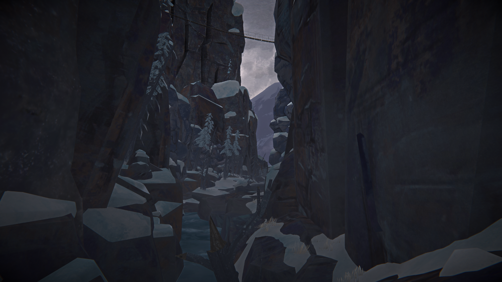

# Builder's Bridge

**Categories:** Landmarks, Locations, Locations in Keeper's Pass North, Outdoor locations · **Source:** [Fandom](https://thelongdark.fandom.com/wiki/Builder's_Bridge)

**Builder's Bridge**

| Property | Details |
| --- | --- |
|  | [Buildersbridge](../assets/Buildersbridge.png) |
| **Location** |  |
|  | [Builder's Bridge Location](../assets/Builder%27s_Bridge_Location.png) |
| Region | [Keeper's Pass North](./Keeper%27s%20Pass%20North.md) |
| Description | A bridge |
| **General** |  |
| Type | Landmark |
|  | Has no shelter |

**Builder's Bridge** is a swinging bridge in [Keeper's Pass North](./Keeper%27s%20Pass%20North.md).

## Overview

A rope bridge providing access to both sides of the river at the end of the crevice back onto the road to [Blackrock](./Blackrock.md). The river valley below can be climbed down into via a [Rope Climbing](./Rope%20Climbing.md) section, with an [Emergency Kit](./Emergency%20Kit.md) containing a [Distress Pistol](./Distress%20Pistol.md) and [Flare Shells](./Flare%20Shell.md). No nearby shelter is present, aside from some Blackrock [Trucks](./Truck.md) on the nearby road.

## Gallery

