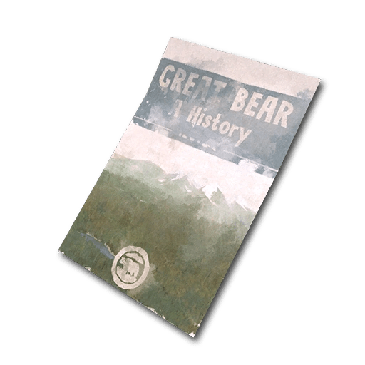

# Building Blackrock

**Contents**

- [Transcript](#Transcript)
- [Part One:](#Part_One%3A)
- [Part Two:](#Part_Two%3A)
- [Part Three:](#Part_Three%3A)
- [Update history](#Update_history)

<table class="infobox">
<caption>Building Blackrock</caption>
<colgroup>
<col style="width: 50%" />
<col style="width: 50%" />
</colgroup>
<tbody>
<tr>
<td colspan="2"><figure>

<figcaption>Building_Blackrock_icon.png</figcaption>
</figure></td>
</tr>
<tr>
<td>
Release
</td>
<td>
<a href="./The%20Long%20Dark%20%E2%80%94%20Changelog.md#1.95" class="wikilink" title="6 October 2021">6 October 2021</a>
</td>
</tr>
<tr>
<td>
Wintermute
</td>
<td>
<a href="./Episode%204%20-%20Fury%2C%20Then%20Silence.md" class="wikilink" title="Episode 4">Episode 4</a>
</td>
</tr>
<tr>
<td colspan="2" class="section">
<strong>Properties</strong>
</td>
</tr>
<tr>
<td>
Item type
</td>
<td>
<a href="./Collectibles.md" class="wikilink" title="Collectibles">Collectibles</a>|-
</td>
</tr>
<tr>
<td>
Stackable
</td>
<td>
No
</td>
</tr>
<tr>
<td>
Examine
</td>
<td>
Leaflet containing information about Great Bear Island, presented by the Great Bear Historical Society.
</td>
</tr>
<tr>
<td colspan="2" class="section">
<strong>Values</strong>
</td>
</tr>
<tr>
<td>
Weight
</td>
<td>
0.00 kg (0 lbs)
</td>
</tr>
<tr>
<td colspan="2" class="section">
<strong>Actions</strong>
</td>
</tr>
<tr>
<td>
Backpack
</td>
<td>
Examine
</td>
</tr>
<tr>
<td>
On ground
</td>
<td>
Take It, Read Text, Leave It
</td>
</tr>
</tbody>
</table>

**Building Blackrock** is a series of <a href="./Collectibles.md" class="wikilink" title="Collectibles">Collectibles</a> found in <a href="./Episode%204%20-%20Fury%2C%20Then%20Silence.md" class="wikilink" title="Episode 4">Episode 4</a> of the <a href="./Wintermute.md" class="wikilink" title="Wintermute">Wintermute</a> story that reveal the history of Blackrock.

- Part One is found on the first toilet in the bathroom of the Guard Barracks at the Prison Yard (areas with lockers for <a href="./Blackrock%20Lockers.md" class="wikilink" title="Blackrock Lockers">Blackrock Lockers</a>)
- Part Two is found on a corkboard near the bed in the <a href="./Old%20Substation.md" class="wikilink" title="Old Substation">Old Substation</a>
- Part Three is found in a <a href="./Backpack.md" class="wikilink" title="Backpack">Backpack</a> inside <a href="./Bricklayer%27s%20Retreat.md" class="wikilink" title="Bricklayer&#39;s Retreat">Bricklayer's Retreat</a>

## Transcript

### Part One:

The following text is transcribed from **Building Blackrock, Part One**

Blackrock’s establishment as a maximum-security incarceration complex is a mixture of truth, legend, and good old-fashioned hyperbole. But its founding is without question bound up with the history of Great Bear Island.

Local communities, almost as a rule, steer clear of the Penitentiary. Whether that is due to reasonable caution or unreasonable fear, no one can say.

There are still others who claim that nothing can match the harshness of winter living on Great Bear, and that Islanders should feel secure in their own hardy resilience. They are tougher than any prison inmate.

### Part Two:

The following text is transcribed from **Building Blackrock, Part Two**

Little is known about Blackrock Penitentiary's original architect, G.W. Jahnn. A pipe organ builder and designer by trade, he switched to institutional design after emigrating to Canada in the late 19th Century.

In terms of his design influences, the official records only note his intense interest in Egyptian monuments, British social theorist Jeremy Bentham, and a somewhat peculiar fascination with the music and astronomy of ancient Greece.

All in all, his work, and the prison itself, make for a remarkable and unusual contribution to the rugged landscape of Great Bear Island.

### Part Three:

The following text is transcribed from **Building Blackrock, Part Three**

Nothing in Blackrock's design could outweigh the influence of the surrounding landscape on the mission of the Penitentiary. The rugged valley surrounding the prison grounds has always been itself a secondary deterrent.

Before the first stone was laid for the Penitentiary, gold miners and prospectors made their way to the region to try their hand at finding fortune in the shadow of Blackrock mountain. Many died, and few found the gold they were looking for.

Still, it's said the many streams and rivers that surround the prison grounds still carry gold, even in winter.

## Update history

- UPDATE **6 October 2021 (<a href="./The%20Long%20Dark%20%E2%80%94%20Changelog.md#1.95" class="wikilink" title="Update">Update</a>):**
  - Added to game.

**Lua execution error in Module:Navbox function navbox**

