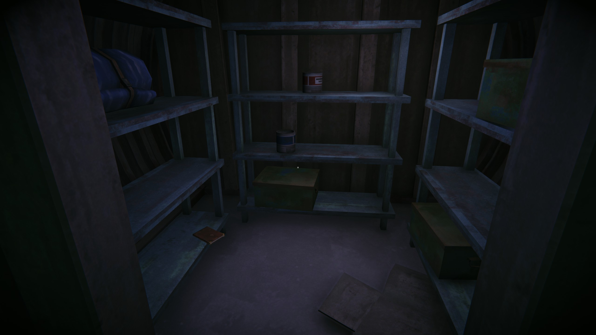
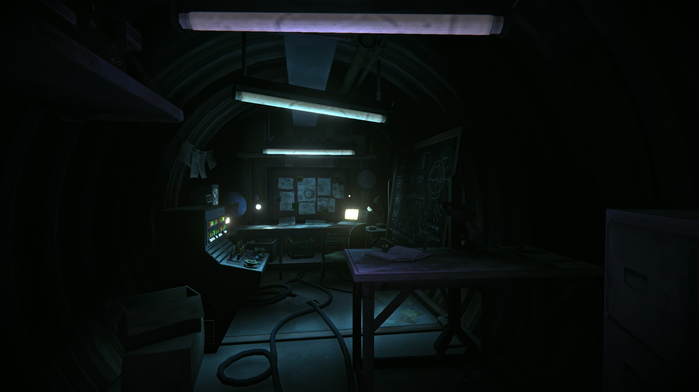
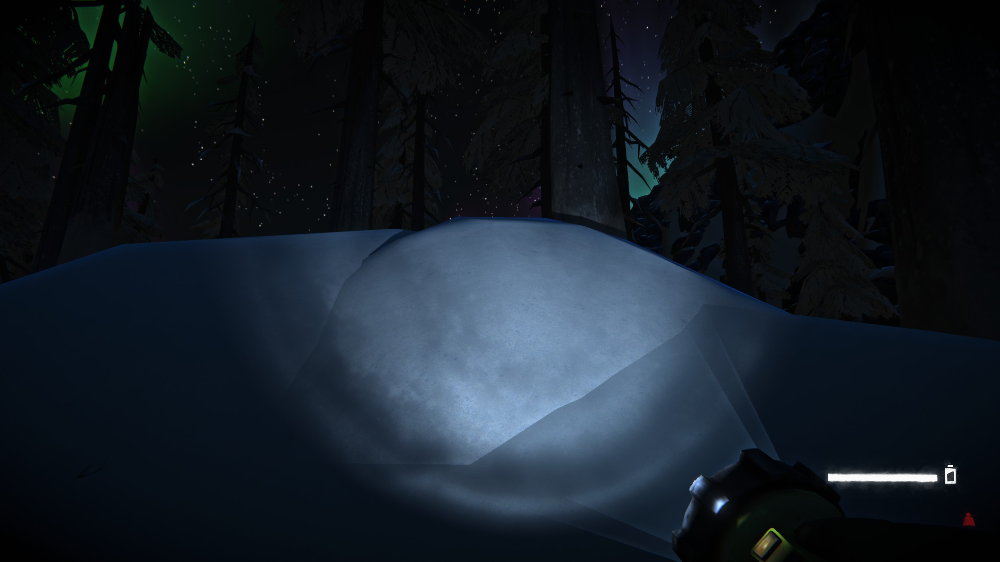

# Bunker Alpha

**Categories:** Indoor locations, Locations, Locations in Bleak Inlet, Military/Sporting locations, Outdoor locations · **Source:** [Fandom](https://thelongdark.fandom.com/wiki/Bunker_Alpha)

**Contents**

- [Unlocking](#unlocking)
- [Overview](#overview)
- [Entrance](#entrance)
- [Kitchen](#kitchen)
- [Back Hallway](#back-hallway)
- [Gallery](#gallery)

**Bunker Alpha**

[Bunker Alpha](../assets/Bunker_Alpha.jpg)

**Location**

[Bunker Alpha Location](../assets/Bunker_Alpha_Location.png)

**Region:** [Bleak Inlet](./Bleak%20Inlet.md)

**General**

**Type:** OutdoorsMilitary/Sporting

Has an interior **Bunker Alpha** is one of the bunkers that can be found as part of the [Signal Void](./Signal%20Void.md) Tale in [Bleak Inlet](./Bleak%20Inlet.md).

## Unlocking

This bunker can only be found after having fixed the [Transmitter](./Transmitters.md) at the [Shortwave Tower East](./Shortwave%20Tower%20East.md) near [Muskeg Overlook](./Muskeg%20Overlook.md) in [Forlorn Muskeg](./Forlorn%20Muskeg.md), then traveling to Bleak Inlet when the [Aurora](./Aurora.md) is active with the [Handheld Shortwave Radio](./Handheld%20Shortwave%20Radio.md) in hand. Prior to this, the entrance is completely covered by snow, and cannot be uncovered.

## Overview

### Entrance

The bunker is somewhat U shaped, with the front door closed upon entering (some [Crates](./Crate.md) are also at the entrance).

### Kitchen

The front door gives way to a kitchen with 2 [Beds](./Bed.md), a sink with [Stored Water](./Stored%20Water.md), 2 [Canned Corn](./Canned%20Corn.md), and 2 [Canned Ham](./Canned%20Ham.md), with several hatches next to the beds.

### Back Hallway

The back kitchen has a door to a hallway intersection. The left path leads to a bathroom with a [Towel](./Towel.md) and [Industrial Toilet](./Industrial%20Toilet.md). The path to the right leads to a storage closet at the end of the hall with [Security Chief's Log 14](./Security%20Chief%27s%20Log%2014.md), with another door leading to a research lab with [Interview Transcript 4](./Interview%20Transcript%204.md).

## Gallery

