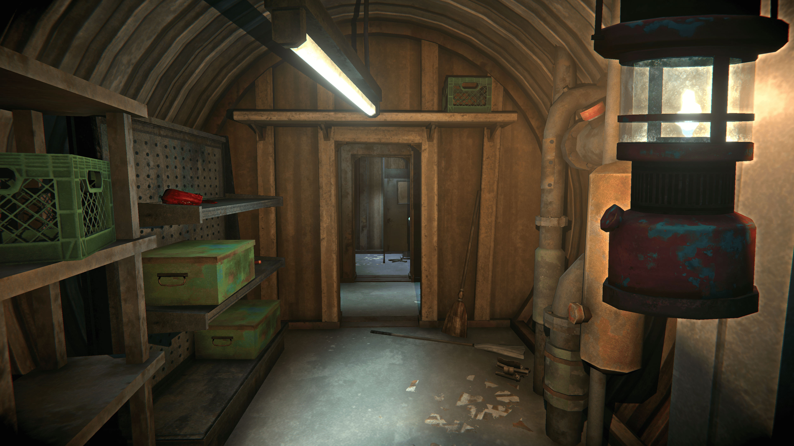
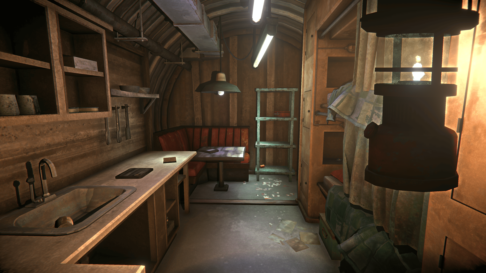

# Bunker Beta

**Contents**

- [Unlocking](#Unlocking)
- [Overview](#Overview)
- [Storage](#Storage)
- [Bathroom](#Bathroom)
- [Kitchen](#Kitchen)
- [Machine Storage](#Machine_Storage)
- [Use as a safehouse](#Use_as_a_safehouse)
- [Gallery](#Gallery)

<table class="infobox">
<caption>Bunker Beta</caption>
<colgroup>
<col style="width: 50%" />
<col style="width: 50%" />
</colgroup>
<tbody>
<tr>
<td colspan="2"><figure>
[Missing image: Bunker_Beta.jpg]
<figcaption>Bunker_Beta.jpg</figcaption>
</figure></td>
</tr>
<tr>
<td colspan="2" class="section">
<strong>Location</strong>
</td>
</tr>
<tr>
<td colspan="2"><figure>
[Missing image: Bunker_Beta_Location.png]
<figcaption>Bunker_Beta_Location.png</figcaption>
</figure></td>
</tr>
<tr>
<td>
Region
</td>
<td>
<a href="./Pleasant%20Valley.md" class="wikilink" title="Pleasant Valley">Pleasant Valley</a>|-
</td>
</tr>
<tr>
<td>
Description
</td>
<td>
A reinforced underground shelter.
</td>
</tr>
<tr>
<td colspan="2" class="section">
<strong>General</strong>
</td>
</tr>
<tr>
<td><figure>

<figcaption>bed_icon.png</figcaption>
</figure></td>
<td>
Has a bed
</td>
</tr>
<tr>
<td></td>
<td>
Has an interior|} <strong>Bunker</strong> <strong>Beta</strong> is one of the bunkers that can be found as part of the <a href="./Signal%20Void.md" class="wikilink" title="Signal Void">Signal Void</a> Tale in <a href="./Pleasant%20Valley.md" class="wikilink" title="Pleasant Valley">Pleasant Valley</a>.

<h2 id="Unlocking">Unlocking</h2>

This bunker can only be found after having fixed the <a href="./Transmitters.md" class="wikilink" title="Transmitter">Transmitter</a> at the <a href="./Radio%20Tower.md" class="wikilink" title="Radio Tower">Radio Tower</a> near <a href="./Signal%20Hill.md" class="wikilink" title="Signal Hill">Signal Hill</a>, then traveling northwest with the <a href="./Handheld%20Shortwave%20Radio.md" class="wikilink" title="Handheld Shortwave Radio">Handheld Shortwave Radio</a> when the <a href="./Aurora.md" class="wikilink" title="Aurora">Aurora</a> is active, at the west end of the map, due south close to <a href="./Three%20Strikes%20Farmstead.md" class="wikilink" title="Three Strikes Farmstead">Three Strikes Farmstead</a>/due north of <a href="./Long%20Curve.md" class="wikilink" title="Long Curve">Long Curve</a> and past a Bear Cave (beware the potential Aurora <a href="./Bear.md" class="wikilink" title="Bear">Bear</a> when traveling to uncover the bunker). Prior to this, the entrance is completely covered by snow and cannot be uncovered.

<h2 id="Overview">Overview</h2>

The bunker is very + shaped, and is the most compact of the 4 bunkers.

<h3 id="Storage">Storage</h3>

The room behind the front entrance is a small storage room with 2 <a href="./Metal%20Container.md" class="wikilink" title="Metal Containers">Metal Containers</a>, <a href="./Work%20Boots.md" class="wikilink" title="Work Boots">Work Boots</a>, and 2 <a href="./Flare.md" class="wikilink" title="Flares">Flares</a>, with a hallway just ahead.

<h3 id="Bathroom">Bathroom</h3>

Moving forwards across the hallway leads to a bathroom with an <a href="./Industrial%20Toilet.md" class="wikilink" title="Industrial Toilet">Industrial Toilet</a> and a <a href="./Towel.md" class="wikilink" title="Towel">Towel</a>, but not much else.

<h3 id="Kitchen">Kitchen</h3>

Turning left of the hallway leads to a kitchen with <a href="./Stored%20Water.md" class="wikilink" title="Stored Water">Stored Water</a>, 3 <a href="./Canned%20Corn.md" class="wikilink" title="Canned Corn">Canned Corn</a>, 1 <a href="./Canned%20Ham.md" class="wikilink" title="Canned Ham">Canned Ham</a>, 1 <a href="./Pinnacle%20Peaches.md" class="wikilink" title="Pinnacle Peaches">Pinnacle Peaches</a>, 2 <a href="./Bed.md" class="wikilink" title="Beds">Beds</a>, a <a href="./Trash%20Can.md" class="wikilink" title="Trash Can">Trash Can</a>, a <a href="./First%20Aid%20Kit.md" class="wikilink" title="First Aid Kit">First Aid Kit</a>, 1 <a href="./Can%20Opener.md" class="wikilink" title="Can Opener">Can Opener</a>, 2 <a href="./Recycled%20Can.md" class="wikilink" title="Recycled Cans">Recycled Cans</a>, 1 <a href="./Hunting%20Knife.md" class="wikilink" title="Hunting Knife">Hunting Knife</a>, and <a href="./Security%20Chief%27s%20Log%2023.md" class="wikilink" title="Security Chief&#39;s Log 23">Security Chief's Log 23</a>.

<h3 id="Machine_Storage">Machine Storage</h3>

Turning right of the hallway leads to a machine storage room, with 1 <a href="./Car%20Battery.md" class="wikilink" title="Car Battery">Car Battery</a>, 1 <a href="./Replacement%20Fuse.md" class="wikilink" title="Replacement Fuse">Replacement Fuse</a>, 1 <a href="./Heavy%20Hammer.md" class="wikilink" title="Heavy Hammer">Heavy Hammer</a>, 1 <a href="./Wires.md" class="wikilink" title="Wire Bundle">Wire Bundle</a>, and <a href="./Interview%20Transcript%2012.md" class="wikilink" title="Interview Transcript 12">Interview Transcript 12</a>.

<h3 id="Use_as_a_safehouse">Use as a <a href="./Safehouse.md" class="wikilink" title="safehouse">safehouse</a></h3>

As with most of the other bunkers unlocked during <a href="./Signal%20Void.md" class="wikilink" title="Signal Void">Signal Void</a>, the bunker does not a particularly practical safe house, despite its plentiful loot. In addition to being isolated, it is very dark inside, requiring a light to navigate, and lacks a fireplace. While it may be useful for providing emergency shelter if caught in a blizzard, there are much better locations to turn into a safehouse in the region.

<h2 id="Gallery">Gallery</h2>
<table class="gallery">
<colgroup>
<col style="width: 25%" />
<col style="width: 25%" />
<col style="width: 25%" />
<col style="width: 25%" />
</colgroup>
<tbody>
<tr>
<td><figure>

<figcaption>Bunker Beta room</figcaption>
</figure></td>
<td><figure>

<figcaption>Bunker Beta Beds and Kitchen</figcaption>
</figure></td>
<td><figure>
[Missing image: Bunker_Beta_Entrance.jpg]
<figcaption>The entrance</figcaption>
</figure></td>
<td><figure>
[Missing image: Bunker_Beta_Machine_Room.jpg]
<figcaption>Machine Room</figcaption>
</figure></td>
</tr>
<tr>
<td><figure>
[Missing image: Bunker_Beta_Snow.jpg]
<figcaption>Bunker Beta before it is uncovered</figcaption>
</figure></td>
<td></td>
<td></td>
<td></td>
</tr>
</tbody>
</table>

<strong>Lua execution error in Module:Navbox function navbox</strong> <a href="ru:%D0%91%D1%83%D0%BD%D0%BA%D0%B5%D1%80_%D0%91%D0%B5%D1%82%D0%B0" class="wikilink" title="ru:Бункер Бета">ru:Бункер Бета</a>
</td>
</tr>
</tbody>
</table>

