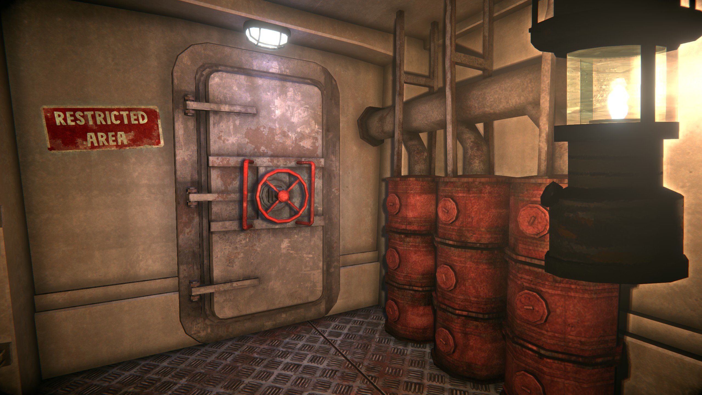
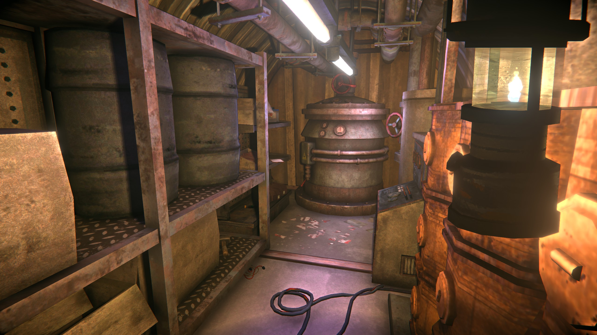
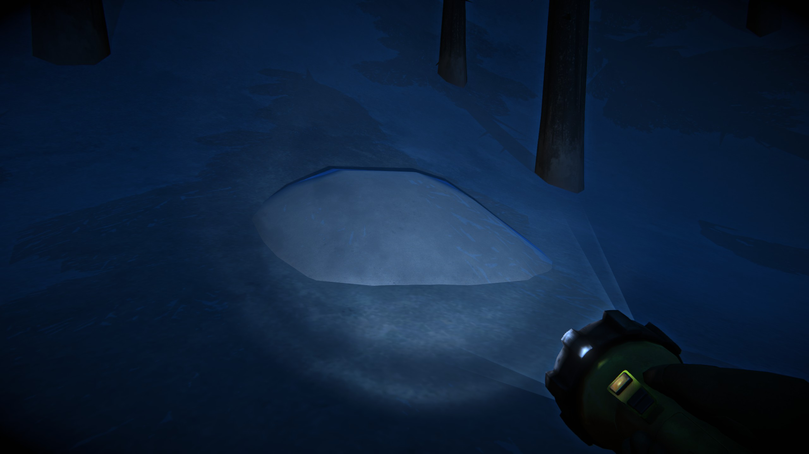

# Bunker Beta

**Categories:** Indoor locations, Locations, Locations in Pleasant Valley · **Source:** [Fandom](https://thelongdark.fandom.com/wiki/Bunker_Beta)

**Contents**

- [Unlocking](#unlocking)
- [Overview](#overview)
- [Storage](#storage)
- [Bathroom](#bathroom)
- [Kitchen](#kitchen)
- [Machine Storage](#machine-storage)
- [Use as a safehouse](#use-as-a-safehouse)
- [Gallery](#gallery)

**Bunker Beta**

| Property | Details |
| --- | --- |
|  |  / _Bunker\_Beta.jpg_ |
| **Location** |  |
|  |  / _Bunker\_Beta\_Location.png_ |
| Region | [Pleasant Valley](./Pleasant%20Valley.md)\|- |
| Description | A reinforced underground shelter. |
| **General** |  |
|  / _bed\_icon.png_ | Has a bed |

|  / _Bunker Beta room_ |  / _Bunker Beta Beds and Kitchen_ /  / _The entrance_ /  / _Machine Room_ |
|  / _Bunker Beta before it is uncovered_ |  |
