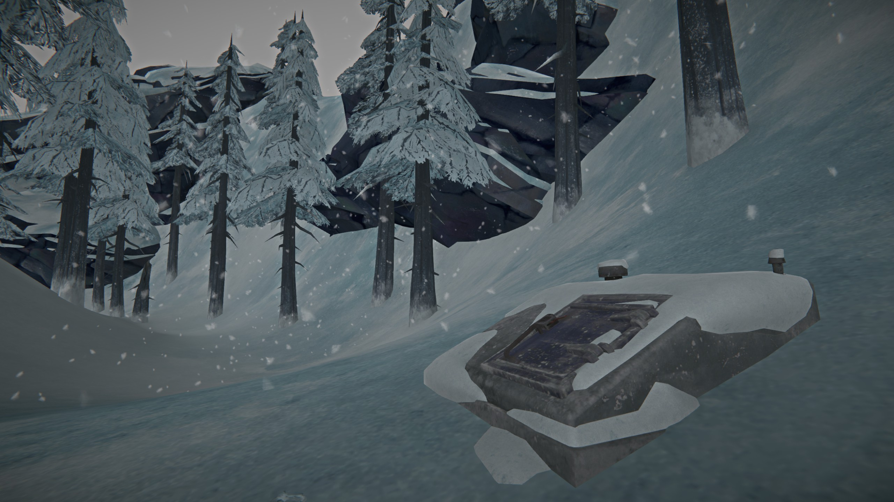
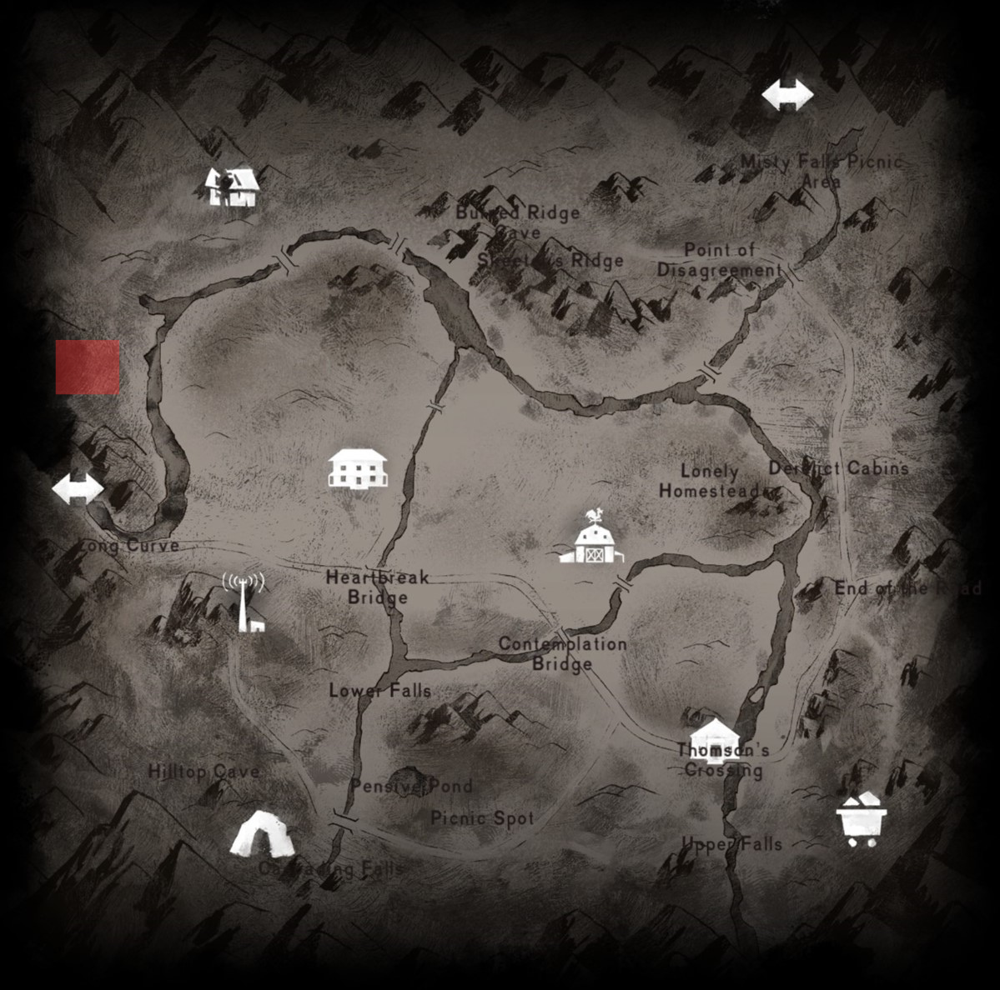

# Bunker Beta

**Categories:** Indoor locations, Locations, Locations in Pleasant Valley · **Source:** [Fandom](https://thelongdark.fandom.com/wiki/Bunker_Beta)

**Contents**

- [Unlocking](#unlocking)
- [Overview](#overview)
- [Storage](#storage)
- [Bathroom](#bathroom)
- [Kitchen](#kitchen)
- [Machine Storage](#machine-storage)
- [Use as a safehouse](#use-as-a-safehouse)
- [Gallery](#gallery)

**Bunker Beta**

_Bunker\_Beta.jpg_

**Location**

_Bunker\_Beta\_Location.png_

**Region:** [Pleasant Valley](./Pleasant%20Valley.md)

**Description:** A reinforced underground shelter.

**General**

_bed\_icon.png_

Has a bed
