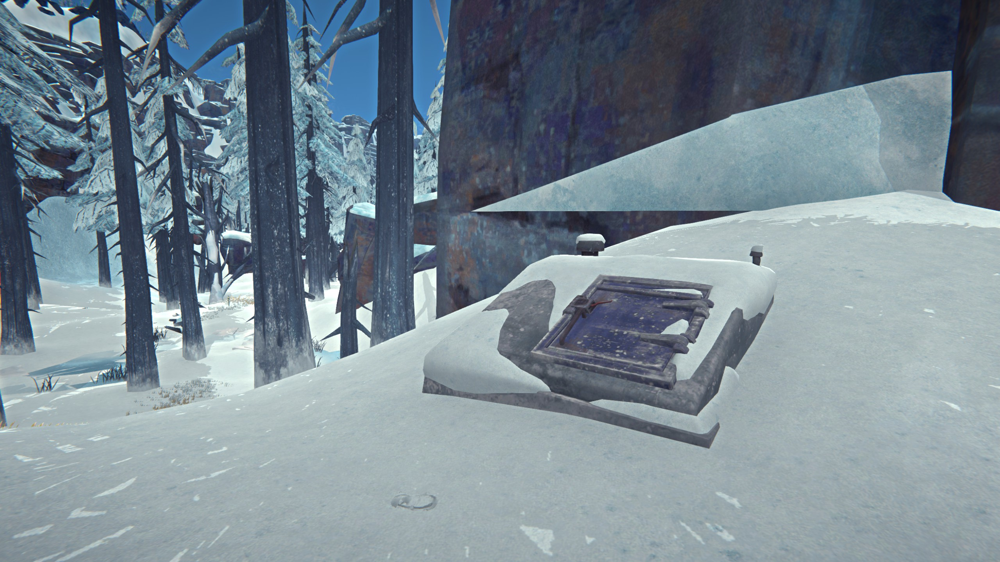
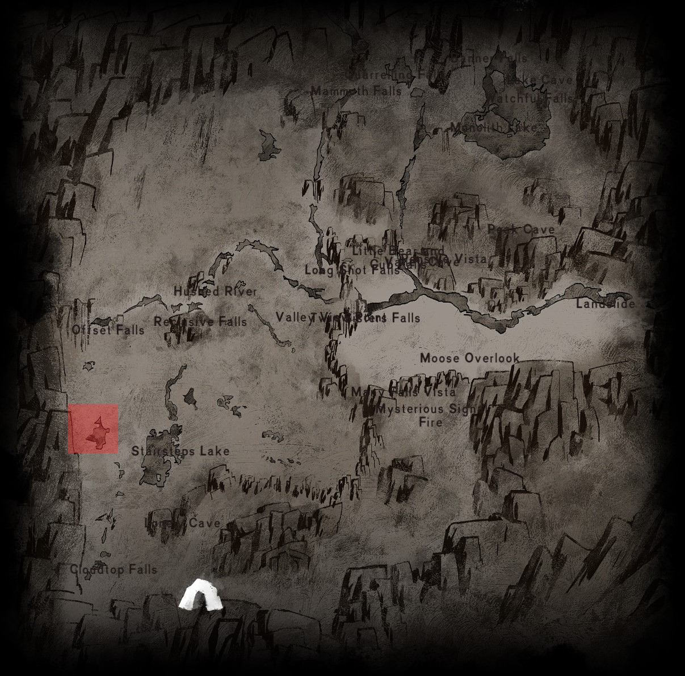

# Bunker Gamma

**Bunker Gamma**

| Property | Details |
| --- | --- |
|  |  / *Bunker\_Gamma.jpg* |
| **Location** |  |
|  |  / *Bunker\_Gamma\_Location.png* |
| Region | [Hushed River Valley](./Hushed%20River%20Valley.md)\|- |
| Description | A reinforced underground shelter. |
| **General** |  |
|  / *bed\_icon.png* | Has a bed |
|  / *workbench\_icon\_green.png* | Has a workbench\|- |
