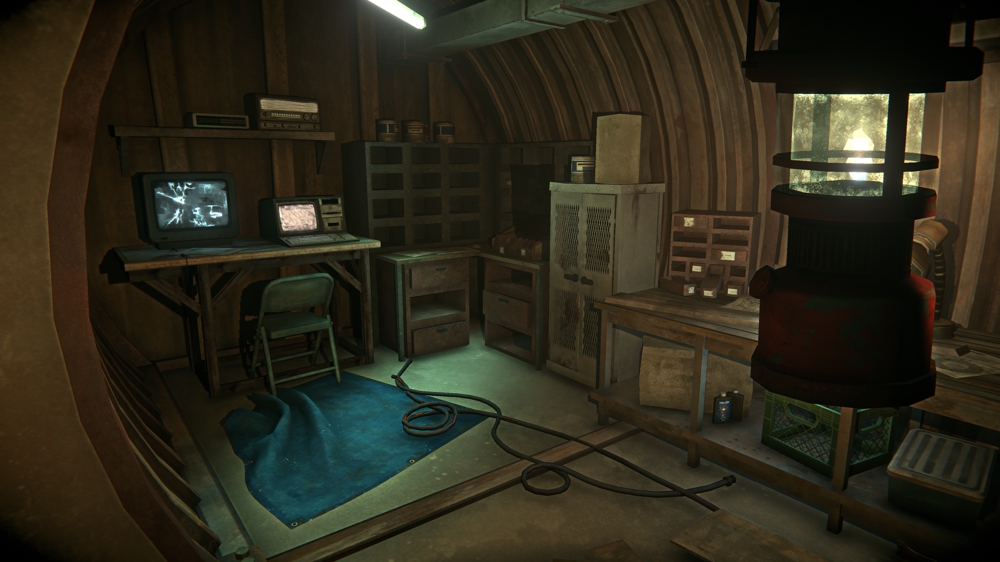
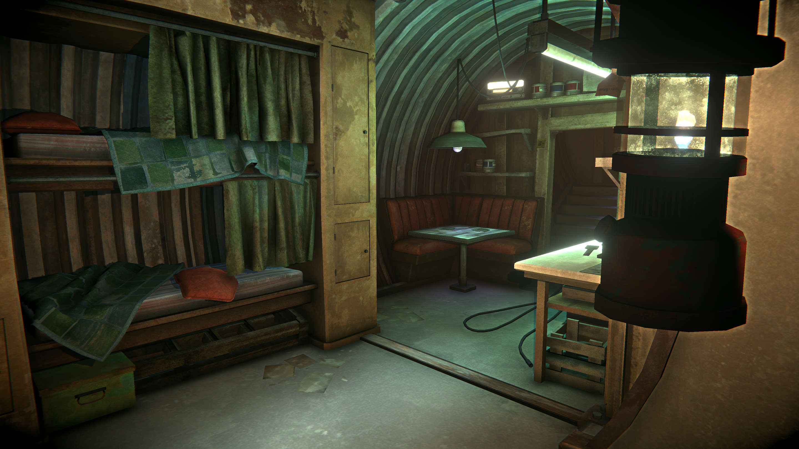
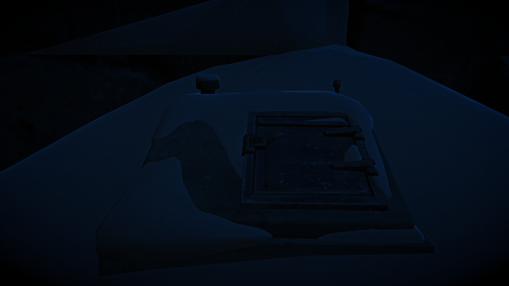
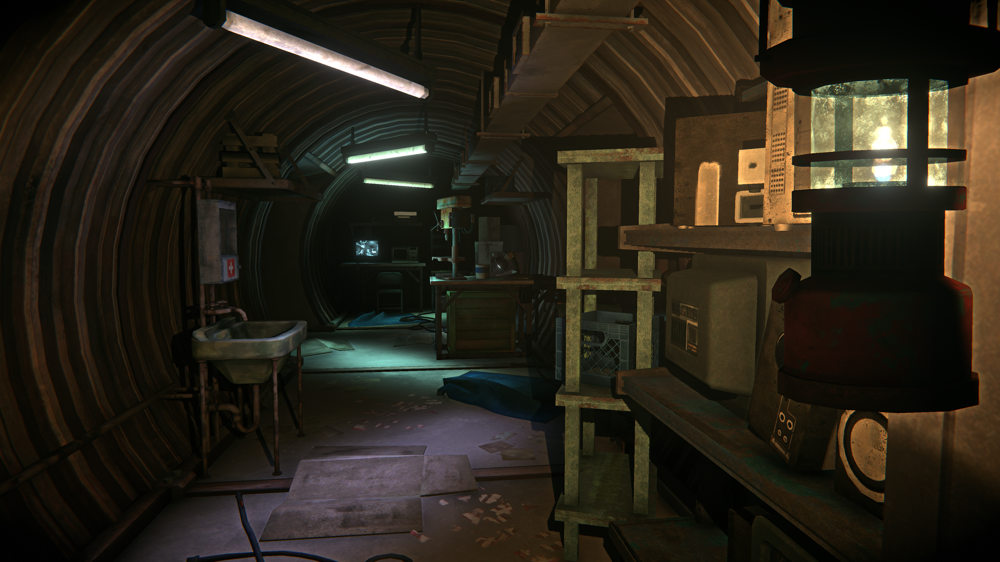
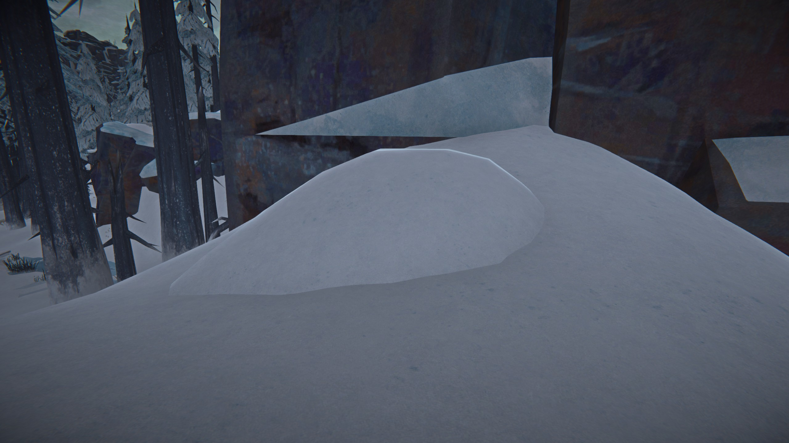

# Bunker Gamma

**Categories:** Indoor locations, Locations, Locations in Hushed River Valley, Locations with a workbench · **Source:** [Fandom](https://thelongdark.fandom.com/wiki/Bunker_Gamma)

**Contents**

- [Unlocking](#unlocking)
- [Overview](#overview)
- [Use as a safehouse](#use-as-a-safehouse)
- [Gallery](#gallery)

**Bunker Gamma**

| Property | Details |
| --- | --- |
|  | [Bunker Gamma](../assets/Bunker_Gamma.jpg) |
| **Location** |  |
|  | [Bunker Gamma Location](../assets/Bunker_Gamma_Location.png) |
| Region | [Hushed River Valley](./Hushed%20River%20Valley.md) |
| Location | A short walk west of [Stairsteps Lake](./Stairsteps%20Lake.md). |
| Description | A reinforced underground shelter. |
| **General** |  |
| [Bed icon](../assets/Bed_icon.png) | Has a bed |
| [Workbench icon green](../assets/Workbench_icon_green.png) | Has a workbench |
|  | Has an interior |

**Bunker Gamma** is one of the bunkers that can be found as part of the [Signal Void](./Signal%20Void.md) Tale in [Hushed River Valley](./Hushed%20River%20Valley.md).

## Unlocking

This bunker can only be found after having fixed the [Transmitter](./Transmitters.md) at the [Radio Tower](./Radio%20Tower.md) near [Milton](./Milton.md), then traveling to the Valley with the [Handheld Shortwave Radio](./Handheld%20Shortwave%20Radio.md) when the [Aurora](./Aurora.md) is active. Prior to this, the entrance is completely covered by snow and cannot be uncovered.

## Overview

This bunker offers the only permanent man-made structure in the entire region, and features a few underground rooms. The layout of the bunker is very L shaped, with the initial room being a the research lab with a [Work Bench](./Work%20Bench.md) and then turning into a kitchen with 2 [Beds](./Bed.md) and a nearby bathroom with an [Industrial Toilet](./Industrial%20Toilet.md).

There is lots of food present in the kitchen, such 2 [Canned Corn](./Canned%20Corn.md), 1 [Canned Ham](./Canned%20Ham.md), and 1 [Tomato Soup](./Tomato%20Soup.md). A toilet and [Stored Water](./Stored%20Water.md) can provide a limited supply of [Water (Potable)](./Water%20%28Potable%29.md). There are also several [Cloth (Object)](./Cloth%20%28Object%29.md) lying on the ground which can be harvested, helping supplement the limited availability of [Cloth](./Cloth.md) on the map.

2 Collectibles for the Tale are found here; [Security Chief's Log 6](./Security%20Chief%27s%20Log%206.md) is found in the kitchen, while [Interview Transcript 14](./Interview%20Transcript%2014.md) is found in the lab.

### Use as a [safehouse](./Safehouse.md)

Of all the bunkers in Signal Void, this one is the most useful as a safehouse. In addition to offering excellent shelter during blizzards, the bunker has good hunting nearby, and is the only place in Hushed River Valley with a workbench. Its relatively central location and larger size makes it superior to the [Prepper Cache](./Prepper%20Cache.md) overall. Its major downsides are that it is dark inside and a lack of other facilities: the closest [Forge](./Forge.md) is [Old Spence Family Homestead](./Old%20Spence%20Family%20Homestead.md) in [Forlorn Muskeg](./Forlorn%20Muskeg.md) and to replenish ammunition it's a long trek to the [Workshop](./Workshop.md) in [Bleak Inlet](./Bleak%20Inlet.md).

## Gallery

