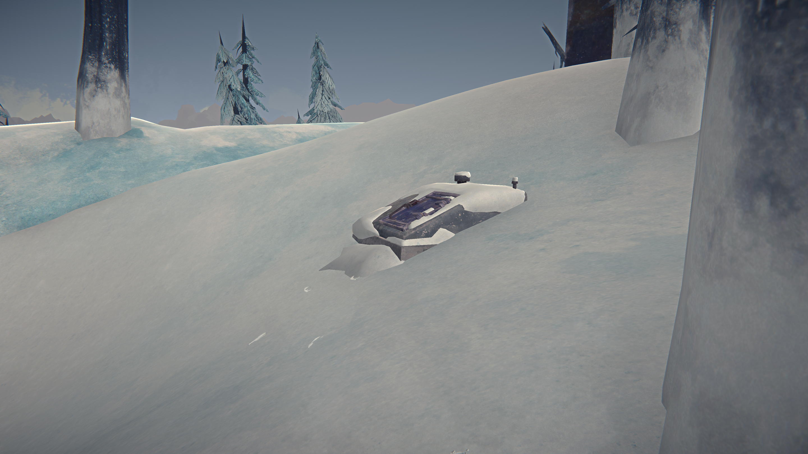
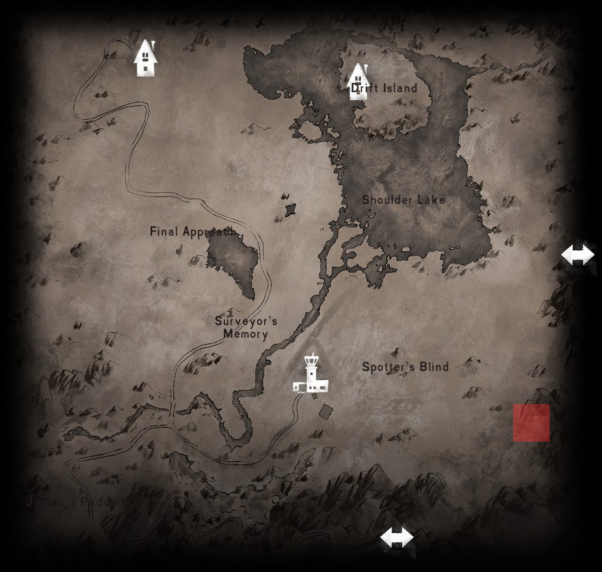

# Bunker Omega

**Bunker Omega**

| Property | Details |
| --- | --- |
|  |  / *Bunker\_Omega\_outside.png* |
| **Location** |  |
|  |  / *Bunker\_Omega\_Location.png* |
| Region | [Forsaken Airfield](./Forsaken%20Airfield.md)\|- |
| Description | A large, reinforced underground shelter. |
| **General** |  |
|  / *bed\_icon.png* | Has a bed |
|  / *workbench\_icon\_green.png* | Has a workbench\|- |
