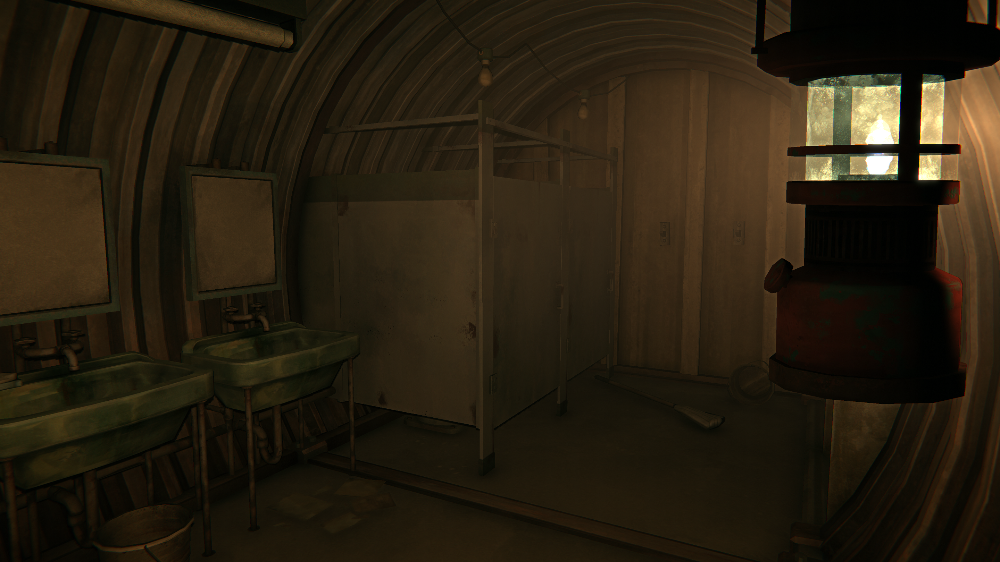
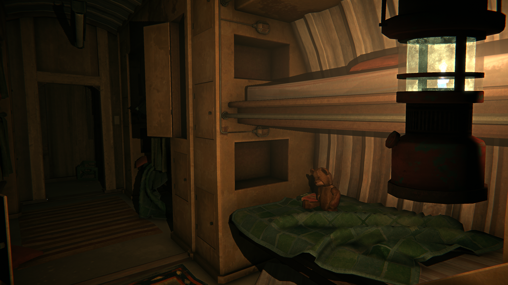
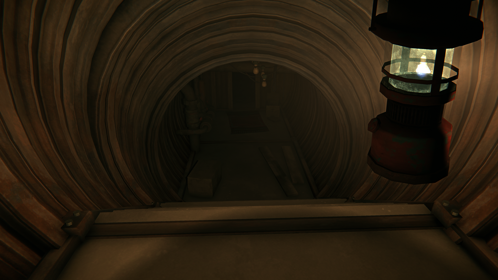
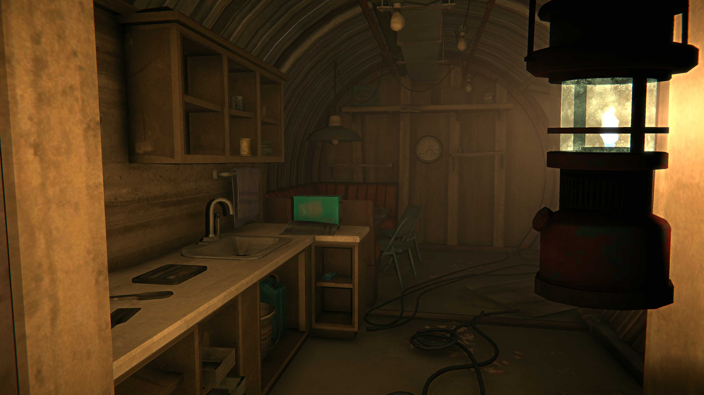
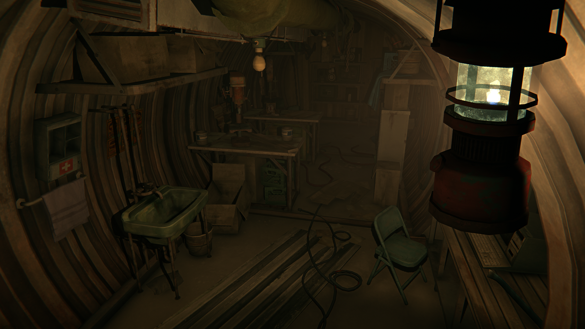
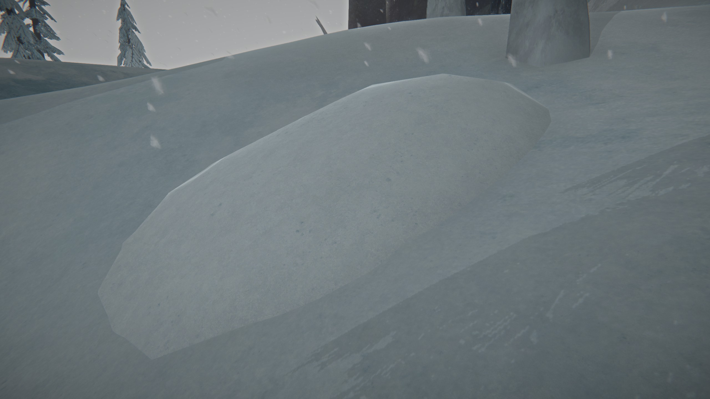

# Bunker Omega

**Categories:** Indoor locations, Locations, Locations in Forsaken Airfield, Locations with a workbench · **Source:** [Fandom](https://thelongdark.fandom.com/wiki/Bunker_Omega)

**Contents**

- [Unlocking](#unlocking)
- [Overview](#overview)
- [Trivia](#trivia)
- [Gallery](#gallery)

**Bunker Omega**

[Bunker Omega outside](../assets/Bunker_Omega_outside.png)

**Location**

[Bunker Omega Location](../assets/Bunker_Omega_Location.png)

**Region:** [Forsaken Airfield](./Forsaken%20Airfield.md)

**Description:** A large, reinforced underground shelter.

**General**

[Bed icon](../assets/Bed_icon.png)

Has a bed

[Workbench icon green](../assets/Workbench_icon_green.png)

Has a workbench

## Unlocking

This bunker can only be found after having fixed all the [Transmitters](./Transmitters.md) in Lower Great Bear AND visiting all three other bunkers, as required by the mission objectives. Then return to Forsaken Airfield when the [Aurora](./Aurora.md) or a [Glimmer Fog](./Glimmer%20Fog.md) event is active to locate it. Prior to this, the entrance is completely covered by snow, and cannot be uncovered without the [Handheld Shortwave Radio](./Handheld%20Shortwave%20Radio.md).

## Overview

This is the largest of all the bunkers discovered in the [Signal Void](./Signal%20Void.md) tale, and features a bedroom with four beds, a bathroom, a kitchen, a workshop, an office, and several storage rooms. This location counts as "underground" in the Frontier, therefore staying here when Glimmer Fog is active will prevent the player from getting [Insomnia](./Insomnia.md). In addition to the notes required to complete the Tale, the bunker contains a wide variety of high-tier [food](./Food%20And%20Drink.md), [clothing](./Clothing.md), and [tools](./Tools.md). The [Security Chief's Rifle Holster](./Security%20Chief%27s%20Rifle%20Holster.md) can be found here, inside the kitchen area, as well as 5 [Canned Corn](./Canned%20Corn.md) and 5 [Canned Ham](./Canned%20Ham.md).

Despite the bunker's large size and plentiful loot, it is not a particularly practical [Safe House](./Safehouse.md) in the region, as it is not easy to find, it's rather isolated, has no indoor fireplace, and is very dark, requiring a light source to navigate. That being said, the bunker is not far from [Justy's Hovel](./Justy%27s%20Hovel.md), which may make it a good location for players using the Hovel as a safe house to wait out Glimmer Fog or for crafting on the workbench.

The player is required to return here as part of [Last Horizon](./Last%20Horizon.md), to find one final secret hidden within the bunker; a hidden room in a closet storage area.

## Trivia

- Given the size of the bunker, it is highly likely that it, along with the [other](./Bunker%20Alpha.md) [three](./Bunker%20Beta.md) [bunkers](./Bunker%20Gamma.md) and the [prepper caches](./Prepper%20Cache.md), were built as fallout shelters in case of nuclear war.

## Gallery

