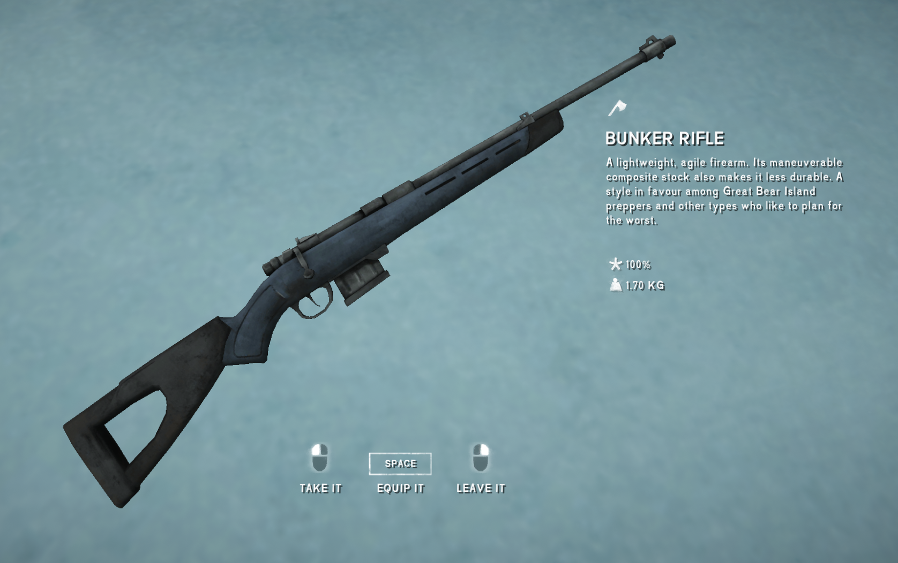

# Bunker Rifle

**Categories:** DLC Content, Tools · **Source:** [Fandom](https://thelongdark.fandom.com/wiki/Bunker_Rifle)

**Contents**

- [Overview](#overview)
- [Locations](#locations)
- [Differences from Hunting Rifle](#differences-from-hunting-rifle)
- [Trivia](#trivia)
- [Gallery](#gallery)
- [Update History](#update-history)

| Column 1 | Column 2 | Column 3 | Column 4 |
| --- | --- | --- | --- |

|  / _Bunker\_Rifle\_icon.png_ |  |  |  |
| Release | [2 December 2024](./The%20Long%20Dark%20%E2%80%94%20Changelog.md#2.33) |  |  |
| Wintermute | No |  |  |
| Renewable | Yes ([Trader](./Trader.md)) |  |  |
| **Properties** |  |  |  |
| Item type | [Tools](./Tools.md)\|- |  |  |
| Stackable | No |  |  |
| Examine | A lightweight, agile firearm. Its maneuverable composite stock also makes it less durable. A style in favour among Great Bear Island preppers and other types who like to plan for the worst. |  |  |
| **Values** |  |  |  |
| Weight | 1.50 kg (3.3 lbs) |  |  |
| **Advanced data** |  |  |  |
| Item key | GEAR\_Rifle\_Trader |  |  |
|  / _When inspected_ |  / _Rifle sight_ |  / _Reload animation_ |  / _Bunker Rifle Ground Model_ |
