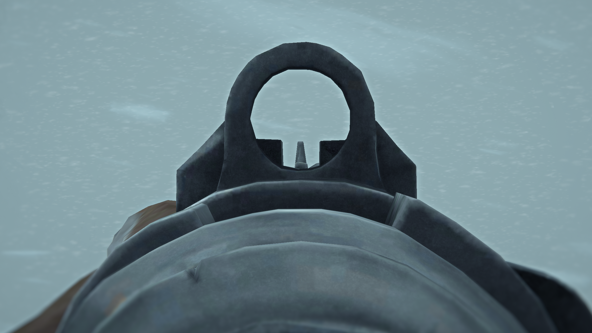
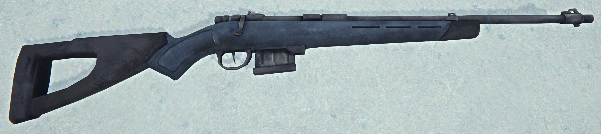

# Bunker Rifle

**Categories:** DLC Content, Tools · **Source:** [Fandom](https://thelongdark.fandom.com/wiki/Bunker_Rifle)

**Contents**

- [Overview](#overview)
- [Locations](#locations)
- [Differences from Hunting Rifle](#differences-from-hunting-rifle)
- [Trivia](#trivia)
- [Gallery](#gallery)
- [Update History](#update-history)

**DLC-Exclusive content.**

This content requires the [Tales from the Far Territory](./Tales%20from%20the%20Far%20Territory.md) addon to be installed before it can be seen or used in regular gameplay.

**Bunker Rifle**

| Property | Details |
| --- | --- |
|  | [Bunker Rifle icon](../assets/Bunker_Rifle_icon.png) |
| Release | [2 December 2024](./The%20Long%20Dark%20%E2%80%94%20Changelog.md#version-2-33-tales-from-the-far-territory-part-6-broken-silence) |
| Wintermute | No |
| Renewable | Yes ([Trader](./Trader.md)) |
| **Properties** |  |
| Item type | [Tools](./Tools.md) |
| Equipable | Yes |
| Stackable | No |
| Examine | A lightweight, agile firearm. Its maneuverable composite stock also makes it less durable. A style in favour among Great Bear Island preppers and other types who like to plan for the worst. |
| **Values** |  |
| Weight | 1.50 kg (3.3 lbs) |
| **Advanced data** |  |
| Item key | GEAR\_Rifle\_Trader |

**Bunker Rifle** is a unique variant of the [Hunting Rifle](./Hunting%20Rifle.md) in _The Long Dark_, added by the _[Tales from the Far Territory](./Tales%20from%20the%20Far%20Territory.md)_ expansion.

## Overview

The Bunker Rifle stands out from other rifles on [Great Bear](./Great%20Bear%20Island.md), as it features a grey-blue polymer furniture resembling more modern hunting rifles. Optimized for maximum weight savings, it features cutout holes on the stock and grip; reducing its total unloaded weight to a mere 1.50 Kg, as well as halving the rate of aim stamina drain. The rifle is extremely fragile and will degrade a whopping 4% condition per shot fired. At 100% condition, it can fire up to 25 times before breaking, and up to 50 times total with [Rifle Firearm](./Rifle%20Firearm.md) level 5. As a slight consolation, the rifle is slightly easier to fix with Firearm cleaning kits and gains 1% more condition per repair, however, the player should still expect to burn through a lot of cleaning kits (or time at the [Milling Machine](./Milling%20Machine.md)) if planning on using this weapon.

The Bunker Rifle also features a unique set of iron sights with a pointed front sight post, letting you more accurately see where your shot will land.

Successful shots on live targets provide experience in the [Rifle Firearm](./Rifle%20Firearm.md) skill.

## Locations

Only obtainable as a trade item through [Sutherland](./Trader.md), the Trader, after completing [Special Request #4](./Sutherland%27s%20Tale.md). It will then appear as a potential trade, and can be ordered repeatedly (this can make them disposable backups to counter the condition loss when multiple are ordered, compensating for the finite number of [Firearm Cleaning Kits](./Firearm%20Cleaning%20Kit.md) in the world).

## Differences from Hunting Rifle

- Base weight is 2.50 kg less than Hunting Rifle
- Total durability is 66% less than Hunting Rifle
- Aim stamina drains 50% slower than Hunting Rifle
- Gains an extra 1% condition per repair action with a firearm cleaning kit

## Trivia

- The name and description of this rifle is related to the various [Prepper Caches](./Prepper%20Cache.md) on the Island, and it may be possible that this rifle originally belonged to Sutherland's brother Wyatt.
  - If so, Wyatt may have ordered several surplus rifles for survival reasons (possibly for his friends and family or as backups). This may also be the reason why Sutherland has so many to trade.
- Contrary to in-game depictions, polymer furnished hunting rifles are better suited for the harsh temperatures and extreme moisture on the island over the older wooden furniture rifles, as wood is prone to cracking and warping in these severe conditions.

## Gallery

## Update History
