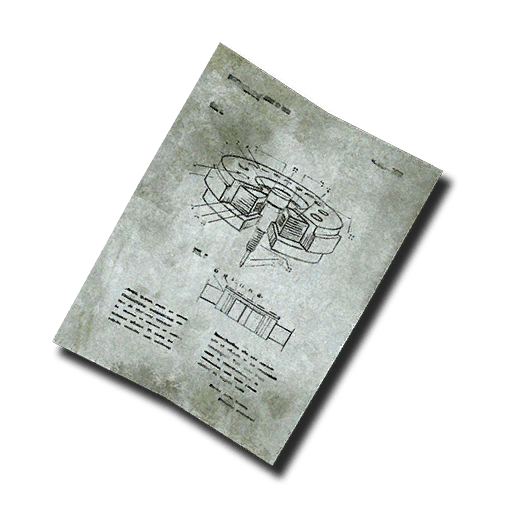

# Bunker Schematic Fragment 1

<table class="infobox">
<caption>Bunker Schematic Fragment 1</caption>
<colgroup>
<col style="width: 50%" />
<col style="width: 50%" />
</colgroup>
<tbody>
<tr>
<td colspan="2"><figure>

<figcaption>Bunker_Schematic_Fragment_1_icon.png</figcaption>
</figure></td>
</tr>
<tr>
<td>
Release
</td>
<td>
<a href="./The%20Long%20Dark%20%E2%80%94%20Changelog.md#2.33" class="wikilink" title="TFTFT Part 6 Broken Silence">TFTFT Part 6 Broken Silence</a>
</td>
</tr>
<tr>
<td colspan="2" class="section">
<strong>Properties</strong>
</td>
</tr>
<tr>
<td>
Item type
</td>
<td>
<a href="./Collectibles.md" class="wikilink" title="Collectibles">Collectibles</a>|-
</td>
</tr>
<tr>
<td>
Stackable
</td>
<td>
No
</td>
</tr>
<tr>
<td>
Examine
</td>
<td>
A technical drawing.
</td>
</tr>
<tr>
<td colspan="2" class="section">
<strong>Values</strong>
</td>
</tr>
<tr>
<td>
Weight
</td>
<td>
0.00 kg (0 lbs)
</td>
</tr>
<tr>
<td colspan="2" class="section">
<strong>Actions</strong>
</td>
</tr>
<tr>
<td>
Backpack
</td>
<td>
Examine
</td>
</tr>
<tr>
<td>
On ground
</td>
<td>
Take It, Read Text, Leave It
</td>
</tr>
</tbody>
</table>

**Bunker Schematic Fragment 1** is a <a href="./Collectibles.md" class="wikilink" title="Collectible">Collectible</a> in <a href="./Survival%20Mode.md" class="wikilink" title="Survival Mode">Survival Mode</a> as part of <a href="./Sutherland%27s%20Tale.md" class="wikilink" title="Sutherland&#39;s Tale">Sutherland's Tale</a>.

## Transcript

The following text is transcribed from **Bunker Schematic Fragment 1**

\[faded handwriting in the margins of a technical drawing\]

...means of protection, really. We already know there are people tracking our project. and when the time comes, they're going to want in. They'll call it "requesting shelter," or some other nonsense. Appealing to our pity.

But we didn't build these for them, we built them for us. And we sure as hell didn't build them for people like Wyatt's asshole brother.

After a little more refinement we can make it a fully mechanical loop, no power needed. With some more insulation to guarantee we can...

## Game history

**Template:update history** **Lua execution error in Module:Navbox function navbox** <a href="ru:%D0%A4%D1%80%D0%B0%D0%B3%D0%BC%D0%B5%D0%BD%D1%82_%D1%87%D0%B5%D1%80%D1%82%D0%B5%D0%B6%D0%B0_%D0%B1%D1%83%D0%BD%D0%BA%D0%B5%D1%80%D0%B0_1" class="wikilink" title="ru:Фрагмент чертежа бункера 1">ru:Фрагмент чертежа бункера 1</a>

