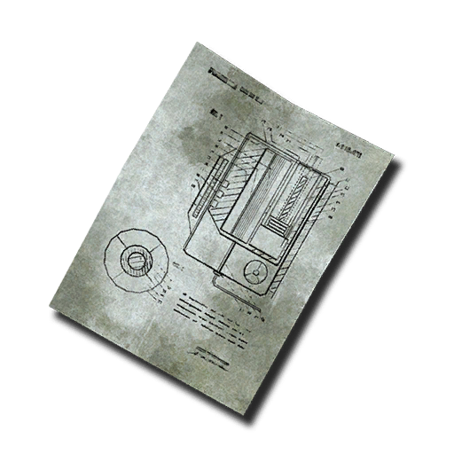

# Bunker Schematic Fragment 2

**Bunker Schematic Fragment 2**

| Property | Details |
| --- | --- |
|  |  / *Bunker\_Schematic\_Fragment\_2\_icon.png* |
| Release | [TFTFT Part 6 Broken Silence](./The%20Long%20Dark%20%E2%80%94%20Changelog.md#2.33) |
| **Properties** |  |
| Item type | [Collectibles](./Collectibles.md)\|- |
| Stackable | No |
| Examine | A technical drawing. |
| **Values** |  |
| Weight | 0.00 kg (0 lbs) |
| **Actions** |  |
| Backpack | Examine |
| On ground | Take It, Read Text, Leave It |

**Bunker Schematic Fragment 2** is a [Collectible](./Collectibles.md) in [Survival Mode](./Survival%20Mode.md) as part of [Sutherland's Tale](./Sutherland%27s%20Tale.md).

## Transcript

*The following text is transcribed from **Bunker Schematic Fragment 2***

**\[faded handwriting in the margins of a technical drawing\]

...once triggered, it can't be stopped. You're either out or you're in. But it'll be the safest place on Great Bear.

SOLVE THE MISFIRE PROBLEM!!!

Wyatt is distracted, getting sloppy. Without these bunkers, what good is he. Or his brother. If he can't fix this one of us could be having a real bad day. There's even a chance the countermeasure could be triggered on purpose, and in that case hold on to your...**

## Game history

**Template:update history** **Lua execution error in Module:Navbox function navbox** [ru:Фрагмент чертежа бункера 2](ru:%D0%A4%D1%80%D0%B0%D0%B3%D0%BC%D0%B5%D0%BD%D1%82_%D1%87%D0%B5%D1%80%D1%82%D0%B5%D0%B6%D0%B0_%D0%B1%D1%83%D0%BD%D0%BA%D0%B5%D1%80%D0%B0_2)
