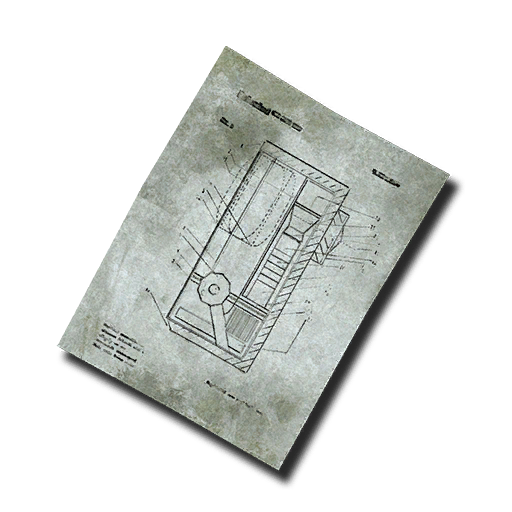

# Bunker Schematic Fragment 3

**Categories:** Collectibles · **Source:** [Fandom](https://thelongdark.fandom.com/wiki/Bunker_Schematic_Fragment_3)

**Bunker Schematic Fragment 3**

| Property | Details |
| --- | --- |
|  |  / _Bunker\_Schematic\_Fragment\_3\_icon.png_ |
| Release | [TFTFT Part 6 Broken Silence](./The%20Long%20Dark%20%E2%80%94%20Changelog.md#2.33) |
| **Properties** |  |
| Item type | [Collectibles](./Collectibles.md)\|- |
| Stackable | No |
| Examine | A technical drawing. |
| **Values** |  |
| Weight | 0.00 kg (0 lbs) |
| **Actions** |  |
| Backpack | Examine |
| On ground | Take It, Read Text, Leave It |

**Bunker Schematic Fragment 3** is a [Collectible](./Collectibles.md) in [Survival Mode](./Survival%20Mode.md) as part of [Sutherland's Tale](./Sutherland%27s%20Tale.md).

## Transcript

_The following text is transcribed from **Bunker Schematic Fragment 3**_

**\[faded handwriting in the margins of a technical drawing\] ...just a single piece of wiring will be enough to close the mechanical circuit. It'll fire the charges on its own with a stored charge from the back up battery.

Just make sure you get everything out of there once it's triggered - there's no going back.

Wyatt knows it's a flaw in his countermeasures design, but as long as we keep it under our hats it shouldn't be a problem.

And as for Wyatt, we're going to sort out our business next week. The four of us. That should be the end of it.

MAKE HIM UNDERSTAND**

## Game history
