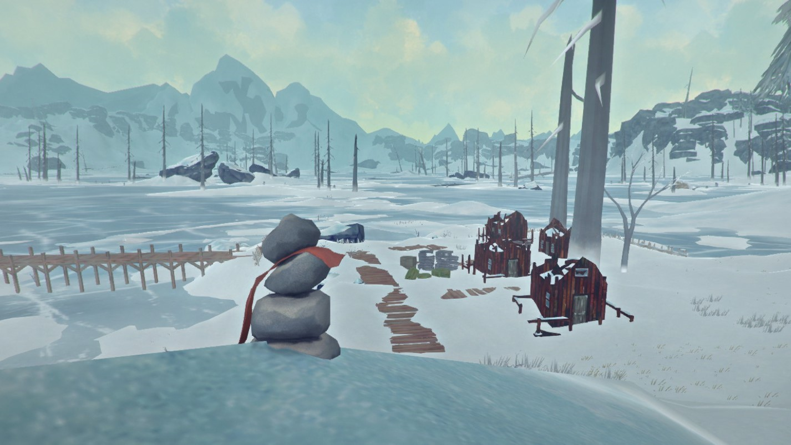

# Bunkhouses

**Categories:** Locations, Locations in Forlorn Muskeg, Outdoor locations · **Source:** [Fandom](https://thelongdark.fandom.com/wiki/Bunkhouses)

**Bunkhouses**

| Property | Details |
| --- | --- |
| | [Forlorn Muskeg Bunkhouses](../assets/Forlorn_Muskeg_Bunkhouses.jpg) |
| **Location** | |
| | [Bunkhouses Location](../assets/Bunkhouses_Location.png) |
| Region | [Forlorn Muskeg](./Forlorn%20Muskeg.md) |
| **General** | |
| Type | Outdoors |
| | Has no shelter |

Bunkhouses is a location in [Forlorn Muskeg](./Forlorn%20Muskeg.md). There are four inaccessible structures with barrels, crates and pallets around, as well as a metal container. The bunkhouses are connected to the [Old Spence Family Homestead](./Old%20Spence%20Family%20Homestead.md) by a wooden footbridge. There is a chance of a [Heavy Hammer](./Heavy%20Hammer.md) spawn near one of the pallet stacks or the barrels.

