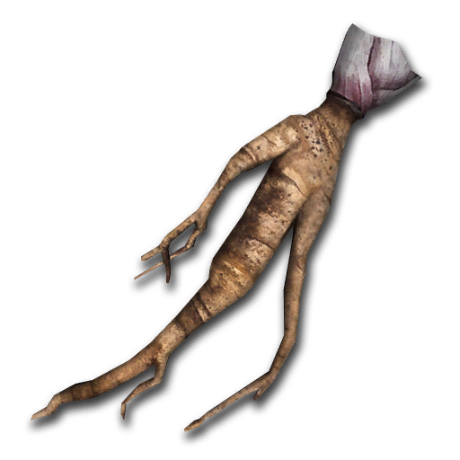

# Burdock Root

**Categories:** Food And Drink, Materials, Pages with update history · **Source:** [Fandom](https://thelongdark.fandom.com/wiki/Burdock_Root)

**Burdock Root**

_Burdock\_Root\_icon.png_

**Release:** [21 June 2023](./The%20Long%20Dark%20%E2%80%94%20Changelog.md#2.17)

**Wintermute:** No

**Renewable:** No

**Properties**

**Item type:** [Materials](./Materials.md)

**Stackable:** Yes

**Examine:** Prepare the root for a crunchy bite or as the base of an antibiotic tea.

**Values**

**Weight:** 0.15 kg (0.33 lbs)

**Actions**

**Backpack:** Prepare, Drop

**Advanced data**

**Item key:** GAMEPLAY\_Burdock

**Burdock Roots** are the edible portion obtained from harvesting a [Burdock](./Burdock.md) plant.

## Overview

After harvesting a Burdock plant, you'll obtain a single Burdock Root. The root itself cannot be eaten on the spot, however it can be [prepared and eaten](./Prepared%20Burdock.md), (providing 275 calories) or brewed into [Burdock Tea](./Burdock%20Tea.md) (which provides 100 calories and antibiotic benefits). Burdock root is also an ingredient used in the [Prepper's Pie](./Prepper%27s%20Pie.md) recipe.

## Products

| Item | Skills | Materials |
| --- | --- | --- |
| &lt;a href="Prepared Burdock"&gt;Prepared Burdock&lt;/a&gt; | None | - 1 × &lt;a href="Burdock Root"&gt;Burdock Root&lt;/a&gt; |
| &lt;a href="Prepper's Pie"&gt;Prepper's Pie&lt;/a&gt; | None | - 1 × &lt;a href="Acorn Grounds"&gt;Acorn Grounds&lt;/a&gt; / - 4 × &lt;a href="Reishi Mushroom"&gt;Reishi Mushroom&lt;/a&gt; / - 2 × &lt;a href="Burdock Root"&gt;Burdock Root&lt;/a&gt; / - 0.10 L × &lt;a href="Water (Potable)"&gt;Water (Potable)&lt;/a&gt; / - 0.05 L × &lt;a href="Cooking Oil"&gt;Cooking Oil&lt;/a&gt; / - 0.01 kg × &lt;a href="Salt"&gt;Salt&lt;/a&gt; |

## Update history

- UPDATE **21 June 2023 ([Update](./The%20Long%20Dark%20%E2%80%94%20Changelog.md#2.17)):**
  - Added to game
