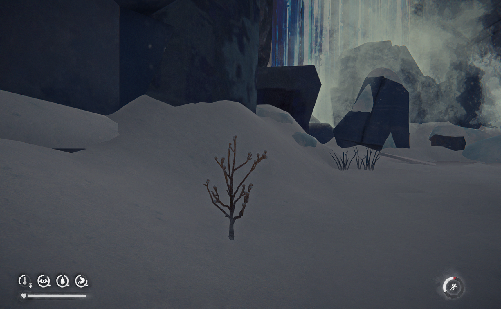
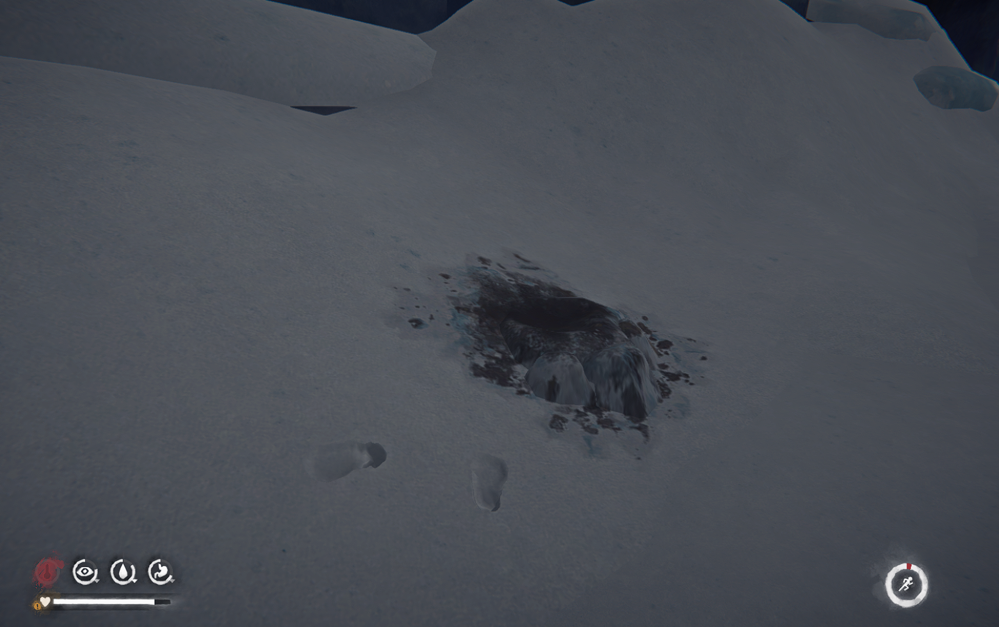

# Burdock

**Contents**

- [Overview](#Overview)
- [Locations](#Locations)
- [Ash Canyon](#Ash_Canyon)
- [Blackrock](#Blackrock)
- [Broken Railroad](#Broken_Railroad)
- [Coastal Highway](#Coastal_Highway)
- [Desolation Point](#Desolation_Point)
- [Forlorn Muskeg](#Forlorn_Muskeg)
- [Hushed River Valley](#Hushed_River_Valley)
- [Mountain Town](#Mountain_Town)
- [Mystery Lake](#Mystery_Lake)
- [Pleasant Valley](#Pleasant_Valley)
- [Sundered Pass](#Sundered_Pass)
- [Timberwolf Mountain](#Timberwolf_Mountain)
- [Zone of Contamination](#Zone_of_Contamination)
- [Gallery](#Gallery)

<table class="infobox">
<caption>Burdock</caption>
<colgroup>
<col style="width: 50%" />
<col style="width: 50%" />
</colgroup>
<tbody>
<tr>
<td colspan="2"><figure>
[Missing image: Burdock_Plant.jpg]
<figcaption>Burdock_Plant.jpg</figcaption>
</figure></td>
</tr>
<tr>
<td>
Release
</td>
<td>
21 June 2023
</td>
</tr>
<tr>
<td>
Story item
</td>
<td>
No
</td>
</tr>
</tbody>
</table>

**Burdocks** are a sapling plant that were released with the free update Part 3: Frontier Comforts portion of the <a href="./Tales%20from%20the%20Far%20Territory.md" class="wikilink" title="Tales from the Far Territory">Tales from the Far Territory</a> expansion.

## Overview

Burdocks are a dark brown, medium sized sapling that can be found on <a href="./Great%20Bear%20Island.md" class="wikilink" title="Great Bear Island">Great Bear Island</a>, and can be harvested for a single <a href="./Burdock%20Root.md" class="wikilink" title="Burdock Root">Burdock Root</a>.

Burdocks need a <a href="./Tools.md" class="wikilink" title="tool">tool</a> to be harvested, similar to <a href="./Green%20Maple%20Sapling.md" class="wikilink" title="Maple">Maple</a> and <a href="./Green%20Birch%20Sapling.md" class="wikilink" title="Birch Saplings">Birch Saplings</a>. <a href="./Hacksaw.md" class="wikilink" title="Hacksaws">Hacksaws</a> cannot be used to harvest Burdocks, as the objective is to harvest the roots of the plant, not the stem. As a result, they take three times as long to harvest since they need to be dug out of the ground rather than cut down.

<a href="./Improvised%20Hatchet.md" class="wikilink" title="Improvised Hatchets">Improvised Hatchets</a>/<a href="./Hatchet.md" class="wikilink" title="Hatchets">Hatchets</a>, <a href="./Hunting%20Knife.md" class="wikilink" title="Hunting">Hunting</a>/<a href="./Improvised%20Knife.md" class="wikilink" title="Improvised Knives">Improvised Knives</a>, and <a href="./Prybar.md" class="wikilink" title="Prybars">Prybars</a> can also be used to dig up the roots, offering a wider range of harvesting options than Maple and Birch saplings.

Each plant yields one Burdock Root, which can be <a href="./Prepared%20Burdock.md" class="wikilink" title="prepared">prepared</a> and eaten raw, or made into a <a href="./Burdock%20Tea.md" class="wikilink" title="tea">tea</a>. Burdocks saplings do not respawn once harvested, and leave a dark hole in the ground where they once grew. Burdock spawns are randomly generated and may vary across playthroughs, leading to spots that had burdocks on previous playthroughs now being empty. The following list of locations cover all possible spawns regardless of loot table.

## Locations

### <a href="./Ash%20Canyon.md" class="wikilink" title="Ash Canyon">Ash Canyon</a>

- A single plant near the cave after the three root climbing sections with rose hip trees that leads to the bridge going over <a href="./Shattered%20Cove.md" class="wikilink" title="Shattered Cove">Shattered Cove</a>.
- A single plant grows at the ledge just after crossing a rope bridge from <a href="./Wolf%27s%20Jaw%20Overlook.md" class="wikilink" title="Wolf&#39;s Jaw Overlook">Wolf's Jaw Overlook</a>.
- 5 plants near the shore next to the fishing hut at <a href="./Bitter%20Marsh.md" class="wikilink" title="Bitter Marsh">Bitter Marsh</a>.
- A couple plants are located close to <a href="./Miner%27s%20Folly.md" class="wikilink" title="Miner&#39;s Folly">Miner's Folly</a>.
- 5 plants grow in front of the <a href="./Angler%27s%20Den.md" class="wikilink" title="Angler&#39;s Den">Angler's Den</a> island.

### <a href="./Blackrock.md" class="wikilink" title="Blackrock">Blackrock</a>

- 5 plants on an accessible part of the river bank, a short walk from <a href="./Narrow%20Bridge.md" class="wikilink" title="Narrow Bridge">Narrow Bridge</a> when going towards <a href="./Bear%27s%20Bend.md" class="wikilink" title="Bear&#39;s Bend">Bear's Bend</a>. On the charcoal map, you can see a group of rock formations, the burdocks are in-between those large rocks and easily visible from the road when looking for that piece of river bank.
- 5 plants on the north edge of the pond if you're standing in <a href="./Bricklayer%27s%20Retreat.md" class="wikilink" title="Bricklayer&#39;s Retreat">Bricklayer's Retreat</a>. They're at the foot of a cliff, at the top of which ptarmigans are nesting.
- A single plant can be found under the waterfall at the end of the creek under <a href="./Blocked%20Bridge.md" class="wikilink" title="Blocked Bridge">Blocked Bridge</a>.
- A single plant can be found at the bottom of the ravine, to the left-hand side (or south) of the cave facing the double-rope climb that leads to the <a href="./Last%20Prospect.md" class="wikilink" title="Last Prospect">Last Prospect</a> mine.
- A single plant can be found on the frozen pond to the right of the <a href="./Blackrock%20Prison.md" class="wikilink" title="prison">prison</a> entrance (where deer roam, not the side where the moose can spawn).

### <a href="./Broken%20Railroad.md" class="wikilink" title="Broken Railroad">Broken Railroad</a>

- 5 plants can be found near some trees on the path on the right side of <a href="./Broken%20Bridge%20%28Broken%20Railroad%20location%29.md" class="wikilink" title="Broken Bridge">Broken Bridge</a>.
- A single plant can be found on the left side of the <a href="./Maintenance%20Yard.md" class="wikilink" title="Maintenance Yard">Maintenance Yard</a> shed.
- A single plant can be found on the right side of the Maintenance Yard near a large green tank.
- A single plant can be found in front of the cave near the hunter's blind.
- 4 plants can be found beneath the tree bridge used to cross to the other side of <a href="./Landslide.md" class="wikilink" title="Landslide">Landslide</a>.

### <a href="./Coastal%20Highway.md" class="wikilink" title="Coastal Highway">Coastal Highway</a>

- One plant near the northeastern side of the <a href="./Abandoned%20Lookout.md" class="wikilink" title="Abandoned Lookout">Abandoned Lookout</a>, near the <a href="./Old%20Man%27s%20Beard%20Lichen.md" class="wikilink" title="old man&#39;s beard lichen">old man's beard lichen</a> spawning trees.
- Three plants near the <a href="./Train%20Loading%20Area.md" class="wikilink" title="Train Loading">Train Loading</a> trailer.
- <a href="./Silent%20Clearing.md" class="wikilink" title="Silent Clearing">Silent Clearing</a>.
- Five plants under the west-most bridge on the map near <a href="./Rockfall.md" class="wikilink" title="Rockfall">Rockfall</a>, the bridge has a car on it and is at the mouth of the river that runs from <a href="./The%20Ravine.md" class="wikilink" title="Ravine">Ravine</a> entrance down to the sea.
- One plant behind one of the <a href="./Coastal%20Townsite.md" class="wikilink" title="Coastal Townhouses">Coastal Townhouses</a>, specifically the house facing the back entrance to <a href="./Quonset%20Garage.md" class="wikilink" title="Quonset Garage">Quonset Garage</a>.
- A single plant can be found next to the furthest house to the eastside of the <a href="./Coastal%20Townsite.md" class="wikilink" title="townsite">townsite</a>, on your way to the crashed plane.

### <a href="./Desolation%20Point.md" class="wikilink" title="Desolation Point">Desolation Point</a>

- Two plants along the path between the <a href="./Stone%20Church.md" class="wikilink" title="Church">Church</a> and the Zone entrance, above the <a href="./Abandoned%20Mine%20No.%205.md" class="wikilink" title="Abandoned Mine No.5">Abandoned Mine No.5</a> entrance.
- Broken Highway.
- One plant at the top of the <a href="./The%20Riken.md" class="wikilink" title="Riken">Riken</a>-facing slope that leads from the ice where the wolves roam to the start of the <a href="./Lonely%20Lighthouse.md" class="wikilink" title="Lighthouse">Lighthouse</a> path.
- Across the road from Hibernia Processing, there's a plant next to a fallen tree with its root exposed. It's along the path that leads into the cave entrance.
- At <a href="./Hibernia%20Processing.md" class="wikilink" title="Hibernia Processing">Hibernia Processing</a> near the three trailers, one plant between the three giant metal tubes and the stack of <a href="./Pallets.md" class="wikilink" title="pallets">pallets</a>, directly across the broken <a href="./Transmitters.md" class="wikilink" title="radio transmitter">radio transmitter</a> you can fix up

### <a href="./Forlorn%20Muskeg.md" class="wikilink" title="Forlorn Muskeg">Forlorn Muskeg</a>

- A single plant grows near the cliff face (map edge) opposite the <a href="./Radio%20Tower.md" class="wikilink" title="Radio Tower">Radio Tower</a> (East) at <a href="./Muskeg%20Overlook.md" class="wikilink" title="Muskeg Overlook">Muskeg Overlook</a>.
- 5 can be found near <a href="./Old%20Spence%20Family%20Homestead.md" class="wikilink" title="Old Spence Family Homestead">Old Spence Family Homestead</a> (just South-West towards the path to the broken radio tower ).
- A single plant grows by the <a href="./Bunkhouses.md" class="wikilink" title="Bunkhouses">Bunkhouses</a>.
- 3 can be found on a small hill near the <a href="./Low%20Blind.md" class="wikilink" title="Low Blind">Low Blind</a>.

### <a href="./Hushed%20River%20Valley.md" class="wikilink" title="Hushed River Valley">Hushed River Valley</a>

- A single plant can be found under the tree bridge leading to <a href="./Moose%20Overlook.md" class="wikilink" title="Moose Overlook">Moose Overlook</a>.
- A single plant can be found to the right of the <a href="./Ice%20Cave.md" class="wikilink" title="Ice cave">Ice cave</a> entrance on <a href="./Hushed%20River.md" class="wikilink" title="Hushed River">Hushed River</a>.
- 2 plants can be found to the right of <a href="./Lake%20Cave.md" class="wikilink" title="Lake Cave">Lake Cave</a>.
- 3 plants can be found just above towards the right of the 2 plants mentioned above.
- A single plant can be found near the lichen in <a href="./Stairsteps%20Lake.md" class="wikilink" title="Stairsteps Lake">Stairsteps Lake</a>.

### <a href="./Mountain%20Town.md" class="wikilink" title="Mountain Town">Mountain Town</a>

- 5 plants grow near the Silo tower at "Hay storage" unmarked location. The tower, as well as several barns, can be seen on the right just after crossing the bridge, on the road towards <a href="./Paradise%20Meadows%20Farm.md" class="wikilink" title="Paradise Meadows Farm">Paradise Meadows Farm</a>.
- A single plant grows at the shore of a pond behind the <a href="./St.%20Christopher%27s%20Church.md" class="wikilink" title="St. Christopher&#39;s Church">St. Christopher's Church</a>, just under the rock outcropping behind the church.
- A single plant can be found near the rock walls of the pond where the moose can spawn.
- A single plant can be found at the bottom of the river below <a href="./Spruce%20Falls%20Bridge.md" class="wikilink" title="Spruce Falls Bridge">Spruce Falls Bridge</a>.
- A single plant grows at the south edge of the Wood Lot that's east of the <a href="./Orca%20Gas%20Station.md" class="wikilink" title="Orca Gas Station">Orca Gas Station</a>.

### <a href="./Mystery%20Lake%20%28region%29.md" class="wikilink" title="Mystery Lake">Mystery Lake</a>

- Two plants just outside <a href="./Carter%20Hydro%20Dam.md" class="wikilink" title="Carter Hydro Dam">Carter Hydro Dam</a>, inside fence by the top left corner of the entrance.
- Two plants along <a href="./Frozen%20Creek.md" class="wikilink" title="Frozen Creek">Frozen Creek</a> going upstream.
- Five plants at the back of mystery lake, around the L and near the bear cave, past the far fishing hut.
- One plant near the reishi mushrooms by the river below the Carter Hydro Dam.
- One plant below the bridge to Carter Hydro Dam.
- One plant near the bear cave next to unnamed pond

### <a href="./Pleasant%20Valley.md" class="wikilink" title="Pleasant Valley">Pleasant Valley</a>

- Five plants on the western bend on the river, if you draw a line between <a href="./Long%20Curve.md" class="wikilink" title="Long Curve">Long Curve</a> and <a href="./Three%20Strikes%20Farmstead.md" class="wikilink" title="Three Strikes Homestead">Three Strikes Homestead</a>, then a line crossing that coming from the unnamed barn north-west of the <a href="./Pleasant%20Valley%20Farmstead.md" class="wikilink" title="farmhouse">farmhouse</a>.
- One plant next to the burned out cabin closest to <a href="./Draft%20Dodger%27s%20Cabin.md" class="wikilink" title="Draft Dodger&#39;s">Draft Dodger's</a> Cabin.
- One plant under <a href="./Heartbreak%20Bridge.md" class="wikilink" title="Heartbreak Bridge">Heartbreak Bridge</a>.
- One plant next to the broken down blue roof of a destroyed cabin, near the bridge just north of <a href="./Lonely%20Homestead.md" class="wikilink" title="Lonely Homestead">Lonely Homestead</a>

### <a href="./Sundered%20Pass.md" class="wikilink" title="Sundered Pass">Sundered Pass</a>

- A single plant at <a href="./Seedling%20Spring.md" class="wikilink" title="Seedling Spring">Seedling Spring</a>
- A single plant between <a href="./Cascading%20Gap.md" class="wikilink" title="Cascading Gap">Cascading Gap</a> and the frozen waterfall to its west, along the frozen river
- A single plant on the lake just above the <a href="./Weather%20Station.md" class="wikilink" title="Weather Station">Weather Station</a>
- A single plant just above <a href="./Ogre%27s%20Teardrop.md" class="wikilink" title="Ogre&#39;s Teardrop">Ogre's Teardrop</a>
- A single plant on <a href="./Ambler%27s%20Lake.md" class="wikilink" title="Ambler&#39;s Lake">Ambler's Lake</a>
- A single plant on the lake just above <a href="./Perilous%20Crossing.md" class="wikilink" title="Perilous Crossing">Perilous Crossing</a>

### <a href="./Timberwolf%20Mountain.md" class="wikilink" title="Timberwolf Mountain">Timberwolf Mountain</a>

- A single plant on the small hill just before <a href="./Mountaineer%27s%20Hut.md" class="wikilink" title="Mountaineer&#39;s Hut">Mountaineer's Hut</a>, after you've passed the rabbit/<a href="./Moose.md" class="wikilink" title="moose">moose</a> area and can overlook the Hut.
- A single plant near a large rock, towards the right side of the cave at <a href="./Deer%20Clearing.md" class="wikilink" title="Deer Clearing">Deer Clearing</a>.
- A single plant near the entrance to <a href="./Blackrock.md" class="wikilink" title="Blackrock">Blackrock</a> on right toward waterfall.
- A single plant near <a href="./Andre%27s%20Peak.md" class="wikilink" title="Andre&#39;s Peak">Andre's Peak</a> and <a href="./Engine%20%28East%29.md" class="wikilink" title="Engine">Engine</a>. Follow path to right of climbing rope.
- 3 can be found around <a href="./Engine%20%28East%29.md" class="wikilink" title="Engine">Engine</a> near Cave C exit.
- A single plant near the wheels of the plane on the <a href="./Summit.md" class="wikilink" title="Summit">Summit</a>.
- 5 plants to the left of the <a href="./Blackrock.md" class="wikilink" title="Blackrock">Blackrock</a> transition cave.

### <a href="./Zone%20of%20Contamination.md" class="wikilink" title="Zone of Contamination">Zone of Contamination</a>

- A single plant can be found near the entrance of the region to the left, on the banks of the frozen pond with the patrolling <a href="./Poisoned%20Wolf.md" class="wikilink" title="Poisoned Wolves">Poisoned Wolves</a>.
- Two plants at the bottom of the ravine under <a href="./Boss%27s%20Settlement.md" class="wikilink" title="Boss&#39;s Settlement">Boss's Settlement</a>, directly under <a href="./Smoker%27s%20Cave.md" class="wikilink" title="Smoker&#39;s Cave">Smoker's Cave</a> alongside the cliff edge.
- A single plant can be found at Boss's Settlement, right next to the human skull at the destroyed cabin
- Two plants under the tree bridge at Enduring Waterfall (Bug: as of December 2023, one of the plants is phased inside of a rock, making it harder to harvest)
- A single plant can be found at the mouth of the river that opens into the <a href="./Unquenched%20Extraction.md" class="wikilink" title="Unquenched Extraction">Unquenched Extraction</a> pond.

## Gallery

<table class="gallery">
<colgroup>
<col style="width: 50%" />
<col style="width: 50%" />
</colgroup>
<tbody>
<tr>
<td><figure>

<figcaption>A Burdock plant growing under a waterfall in Blackrock region.</figcaption>
</figure></td>
<td><figure>

<figcaption>A spot where a Burdock plant used to grow.</figcaption>
</figure></td>
</tr>
</tbody>
</table>

**Lua execution error in Module:Navbox function navbox** <a href="ru:%D0%9B%D0%BE%D0%BF%D1%83%D1%85" class="wikilink" title="ru:Лопух">ru:Лопух</a>

