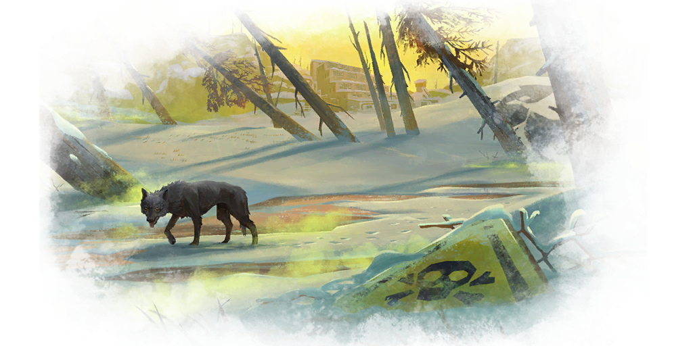

# Buried Echoes

**Categories:** DLC Content · **Source:** [Fandom](https://thelongdark.fandom.com/wiki/Buried_Echoes)

**Contents**

- [Preface](#preface)
- [Objectives](#objectives)
- [Search for signs of life](#search-for-signs-of-life)
- [Search the Mine](#search-the-mine)
- [Search the Mountain Mine for any signs of Rüdiger](#search-the-mountain-mine-for-any-signs-of-rüdiger)
- [Collectibles](#collectibles)
- [Clothing](#clothing)
- [Notes](#notes)
- [Gallery](#gallery)
- [Notes](#notes-1)

**Buried Echoes**

_Tales\_objectives\_02\_BuriedEchoes.png_

**Missions**

**Previous:** [Signal Void](./Signal%20Void.md)

**Current:** Buried Echoes

**Next:** [Last Horizon](./Last%20Horizon.md)

**Region:** [Zone of Contamination](./Zone%20of%20Contamination.md)

_Ptarmigan\_icon.png_

**DLC-Exclusive content.** / This content requires the [Tales from the Far Territory](./Tales%20from%20the%20Far%20Territory.md) addon to be installed before it can be seen or used in regular gameplay.

> “**Search the Langston mine for remnants of Rüdiger and his project.**”

_The Foreman's Tool Belt at the end of the episode_
