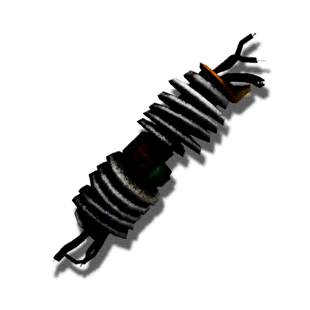

# Burned Out Fuse

**Categories:** Pages with update history, Tools, Wintermute · **Source:** [Fandom](https://thelongdark.fandom.com/wiki/Burned_Out_Fuse)

_2120907963\_TLD-Wintermute-v2.png.de8a285930f6a8f5ad9cf5878754cf5b.png_

**Wintermute-Exclusive content.** / This content only appears in [Wintermute](./Wintermute.md).

_Burned\_Out\_Fuse\_icon.png_

**Wintermute:** [Episode 3](./Episode%203%20-%20Crossroads%20Elegy.md) - [Aftermath](./Aftermath.md)

**Properties**

**Item type:** [Tools](./Tools.md)

**Examine:** Burned out fuse. Needs replacing.

**Values**

**Weight:** 0.20 kg (0.44 lbs)

**Advanced data**

**Item key:** STORY\_ElevatorPartsDead
