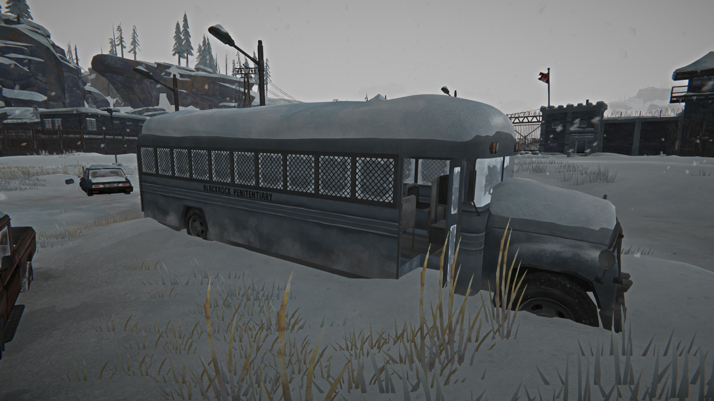
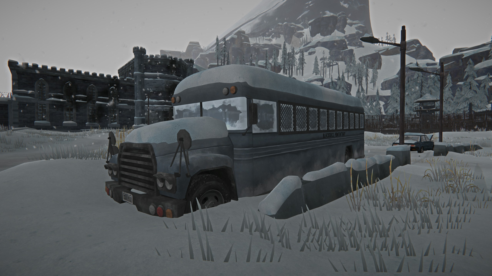
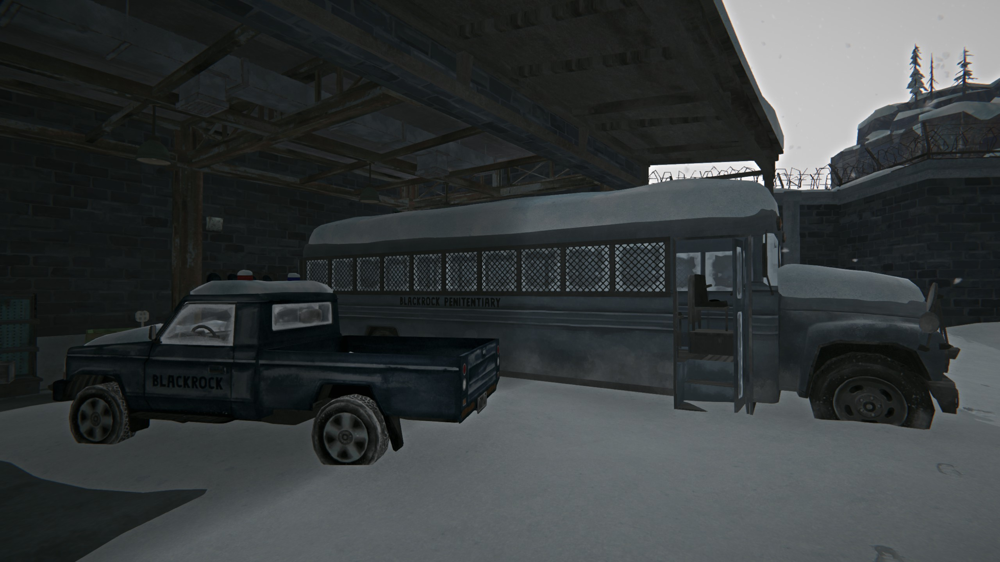
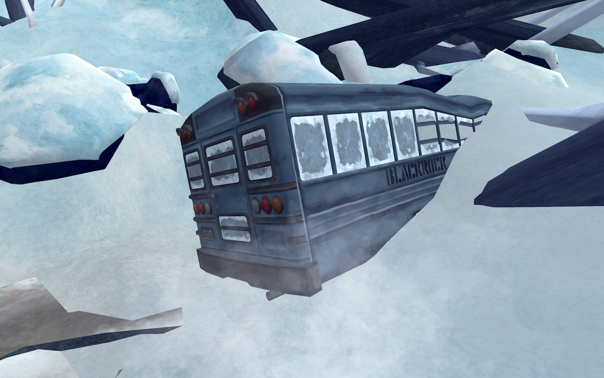

# Bus

 **Buses** are a stationary [Vehicle](./Vehicle.md) found in *The Long Dark*.

Buses are primarily found in the [Blackrock](./Blackrock.md) region, particularly in the [Blackrock Prison](./Blackrock%20Prison.md) yard. They can be entered and provide shelter from Windchill, but do not provide bonus Warmth. [Campfires](./Campfire.md) can be started inside the backs of Buses. Loot can often be found inside, including Clothing and a possible [Improvised Knife](./Improvised%20Knife.md) spawn. The hood of a Bus cannot be opened to obtain a [Car Battery](./Car%20Battery.md). Despite having open doors, [Wolves](./Wolf.md) cannot enter Buses.

So far, all Buses are owned by the Blackrock Prison, as no other Bus variant is found in the game. 2 Buses can be found in the Blackrock Prison yard, one in the parking lot, and 1 in the garage near the ammunition workshop.

A single [Crashed Prison Transport Bus](./Crashed%20Prison%20Transport%20Bus.md) can be found near the town of [Milton](./Milton.md) in the [Mountain Town](./Mountain%20Town.md) Region, and is the only example of a Bus located outside of Blackrock.

| Column 1 | Column 2 | Column 3 |
| --- | --- | --- |
|  / *PrisonBus2.jpg* |  / *PrisonBus3.jpg* |  / *Crashed\_Prison\_Transport\_Bus.png* |

**Lua execution error in Module:Navbox function navbox**
