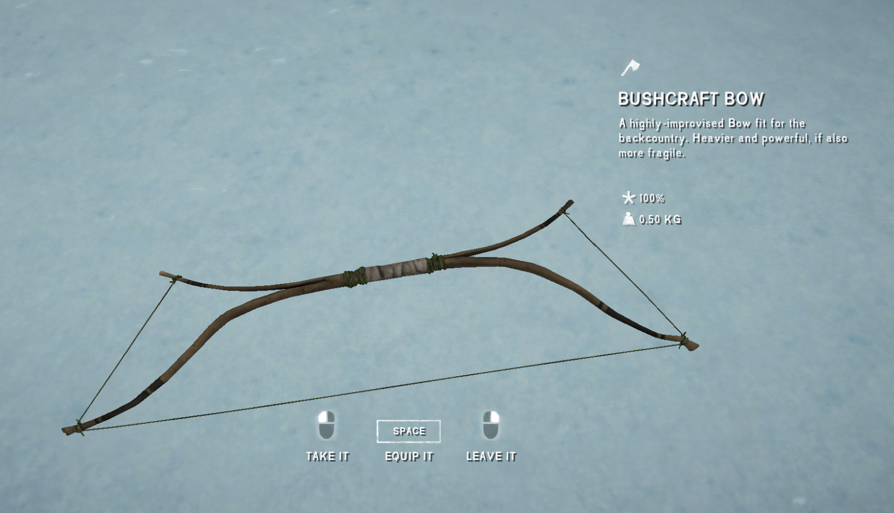

# Bushcraft Bow

**Categories:** DLC Content, Tools · **Source:** [Fandom](https://thelongdark.fandom.com/wiki/Bushcraft_Bow)

**Contents**

- [Overview](#overview)
- [Differences from Survival Bow](#differences-from-survival-bow)
- [Locations](#locations)
- [Crafting](#crafting)
- [Tips](#tips)
- [Trivia](#trivia)
- [Gallery](#gallery)
- [Update history](#update-history)

_Ptarmigan\_icon.png_

**DLC-Exclusive content.** / This content requires the [Tales from the Far Territory](./Tales%20from%20the%20Far%20Territory.md) addon to be installed before it can be seen or used in regular gameplay.

_Bushcraft\_Bow\_icon.png_

**Release:** [2 December 2024](./The%20Long%20Dark%20%E2%80%94%20Changelog.md#2.33)

**Wintermute:** No

**Renewable:** Yes

**Properties**

**Item type:** [Tools](./Tools.md)

**Stackable:** No

**Examine:** A highly-improvised Bow fit for the backcountry. Heavier and powerful, if also more fragile.

**Values**

**Weight:** 0.50 kg (1.1 lbs)

300 minutes (5 hour 0 minutes)

**Requirements**

**Facility:** 

**Materials**

**Item:** [Green Birch Sapling](./Green%20Birch%20Sapling.md)

**Quantity:** 2

[Cured Gut](./Cured%20Gut.md)

2

_When inspected_

_FIrst person view_

_When drawn_

_Bushcraft bow ground model_
