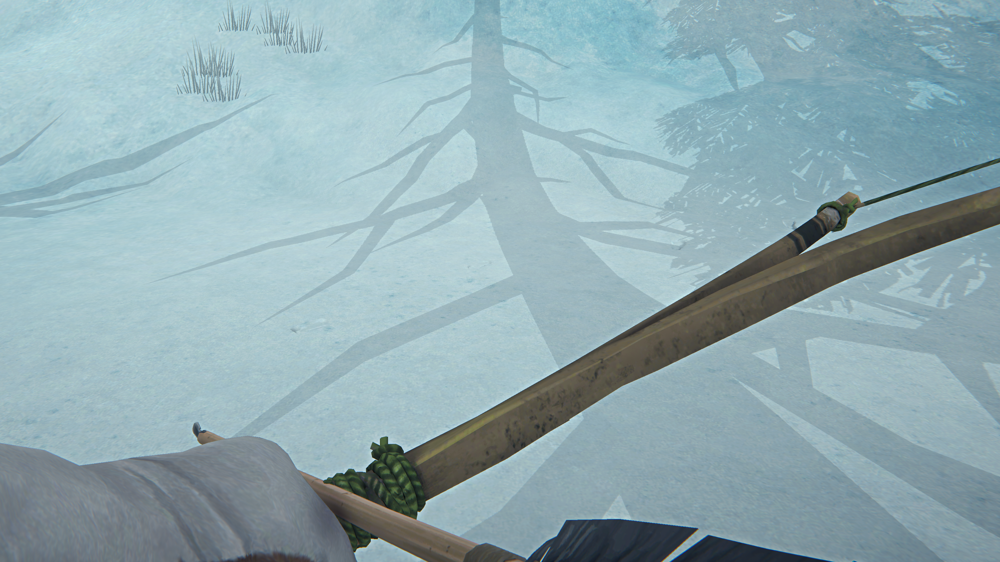

# Bushcraft Bow

**Categories:** DLC Content, Tools · **Source:** [Fandom](https://thelongdark.fandom.com/wiki/Bushcraft_Bow)

**Contents**

- [Overview](#overview)
- [Differences from Survival Bow](#differences-from-survival-bow)
- [Locations](#locations)
- [Crafting](#crafting)
- [Tips](#tips)
- [Trivia](#trivia)
- [Gallery](#gallery)
- [Update history](#update-history)

**DLC-Exclusive content.** This content requires the [Tales from the Far Territory](./Tales%20from%20the%20Far%20Territory.md) addon to be installed before it can be seen or used in regular gameplay.

 **Bushcraft Bow**  **Release:** [2 December 2024](./The%20Long%20Dark%20%E2%80%94%20Changelog.md#2.33) **Wintermute:** No **Renewable:** Yes **Properties** **Item type:** [Tools](./Tools.md)\\|- **Stackable:** No **Examine:** A highly-improvised Bow fit for the backcountry. Heavier and powerful, if also more fragile. **Values** **Weight:** 0.50 kg (1.1 lbs) The **Bushcraft Bow** is a variant of the [Survival Bow](./Survival%20Bow.md) in _The Long Dark,_ whose recipe can be acquired from the [Trader](./Trader.md), after completing [Sutherland's Tale](./Sutherland%27s%20Tale.md).

## Overview

The Bushcraft bow is a handmade penobscot bow with a cloth wrapped handle, black stripe tips, and distinct green colored string. It deals the most damage to [wildlife](./Wildlife.md) when compared to other bows, and degrades slightly slower than the survival bow, however, the Bushcraft Bow has the potential to break much earlier than other bows; starting at 50% condition instead of 15%.

## Differences from Survival Bow

- 25% more damage than the [Survival Bow](./Survival%20Bow.md)
- Total durability is 20% more than Survival Bow (uses 1.6%-0.8% condition per shot based on [archery skill](./Archery.md))
- Can break earlier, risks breaking under 50% condition, all other bows risk breaking below 15% condition

## Locations

Obtaining the [Bushcraft Bow Blueprint Card](./Bushcraft%20Bow%20Blueprint%20Card.md) is required to unlock the crafting blueprint, as this bow does not appear naturally in the game world. It is available from the [Trader](./Trader.md) after completing [Sutherland's Tale](./Sutherland%27s%20Tale.md). It will always appear as a trade when unlocked and the card can only be purchased once.

- 10.00 kg of any raw animal or raw fish meat
- 5 [Cured Maple Sapling](./Cured%20Maple%20Sapling.md)
- 2 any cured hides

This cost is lowered when the player has gained enough Trust to get a discount from the Trader, reducing the trade cost to:

- 5.00 kg of any raw animal or raw fish meat
- 2 [Cured Maple Sapling](./Cured%20Maple%20Sapling.md)
- 2 any cured hides

## Crafting

One key note about this bow is that it requires 2 [**Green Birch Saplings**](./Green%20Birch%20Sapling.md), not 2 [Cured Birch Saplings](./Cured%20Birch%20Sapling.md). This is the only tool in the game that requires an uncured item to craft. If you plan on getting this tool from the Trader eventually, make sure to save some uncured Birch saplings in storage, as although it is a renewable material, [Beachcombing](./Beachcombing.md) can only yield so many Green Birches in a set amount of time.

**Bushcraft Bow**

300 minutes (5 hour 0 minutes)

[Cured Gut](./Cured%20Gut.md)

2

**Requirements**

**Item:** [Green Birch Sapling](./Green%20Birch%20Sapling.md)

**Quantity:** 2

## Tips

- The Bushcraft bow's recipe card is available for purchase on [Interloper](./Interloper.md) and [Misery](./Misery.md) difficulties, provided the player has completed the entirety of [Sutherland's Tale](./Sutherland%27s%20Tale.md).
- At base archery skill the Bushcraft Bow can fire 31 times before hitting the breaking threshold at 50% condition. This rises to 62 guaranteed uses once the player attains level 4 archery skills. On average, the bushcraft bow will be able to fire more shots than the survival bow despite its higher breaking chances.
- Breaking chance increases quadratically as bow condition degrades, and follows this pattern: 4% break chance at 40% condition, 16% break chance at 30% condition, 36% break chance at 20% condition, 50% break chance at 15% condition, and 81.72% break chance at 5% condition.
- The damage modifier from the bow stacks with the [manufactured arrow's](./Manufactured%20Arrow.md) damage bonus allowing the player to inflict large amounts of damage to animals, the most notable breakpoint being neck shots (not headshots) on [moose](./Moose.md) become instant-kills with this setup.

## Trivia

- The Bushcraft Bow is based on a Penobscot/Wabanaki type of cable-backed bows, thought to be one of the first composite bow designs in history.
- The bow being crafted from [Green Birch Saplings](./Green%20Birch%20Sapling.md) is an accurate real-world representation of how cable-backed bows can be made from poor-quality wood.

## Gallery

## Update history
