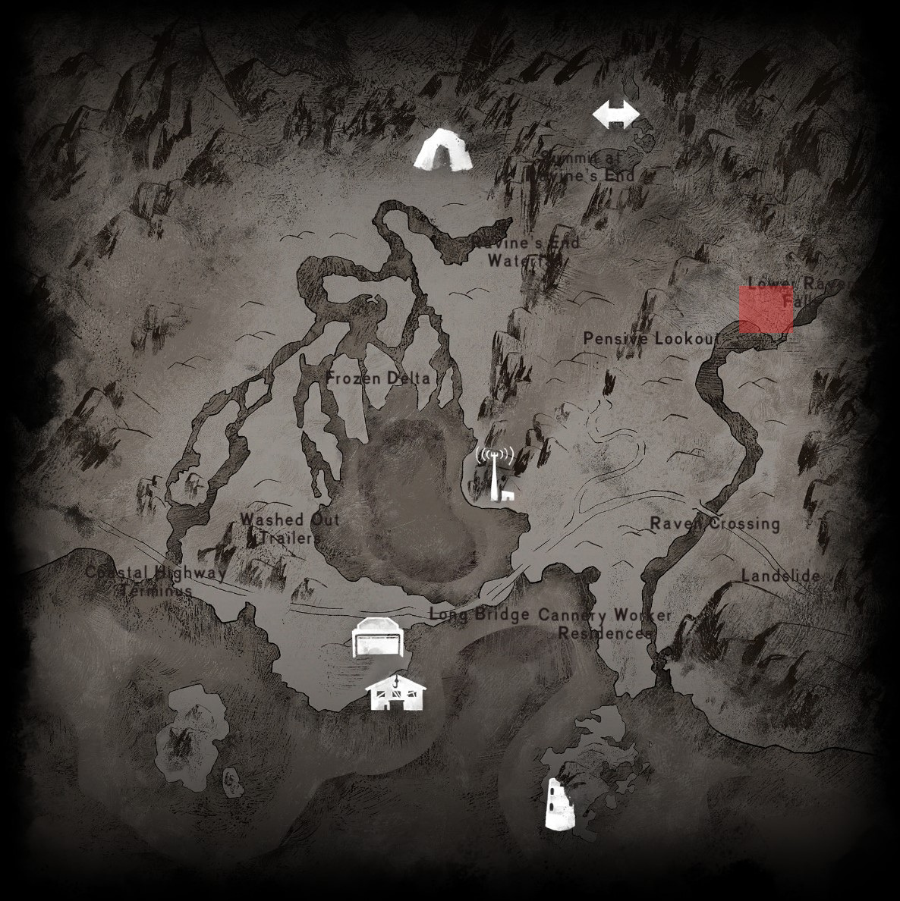

# Cabin

**Categories:** Indoor locations, Locations, Locations in Bleak Inlet, Military/Sporting locations, Residential locations · **Source:** [Fandom](https://thelongdark.fandom.com/wiki/Cabin)

**Cabin**

_screen\_76a1ab96-202f-48fe-b28f-7d60e07bc4ea\_hi.png_

**Location**

_Cabin\_Bleak\_Inlet\_Location.png_

**Region:** [Bleak Inlet](./Bleak%20Inlet.md)

**Sublocations:** Near the [Lower Raven Falls](./Lower%20Raven%20Falls.md)

**Description:** a weathered cabin hidden in the forest

**General**

**Type:** ResidentialMilitary/Sporting

_bed\_icon.png_

Has a bed
