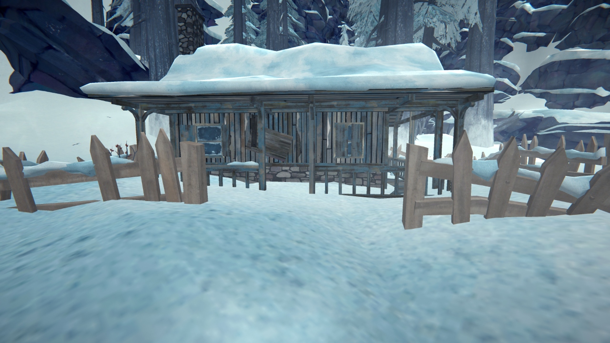
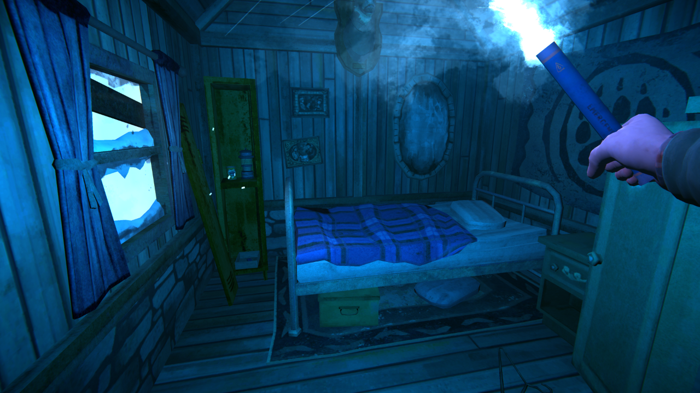

# Cabin

**Categories:** Indoor locations, Locations, Locations in Bleak Inlet, Military/Sporting locations, Residential locations · **Source:** [Fandom](https://thelongdark.fandom.com/wiki/Cabin)

**Cabin**

| Property | Details |
| --- | --- |
|  | [Screen 76a1ab96 202f 48fe b28f 7d60e07bc4ea hi](../assets/Screen_76a1ab96-202f-48fe-b28f-7d60e07bc4ea_hi.png) |
| **Location** |  |
|  | [Cabin Bleak Inlet Location](../assets/Cabin_Bleak_Inlet_Location.png) |
| Region | [Bleak Inlet](./Bleak%20Inlet.md)\|- |
| Sublocations | Near the [Lower Raven Falls](./Lower%20Raven%20Falls.md) |
| Description | a weathered cabin hidden in the forest |
| **General** |  |
| Type | ResidentialMilitary/Sporting\|- |
| [Bed icon](../assets/Bed_icon.png) | Has a bed |
|  | Has an interior / `The`**`Cabin`**`is a building in`[`Bleak Inlet`](./Bleak%20Inlet.md)`close to`[`Lower Raven Falls`](./Lower%20Raven%20Falls.md)`. The player can find it by going left after crossing`[`Raven Crossing`](./Raven%20Crossing.md)`(just down the road from long bridge), then hugging the wall of the map until they reach a log bridge. From there, it should be visible. Although it is its own location (with a loading screen), it has a hole in its roof and therefore suffers from slightly lower temperatures.` |

## Overview

The cabin is a secluded, weathered cabin dominating one side of the map. It is near the bottom of the hill from [Pensive Lookout](./Pensive%20Lookout.md), but otherwise it is not very close to any other structures/landmarks. If the player doesn't mind a more cold residence, the cabin could serve as a decent safehouse, although its disconnected state from the rest of the region makes it more for players who like the survival experience of [Hushed River Valley](./Hushed%20River%20Valley.md) but prefer the safety of houses. Inside the building the player will find slightly low amounts of loot, although there are some [Storm Lantern](./Storm%20Lantern.md) and [Marine Flare](./Marine%20Flare.md) spawns. There are plenty of wooden objects to break down though and a 2-slot [Rim Grill](./Rim%20Grill.md) to burn them on. The player should be aware that if they track around the right side of the house they will find a firewood bin (which is normally locked, but can be unlocked using a prybar), and a possible can of [Stump Remover](./Stump%20Remover.md) next to it.

## Safehouse

This cabin and the [Cannery Worker Residences](./Cannery%20Worker%20Residences.md) are some recommended safehouses in the area. Although you could count on your hands the number of enterable locations in this region, these two definitely serve the best. The cabin sits in a secluded area on the eastern end of the map, surrounded by scrub brush, rose hips and wildlife. Due to the hole in its roof, it provides slightly lower temperatures, but it probably has the densest and most storage on the lower part of the region, and plenty of deer spawn nearby making it unnecessary to voyage westward. Timberwolves might become a light problem, though.

_[Lower Raven Falls](./Lower%20Raven%20Falls.md) near the cabin._
