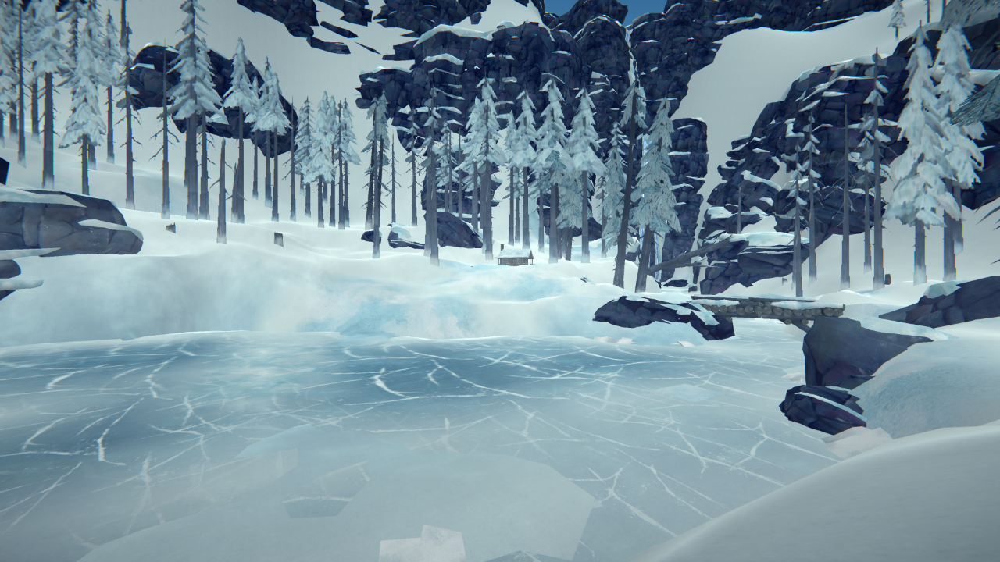
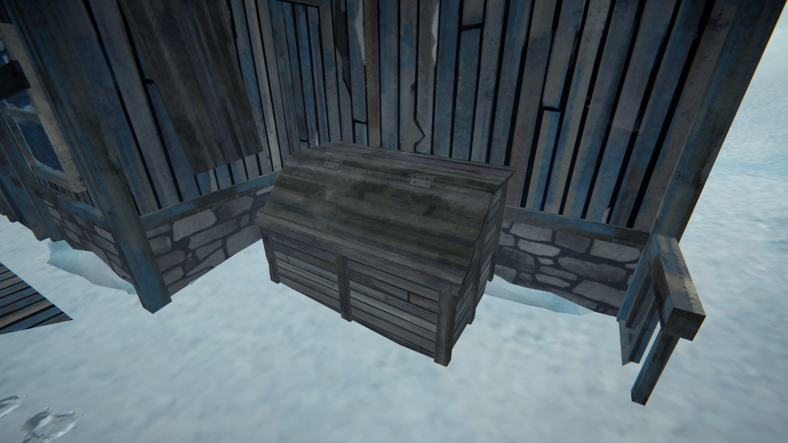
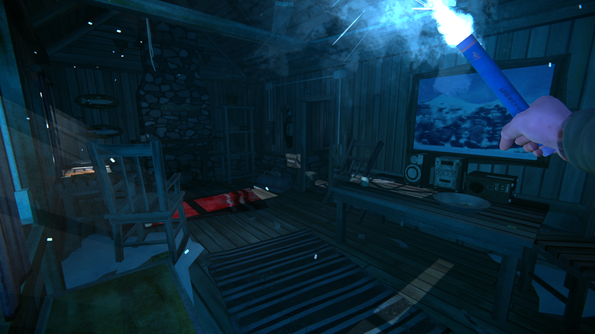

# Cabin

<table class="infobox">
<caption>Cabin</caption>
<colgroup>
<col style="width: 50%" />
<col style="width: 50%" />
</colgroup>
<tbody>
<tr>
<td colspan="2"><figure>

<figcaption>screen_76a1ab96-202f-48fe-b28f-7d60e07bc4ea_hi.png</figcaption>
</figure></td>
</tr>
<tr>
<td colspan="2" class="section">
<strong>Location</strong>
</td>
</tr>
<tr>
<td colspan="2"><figure>
[Missing image: Cabin_Bleak_Inlet_Location.png]
<figcaption>Cabin_Bleak_Inlet_Location.png</figcaption>
</figure></td>
</tr>
<tr>
<td>
Region
</td>
<td>
<a href="./Bleak%20Inlet.md" class="wikilink" title="Bleak Inlet">Bleak Inlet</a>|-
</td>
</tr>
<tr>
<td>
Sublocations
</td>
<td>
Near the <a href="./Lower%20Raven%20Falls.md" class="wikilink" title="Lower Raven Falls">Lower Raven Falls</a>
</td>
</tr>
<tr>
<td>
Description
</td>
<td>
a weathered cabin hidden in the forest
</td>
</tr>
<tr>
<td colspan="2" class="section">
<strong>General</strong>
</td>
</tr>
<tr>
<td>
Type
</td>
<td>
ResidentialMilitary/Sporting|-
</td>
</tr>
<tr>
<td><figure>

<figcaption>bed_icon.png</figcaption>
</figure></td>
<td>
Has a bed
</td>
</tr>
<tr>
<td></td>
<td>
Has an interior|}

<code>The </code><strong><code>Cabin</code></strong><code> is a building in </code><a href="./Bleak%20Inlet.md" class="wikilink" title="Bleak Inlet"><code>Bleak Inlet</code></a><code> close to </code><a href="./Lower%20Raven%20Falls.md" class="wikilink" title="Lower Raven Falls"><code>Lower Raven Falls</code></a><code>. The player can find it by going left after crossing </code><a href="./Raven%20Crossing.md" class="wikilink" title="Raven Crossing"><code>Raven Crossing</code></a><code> (just down the road from long bridge), then hugging the wall of the map until they reach a log bridge. From there, it should be visible. Although it is its own location (with a loading screen), it has a hole in its roof and therefore suffers from slightly lower temperatures.</code>

<h2 id="Overview">Overview</h2>

The cabin is a secluded, weathered cabin dominating one side of the map. It is near the bottom of the hill from <a href="./Pensive%20Lookout.md" class="wikilink" title="Pensive Lookout">Pensive Lookout</a>, but otherwise it is not very close to any other structures/landmarks. If the player doesn't mind a more cold residence, the cabin could serve as a decent safehouse, although its disconnected state from the rest of the region makes it more for players who like the survival experience of <a href="./Hushed%20River%20Valley.md" class="wikilink" title="Hushed River Valley">Hushed River Valley</a> but prefer the safety of houses. Inside the building the player will find slightly low amounts of loot, although there are some <a href="./Storm%20Lantern.md" class="wikilink" title="Storm Lantern">Storm Lantern</a> and <a href="./Marine%20Flare.md" class="wikilink" title="Marine Flare">Marine Flare</a> spawns. There are plenty of wooden objects to break down though and a 2-slot <a href="./Rim%20Grill.md" class="wikilink" title="Rim Grill">Rim Grill</a> to burn them on. The player should be aware that if they track around the right side of the house they will find a firewood bin (which is normally locked, but can be unlocked using a prybar), and a possible can of <a href="./Stump%20Remover.md" class="wikilink" title="Stump Remover">Stump Remover</a> next to it.

<h2 id="Safehouse">Safehouse</h2>

This cabin and the <a href="./Cannery%20Worker%20Residences.md" class="wikilink" title="Cannery Worker Residences">Cannery Worker Residences</a> are some recommended safehouses in the area. Although you could count on your hands the number of enterable locations in this region, these two definitely serve the best. The cabin sits in a secluded area on the eastern end of the map, surrounded by scrub brush, rose hips and wildlife. Due to the hole in its roof, it provides slightly lower temperatures, but it probably has the densest and most storage on the lower part of the region, and plenty of deer spawn nearby making it unnecessary to voyage westward. Timberwolves might become a light problem, though.

<table class="gallery">
<colgroup>
<col style="width: 25%" />
<col style="width: 25%" />
<col style="width: 25%" />
<col style="width: 25%" />
</colgroup>
<tbody>
<tr>
<td><figure>

<figcaption>The cabin as seen from the entrance</figcaption>
</figure></td>
<td><figure>

<figcaption>The cabin and its surroundings as seen upon approaching</figcaption>
</figure></td>
<td><figure>

<figcaption>It should be noted that there is a firewood bin around the corner of the building</figcaption>
</figure></td>
<td><figure>

<figcaption>Inside the house</figcaption>
</figure></td>
</tr>
<tr>
<td><figure>

<figcaption>The bedroom of the house</figcaption>
</figure></td>
<td><figure>
[Missing image: SS-BI-LowerCabin01.jpg]
<figcaption>The cabin and log bridge</figcaption>
</figure></td>
<td><figure>
[Missing image: SS-BI-LowerRavenFall.jpg]
<figcaption><a href="./Lower%20Raven%20Falls.md" class="wikilink" title="Lower Raven Falls">Lower Raven Falls</a> near the cabin.</figcaption>
</figure></td>
<td></td>
</tr>
</tbody>
</table>

<strong>Lua execution error in Module:Navbox function navbox</strong>
</td>
</tr>
</tbody>
</table>

