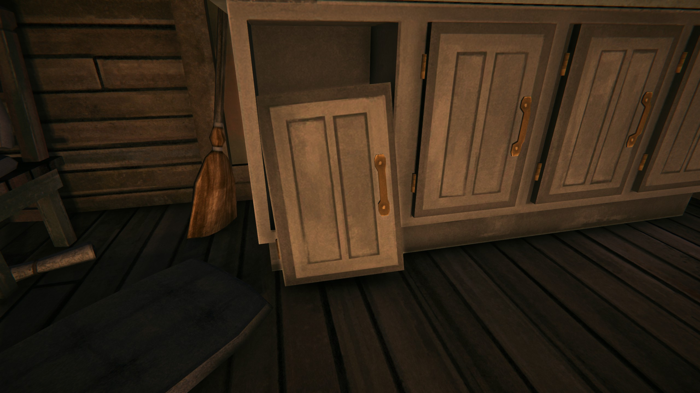

# Cabinet Door

**Cabinet Door**

| Property | Details |
| --- | --- |
|  |  / *Cabinet\_Door.jpg* |
| **General** |  |
| Item Type |  |
| Wintermute | Yes\|- |
| Harvest | 8 Minutes 1 x [Reclaimed Wood](./Reclaimed%20Wood.md) |

A **Cabinet Door** is a harvestable object found in various homes across the Island. Only Cabinet Doors that are broken off their hinges and laying against the cabinet can be harvested, ones on the floor cannot. The door can only be harvested with a [Hatchet](./Hatchet.md) and provides 1 [Reclaimed Wood](./Reclaimed%20Wood.md) after 8 minutes of harvesting. They sometimes hide items behind them. **Lua execution error in Module:Navbox function navbox**
