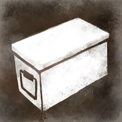

# Cache Mastery

**Contents**

- [Guide](#Guide)
- [Tasks](#Tasks)
- [Episode 1](#Episode_1)
- [Episode 2](#Episode_2)
- [Game History](#Game_History)

<table class="infobox">
<caption>Cache Mastery</caption>
<colgroup>
<col style="width: 50%" />
<col style="width: 50%" />
</colgroup>
<tbody>
<tr>
<td colspan="2"><figure>

<figcaption>Cache_Mastery_icon.png</figcaption>
</figure></td>
</tr>
<tr>
<td>
Description
</td>
<td>
Find all hidden caches in Episode One and Episode Two.
</td>
</tr>
</tbody>
</table>

**Cache Mastery** is a <a href="./Wintermute.md" class="wikilink" title="Wintermute">Wintermute</a> <a href="./The%20Long%20Dark%20%E2%80%94%20Achievements.md" class="wikilink" title="achievement">achievement</a> acquired from playing <a href="./Episode%201%20-%20Do%20Not%20Go%20Gentle.md" class="wikilink" title="Episode 1: Do Not Go Gentle">Episode 1: Do Not Go Gentle</a> and <a href="./Episode%202%20-%20Luminance%20Fugue.md" class="wikilink" title="Episode 2: Luminance Fugue">Episode 2: Luminance Fugue</a> of *<a href="./The%20Long%20Dark.md" class="wikilink" title="The Long Dark">The Long Dark</a>*.

## Guide

This achievement is acquired from finding hidden caches across both Episode 1 and Episode 2. This is best done in one playthrough, and often requires finding notes to find these caches.

This achievement is separate from the Forest Talker caches in the <a href="./Forest%20Talker%20Supply%20Caches.md" class="wikilink" title="Forest Talker Supply Caches">Forest Talker Supply Caches</a> and <a href="./Sounds%20Like%20Some%20Kind%20of%20Indie%20Band.md" class="wikilink" title="Sounds Like Some Kind of Indie Band">Sounds Like Some Kind of Indie Band</a> achievement.

## Tasks

The following Side Missions lead you to each cache needed to unlock this achievement:

### Episode 1

<a href="./Milton%20Supply%20Caches.md" class="wikilink" title="Milton Supply Caches">Milton Supply Caches</a>

- To start the mission, the survivor has to find one of the corresponding notes scattered around <a href="./Milton.md" class="wikilink" title="Milton">Milton</a>:
  - <a href="./Cave%20Hidden%20Cache%20Note.md" class="wikilink" title="Cave Hidden Cache Note">Cave Hidden Cache Note</a>
  - <a href="./Medicine%20in%20my%20backyard.md" class="wikilink" title="Medicine in my backyard">Medicine in my backyard</a>
  - <a href="./Milton%20Hidden%20Cache%20Note.md" class="wikilink" title="Milton Hidden Cache Note">Milton Hidden Cache Note</a>

### Episode 2

<a href="./Mystery%20Lake%20Supply%20Caches.md" class="wikilink" title="Mystery Lake Supply Caches">Mystery Lake Supply Caches</a>

- Find the cache near the old Hunting Lodge in the Broken Railroad region.
- Find the cache at the end of the ravine in the Broken Railroad region.
- Find the cache in the Clear Cut in Mystery Lake.
- Find the cache under some tree roots in the Forlorn Muskeg.
- Find the cache in Alan's Cave in Mystery Lake.
- Find the cache near the entrance to Forlorn Muskeg region from Mystery Lake.

## Game History

- UPDATE **1 August 2017 (<a href="./The%20Long%20Dark%20%E2%80%94%20Changelog.md#1.00" class="wikilink" title="Update">Update</a>):**
  - Added to game.

**Lua execution error in Module:Navbox function navbox**

