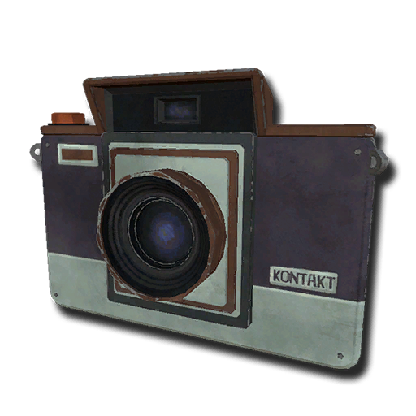
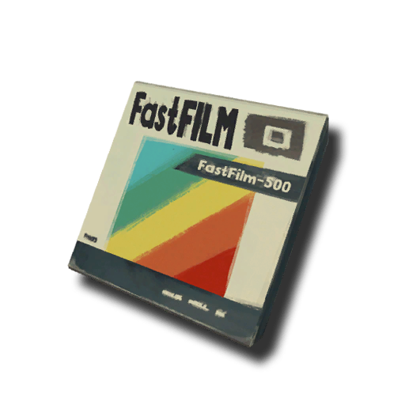
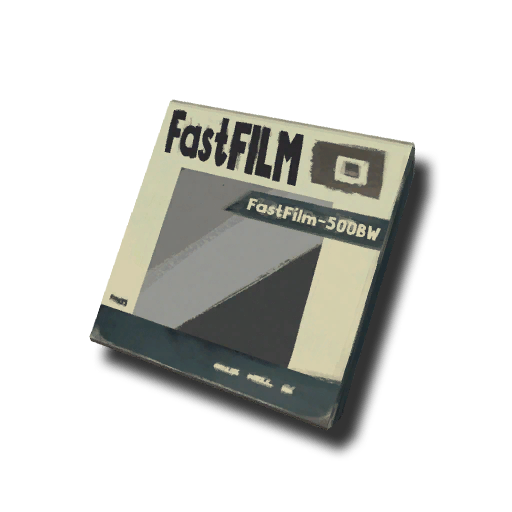
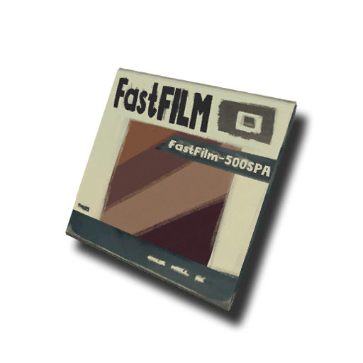
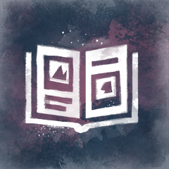
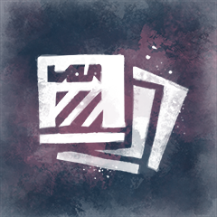

# Camera

**Contents**

- [Overview](#Overview)
- [Location](#Location)
- [Photos](#Photos)
- [Film and Colouring](#Film_and_Colouring)
- [Trivia](#Trivia)
- [Bugs](#Bugs)
- [Achievements](#Achievements)
- [Gallery](#Gallery)
- [Game History](#Game_History)

<table class="infobox">
<caption>Camera</caption>
<colgroup>
<col style="width: 50%" />
<col style="width: 50%" />
</colgroup>
<tbody>
<tr>
<td colspan="2"><figure>

<figcaption>Camera_icon.png</figcaption>
</figure></td>
</tr>
<tr>
<td>
Release
</td>
<td>
<a href="./The%20Long%20Dark%20%E2%80%94%20Changelog.md#2.33" class="wikilink" title="2 December 2024">2 December 2024</a>
</td>
</tr>
<tr>
<td>
Wintermute
</td>
<td>
No
</td>
</tr>
<tr>
<td colspan="2" class="section">
<strong>Properties</strong>
</td>
</tr>
<tr>
<td>
Item type
</td>
<td>
<a href="./Tools.md" class="wikilink" title="Tools">Tools</a>|-
</td>
</tr>
<tr>
<td>
Stackable
</td>
<td>
No
</td>
</tr>
<tr>
<td>
Examine
</td>
<td>
A mechanical instant film Camera. Compatible with Colour, Black and White, and Sepia instant film packs.
</td>
</tr>
<tr>
<td colspan="2" class="section">
<strong>Values</strong>
</td>
</tr>
<tr>
<td>
Weight
</td>
<td>
0.00 kg (0 lbs)
</td>
</tr>
</tbody>
</table>

<table style="width:100%;">
<colgroup>
<col style="width: 16%" />
<col style="width: 16%" />
<col style="width: 16%" />
<col style="width: 16%" />
<col style="width: 16%" />
<col style="width: 16%" />
</colgroup>
<tbody>
<tr>
<td width="40px"><figure>
[Missing image: Ptarmigan_icon.png]
<figcaption>Ptarmigan_icon.png</figcaption>
</figure></td>
<td>
<strong>DLC-Exclusive content.</strong> 

This content requires the <a href="./Tales%20from%20the%20Far%20Territory.md" class="wikilink" title="Tales from the Far Territory">Tales from the Far Territory</a> addon to be installed before it can be seen or used in regular gameplay.

</td>
<td>
|}{| style="margin:auto"
</td>
<td style="vertical-align: top; font-size: 3em; color: #5d5980; padding-right: 10px">
“
</td>
<td>
Discover an old manual instant camera. Take photos anywhere in the world and add them to your Album. Craft photos into wall-hangings for your personal Safehouse. Find Colour, Black &amp; White, or Sepia-toned film stock. Be a photographer at the end of the world.

&#10;

Official Description

</td>
<td style="vertical-align: bottom; font-size: 3em; color: #5d5980; padding-left: 10px">
”
</td>
</tr>
</tbody>
</table>

The **Camera** is a <a href="./Tools.md" class="wikilink" title="Tool">Tool</a> found in <a href="./Survival%20Mode.md" class="wikilink" title="Survival Mode">Survival Mode</a> in *<a href="./The%20Long%20Dark.md" class="wikilink" title="The Long Dark">The Long Dark</a>.* It is available for players that purchase the <a href="./Tales%20from%20the%20Far%20Territory.md" class="wikilink" title="Tales from the Far Territory">Tales from the Far Territory</a> expansion, and is designed to be an in game photo/screenshot system for custom photos.

It is one of the few items that cannot be dropped or placed in containers so it cannot be lost, similar to the <a href="./Handheld%20Shortwave%20Radio.md" class="wikilink" title="Handheld Shortwave Radio">Handheld Shortwave Radio</a> and <a href="./Respirator.md" class="wikilink" title="Respirator">Respirator</a>.

## Overview

The Camera is an Instant Camera model that can print photos right after they are taken. Photos taken can not be turned into <a href="./Polaroids.md" class="wikilink" title="Polaroids">Polaroids</a> to unlock Vistas. Only 1 Camera exists in the entire game.

### Location

It can be found sitting on one of the control panels at the <a href="./Station%20Bunkhouse.md" class="wikilink" title="Station Bunkhouse">Station Bunkhouse</a> in <a href="./Sundered%20Pass.md" class="wikilink" title="Sundered Pass">Sundered Pass</a>, with a starting box of <a href="./FastFilm-500.md" class="wikilink" title="FastFilm-500">FastFilm-500</a> next to it.

### Photos

Photos can be taken by equipping the Camera and aiming it with "Right Mouse," which produces a square box on the screen that will become the taken photograph. Once the Camera is shot, the survivor takes the photo out and watches it develop right in front of them before putting it away.

Photographs taken with the Camera appear in a special section of the <a href="./Journal.md" class="wikilink" title="Journal">Journal</a> called the Photo Album, which lists the Region and location of where the photo was taken. Photos can be Discarded, Annotated (the player can write a story on it), or Examined in this menu. While it is unknown if there is a limit to how many photos can be taken, it is more than than the 20 blank slots one starts with.

Photos taken can be placed inside a constructed <a href="./Framed%20Photo.md" class="wikilink" title="Framed Photo">Framed Photo</a> and placed inside a player's <a href="./Safehouse.md" class="wikilink" title="Safehouse">Safehouse</a> as a <a href="./Decorations.md" class="wikilink" title="Decoration">Decoration</a>.

## Film and Colouring

\[Missing image: Camera_Colour_films.jpg\] From left to right: Sepia, Colour, Black & White of Barn (Molly's)FastFilm is required to make the Camera work, and the film used effects the coloring of the photograph taken. They are commonly found in various locations around Great Bear Island, mostly hidden in houses and cabins. A single FastFilm contains enough film for 6 Shots. Running out of film in the Camera will cause the survivor to reload another FastFilm of the same color type into the Camera.

-  <a href="./FastFilm-500.md" class="wikilink" title="FastFilm-500">FastFilm-500</a> (Colour-toned)
-  <a href="./FastFilm-500BW.md" class="wikilink" title="FastFilm-500BW">FastFilm-500BW</a> (Black & White-toned)
-  <a href="./FastFilm-500SPA.md" class="wikilink" title="FastFilm-500SPA">FastFilm-500SPA</a> (Sepia-toned)

Swapping to different film types into the Camera simply requires the player to press the "R" key when the Camera is equipped, where it cycles through the order Colour, Black and White, and Sepia film if the player has them in their inventory. Manually swapping through different film colors will also reload the Camera with fresh film from the player's inventory, if film Shots of a particular color inside the Camera is running low.

There is currently not an option to unload all film from inside the Camera in the Backpack options.

## Trivia

- Despite not being a weapon, aiming the Camera at a <a href="./Wolf.md" class="wikilink" title="Wolf">Wolf</a> that cannot reach you will scare it off like any other weapon (or cause it to agro and charge).
- The Camera was originally teased as "A Photo Mode for THE LONG DARK, but contextualized with an in-game camera and Dark Room chemicals so that you can process your own film." This meant that the original Camera used a model that required its pictures to be processed first before they could be displayed, which was also shown in the teaser image showing polaroids hanging out to develop.
  - An interview by Hinterland later revealed that the Dark Room was cut "because it would have required electrical equipment that we'd only be able to let players use during an active aurora. We came up with a good solution that is true to our lore and also gives players a lot of freedom for self-expression."[^1]
- The Camera has the brand "Kontakt" etched into the front and back, which may be a reference to Kodak cameras.

## Bugs

- The quality of an image taken with the camera is directly affected by Motion Blur (Settings \> Visuals \> Quality). High levels of Motion Blur result in extremely blurry photographs, whereas "none" results in crystal clear images.

## Achievements

-  <a href="./Exposure.md" class="wikilink" title="Exposure">Exposure</a>
-  <a href="./Shutterbug.md" class="wikilink" title="Shutterbug">Shutterbug</a>

## Gallery

<table class="gallery">
<colgroup>
<col style="width: 33%" />
<col style="width: 33%" />
<col style="width: 33%" />
</colgroup>
<tbody>
<tr>
<td><figure>

<figcaption>The Camera with Colour, Black &amp; White, and Sepia-toned film stock, as well as some taken photos.</figcaption>
</figure></td>
<td><figure>

<figcaption>The Camera's location in the <a href="./Station%20Bunkhouse.md" class="wikilink" title="Station Bunkhouse">Station Bunkhouse</a>.</figcaption>
</figure></td>
<td><figure>

<figcaption>The teased marketing photo for the Camera and former Dark Room.</figcaption>
</figure></td>
</tr>
</tbody>
</table>

## Game History

**Template:update historyLua execution error in Module:Navbox function navbox**

<a href="ru:%D0%A4%D0%BE%D1%82%D0%BE%D0%B0%D0%BF%D0%BF%D0%B0%D1%80%D0%B0%D1%82" class="wikilink" title="ru:Фотоаппарат">ru:Фотоаппарат</a>

## Notes

[^1]: <https://www.shacknews.com/article/142391/the-long-dark-raphael-van-lierop-interview-2024>
