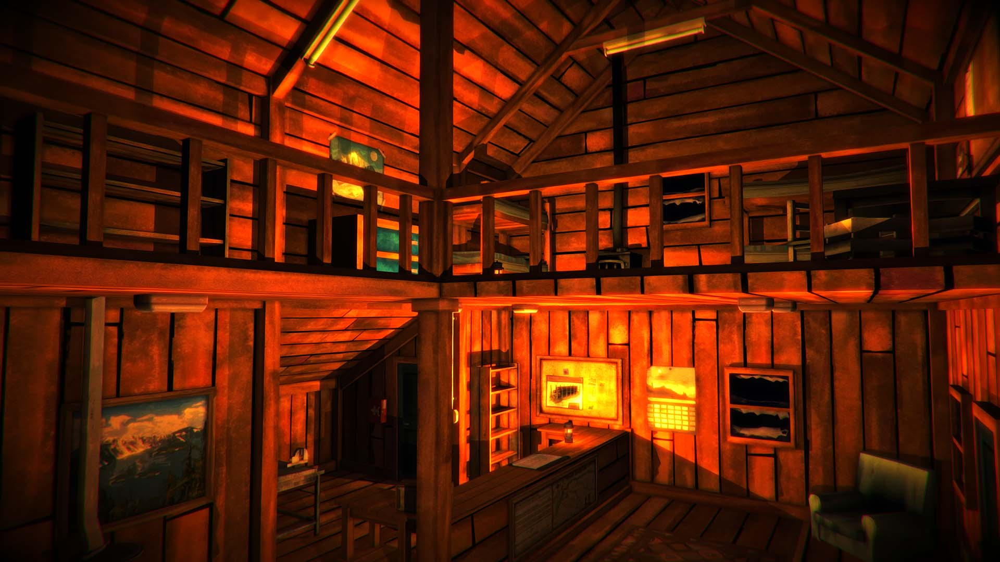

# Camp Office

**Camp Office**

| Property | Details |
| --- | --- |
| \[\[File: / \|  / *Exterior* \|  / *Interior* \| / \| --- \| --- \| | 250px\]\] |
|  / *Exterior* |  / *Interior* |
| **Location** |  |
|  / *Camp\_Office\_Location.png* |  |
| Region | [Mystery Lake](./Mystery%20Lake%20%28region%29.md)\|- / Location |
| Description | A two-story cabin. |
| **General** |  |
| Type | Military/Sporting\|- / Firebox |
|  / *bed\_icon.png* | Has a bed |
|  / *workbench\_icon\_green.png* | Has a workbench\|- |
