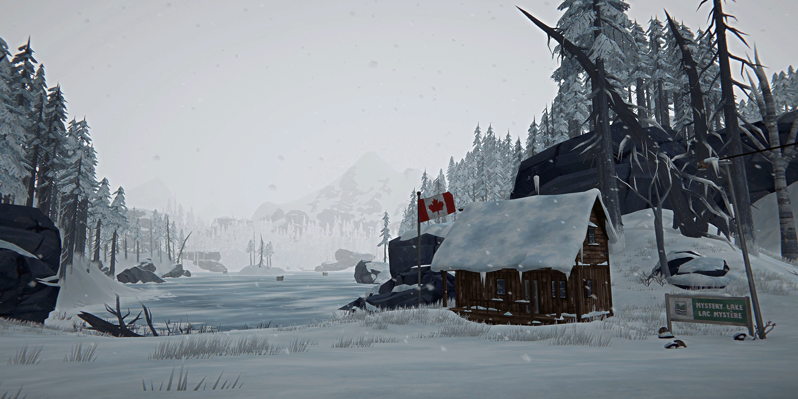
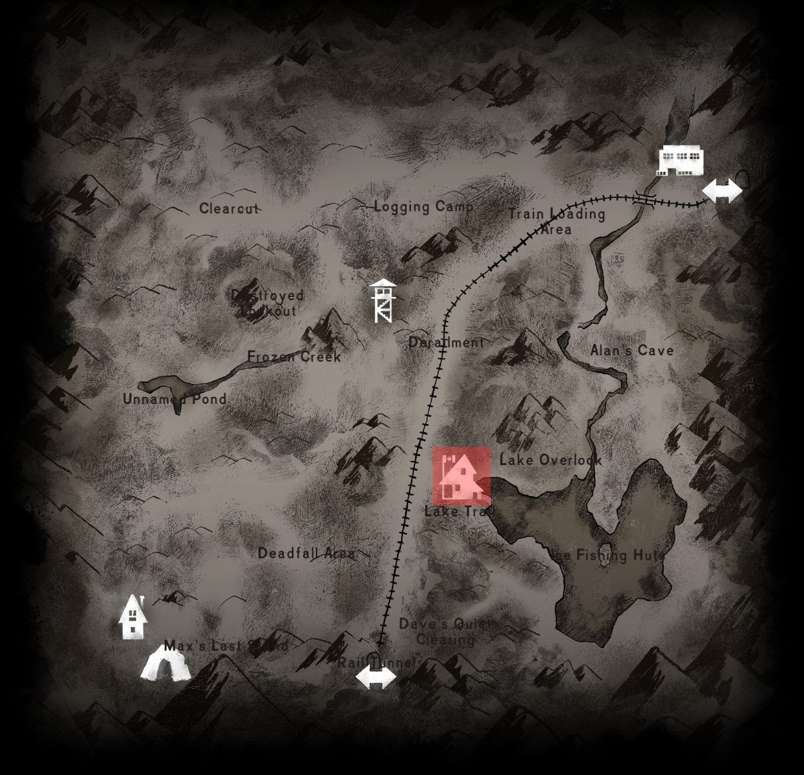
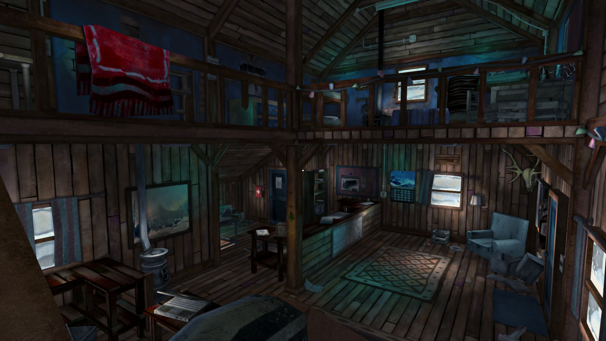
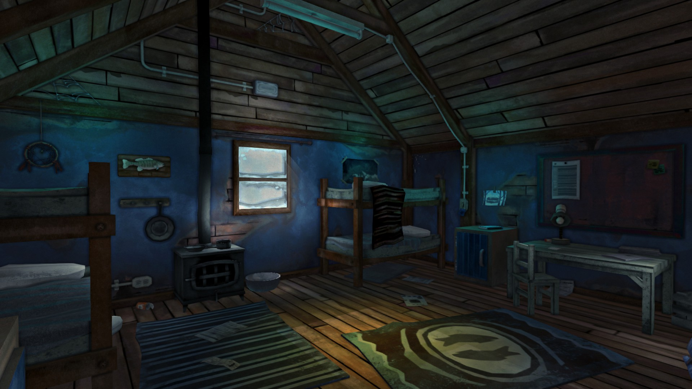
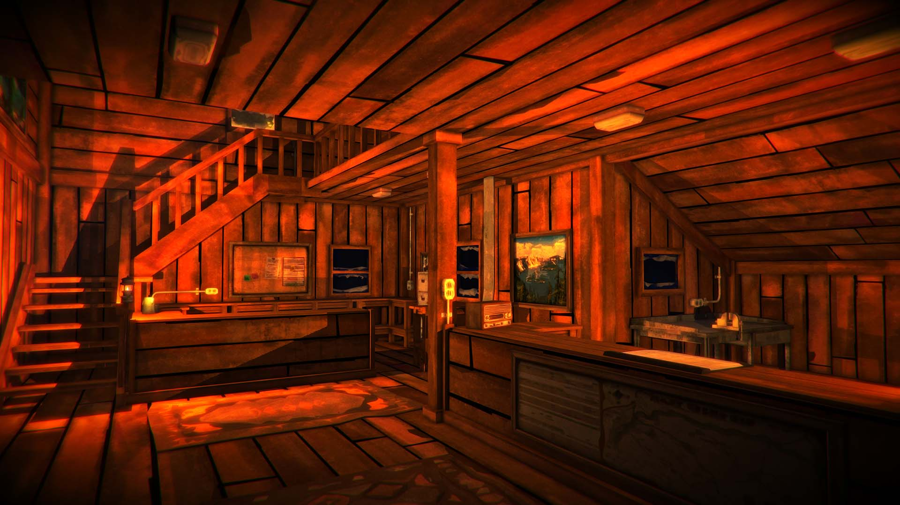
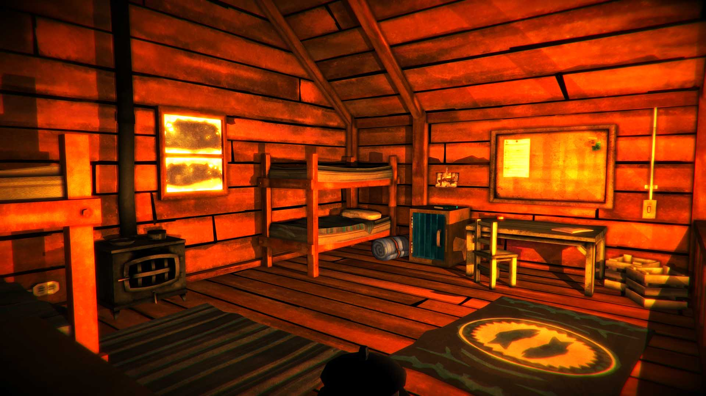
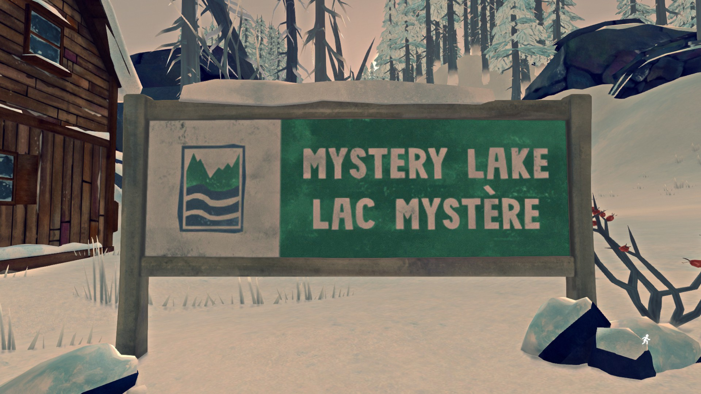
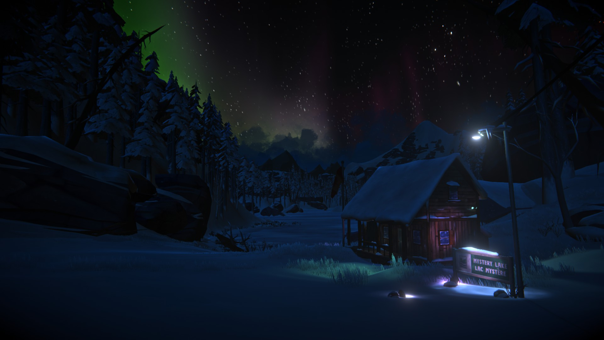
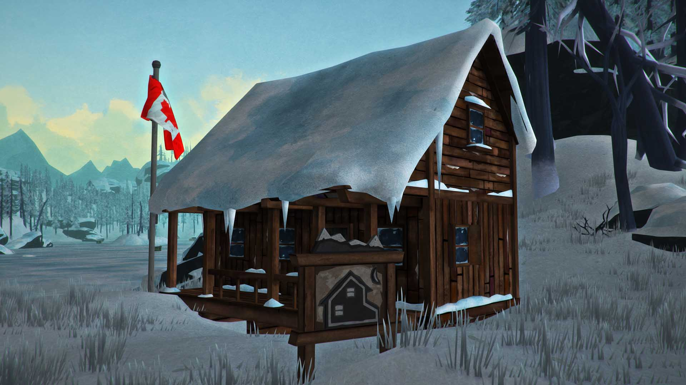
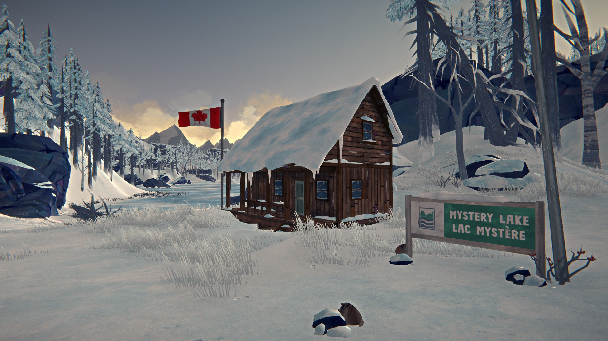

# Camp Office

**Categories:** Indoor locations, Locations, Locations in Mystery Lake, Locations with a workbench, Military/Sporting locations · **Source:** [Fandom](https://thelongdark.fandom.com/wiki/Camp_Office)

**Camp Office**

\[\[File:

250px\]\]

**Location**

Region

[Mystery Lake](./Mystery%20Lake%20%28region%29.md)|-

Location

Description

A two-story cabin.

**General**

Type

Military/Sporting|-

Firebox

Has a bed

Has a workbench|-

## Overview

The Camp Office's location makes it arguably the best [safehouse](./Safehouse.md) in most [gameplay modes](./Survival%20Mode.md#Experience), as it is centrally located both midway other [Regions](./Region.md) on [Great Bear](./Great%20Bear%20Island.md), as well as within Mystery Lake itself.

Nearby key locations are: [Mystery Lake](./Mystery%20Lake%20%28location%29.md), [ice fishing huts](./Fishing%20Hut.md) scattered about, [cat tails](./Cat%20Tail.md) around the lake perimeter, and a [rabbit](./Rabbit.md) grove nearby between the [Deadfall area](./Deadfall%20Area.md) and [Trapper's homestead](./Trapper%27s%20Homestead.md). [Deer](./Deer.md) and [wolves](./Wolf.md) may wander the area, with additional Deer spawns on the Lake and the clearing between the Office and [Forestry Lookout](./Forestry%20Lookout.md), as well as a [moose](./Moose.md) sometimes frequenting the train tracks some distance from the building.

The Office has two entrances (front and back), and two floors. The first floor features a [work bench](./Work%20Bench.md), a first aid box next to the back door, and a potbelly stove. A [potato sack](./Potato%20Sack.md) can potentially spawn under the staircase. Next to the stairs is one of the [Radios](./Trader.md#Radio_Locations) necessary to contact the Trader (if enabled).

The second floor sometimes features a corpse that may spawn at the top of the stairs, a wood burning stove, two bunk beds, a dresser, a shelf, a cupboard, a table, and chair. Near the desk upstairs is a [note](./Notes.md) left behind.

All the containers combined: Dresser (2 x 10 kg), Cupboard (15 kg), and [File Cabinet](./File%20Cabinet.md) (4 x 10 kg) offers a total **75 kg (165 lbs)** of guaranteed indoor storage, an additional 10 kg (22 lbs) with Workbench and First Aid shelf added, plus a wide and a tall shelf. Running the 3 indoor [cooking](./Cooking.md) slots simultaneously - while [fuel](./Fire.md#Types_of_Fuel) intensive - makes it possible to cook large amounts of meat relatively quickly.

There is also a [metal container](./Metal%20Container.md) outside behind the building, ideal for storing both perishables such as meat, and items intended to be left uncured, like [Green Birch Saplings](./Green%20Birch%20Sapling.md). Keep in mind that Ruined items disappear when they reach 0% condition inside a container, so consider storing food on the ground instead.

## Trivia

It is implied in [Episode 2: Luminance Fugue](./Episode%202%20-%20Luminance%20Fugue.md) that [Jeremiah](./Jeremiah.md) would regularly shelter in the Camp Office, judging by the amount of discarded [Pork and Beans](./Pork%20and%20Beans.md) cans left around.

This location is one of the most iconic places in the game as an important central location in the first region to be released.

## Gallery

