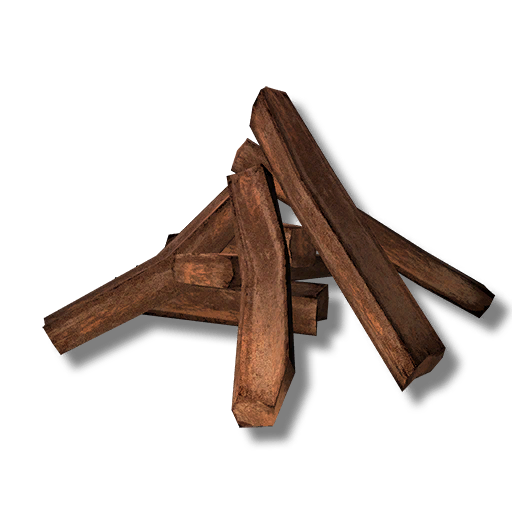
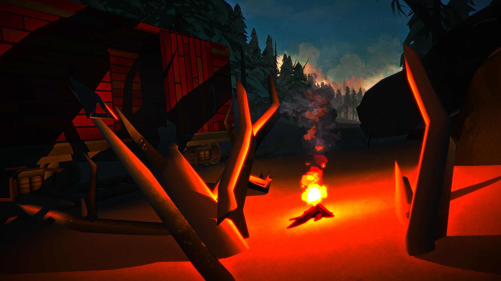
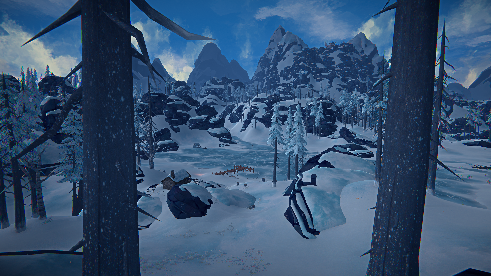
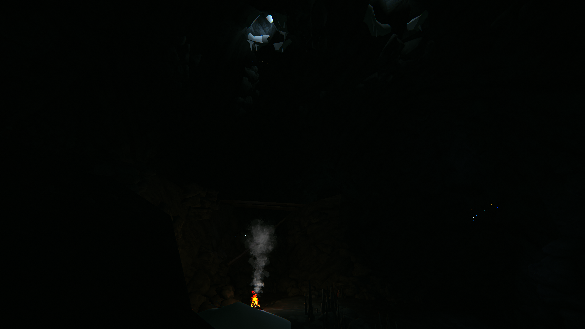
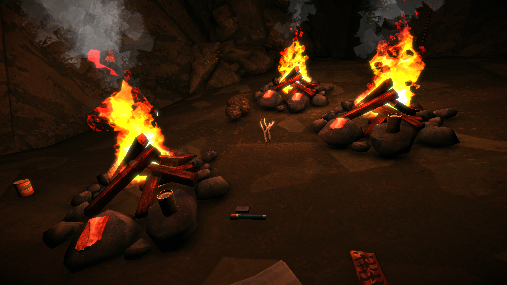

# Campfire

**Contents**

- [Placing campfires](#placing-campfires)
- [Windblown](#windblown)
- [Burnt out](#burnt-out)
- [Additional Tips](#additional-tips)
- [Gallery](#gallery)

**Campfire**

| Property | Details |
| --- | --- |
|  |  / *Campfire\_icon.png* |
| **General** |  |
| Type | Fire Starting\|- |
| Max temperature | 80 °C / *(144 °F)* |
| Cooking slots | 2 |

A **Campfire** is an open [Fire](./Fire.md) that can be placed into the outdoors. Campfires can cook meat to make it safer to eat, melt snow into [Water](./Water%20%28Unsafe%29.md) and [sterilize](./Water%20%28Potable%29.md) it, make beverages, heat canned food/beverages, scare off predators and create [Torches](./Torch.md).

## Placing campfires

Campfires can be placed with the [Radial Menu](./Radial%20Menu.md) outdoors on the ground, provided the following conditions are met:

- The player has at least one of any: Firestarter, Tinder, and Fuel.
- Optionally: [Accelerant](./Accelerant.md) or 0,1L of [Lantern Fuel](./Lantern%20Fuel.md) can used when starting a fire, guaranteeing it will light and light faster.
- Ground must be mostly level.
- Cannot be placed on top of wooden, concrete, or metal surfaces (such as porches).
- Must be placed in close proximity to the player.
- Cannot be started inside most interior locations or mines. ([Maintenance Yard](./Maintenance%20Yard.md) and [Langston Mine](./Langston%20Mine.md) are exceptions)
- [Strong Winds](./Survival%20Overlay.md) or Blizzards prevent unsheltered fires from being created. **Note:** wind changing directions can cause previously sheltered fires to be blown out.

## Windblown

*old campfire* Campfires can be used like all other fires, but unlike contained fires, they are vulnerable to high winds. The Wind Shield icon can be useful for locating an area that is not currently being blown by wind.

An indicator that a fire is about to blow out is its smoke will be blowing away sideways instead of rising up.

- Attempting to fuel to a windblown fire may prompt that it is "too windy to sustain the fire". In other cases fuel may be added but the maximum possible life of the fire is limited to 9 minutes, making most fuels extremely wasteful and refueling tedious.
- Periodically feeding sticks to a windblown fire may be useful if one finds oneself still in dire need of warmth when their fire starts to go out. The wind may also eventually shift, allowing the player to extend the fire's life beyond the 9-minute cap.
- Windblown fires can still be useful for short tasks, like brewing beverages or heating cans or boiling the smallest amounts of water.

## Burnt out

Campfires which run out of fuel will persist as a burnt out campfire, from which [Charcoal](./Charcoal.md) can be harvested based on how much fuel was burned (up to 50 pieces of charcoal), or left to gather over successive fires.

- Burnt out campfires can be found pre-generated in all regions, to suggest the activity of other survivors. If such fire exist indoors or in other locations where a campfire could not normally be started, the player can relight them.
- Pulling a Torch from a lit campfire will reduce its lifespan by 10 minutes, and cannot be used if the Campfire has less than 10 minutes left to burn.
- Just before a campfire burns out, it may persist with a duration of "embers" for a few minutes, allowing more fuel to be added on. Whether and for how long embers will linger seems to depend on the ambient conditions (wind/cold) and strength of the fire.
- Burnt out campfires can be broken down, removing them but providing no resources.
- At extremely cold temperatures (0 degrees C or colder) fuel burns much slower, making it more efficient.

## Additional Tips

- Lit Torches, [Flares](./Flare.md), and [Marine Flares](./Marine%20Flare.md) can be used to start a campfire. At low [Firestarting skill](./Skills.md) and/or higher difficulties, this is an effective way to conserve matches.
- Torches may be pulled from a campfire, allowing the fire to be transported or excess fuel conserved by breaking the torches down into sticks.
- Pulling a torch from the fire will reduce the duration by 10 minutes and the temperature by 1 degree Celsius.
- The [Magnifying Lens](./Magnifying%20Lens.md) is the only infinitely renewable firestarter and must be used during sunny daylight.
- Few outdoor locations provide perfect protection for a fire, but caves notable enough to be marked on the map are typically fully sheltered, even in the colder area near the lip of the cave.
- [Bear Carcass](./Black%20Bear%20Carcass.md) and [Moose Carcass](./Moose%20Carcass.md) are large enough to block wind for a campfire, making them an unusual example of a windshield the player has some small agency in positioning. They can also be used to warm the player and keep the carcass from freezing while harvesting it.
- Using sticks and pulled torches to light several campfires in rapid succession is a cheap, efficient method of rapidly training the Firestarting skill.
- Stepping into an active campfire will result in [Burns](./Burns.md) and constant Condition loss.
- Despite having only two cooking slots, some food items (e.g. coffees, teas, canned foods) can be heated up by dropping near the campfire, but there is still a risk of burning them away if left for too long.
- Starting multiple fires may be desirable to mass produce food and water, making closely placed campfires the logical choice. The only downside is that each active campfire will require larger amounts of fuel to keep each one going.
- Most hostile [Wildlife](./Wildlife.md) will be held at bay by an active campfire, or at least won't directly cross one. Hastily lighting a fire can be a life saver.
- Right clicking valid cooking slot items can be used to place them in a cooking slot or to transfer items currently cooking from one fire to another. This will not reset the timer, regardless of the distance between fires. This can be very useful when one needs to move from a windblown fire to a sheltered fire.
- Special green campfires imbued with magic can be found during the [Escape the Darkwalker](./Escape%20the%20Darkwalker.md) challenge.

## Gallery

| Column 1 | Column 2 | Column 3 |
| --- | --- | --- |
|  / *Campfire seen burning in the distance* |  / *A campfire in a cave* |  / *Multiple fires for cooking* |

**Lua execution error in Module:Navbox function navbox** **Lua execution error in Module:Navbox function navbox**

[ru:Костёр](ru:%D0%9A%D0%BE%D1%81%D1%82%D1%91%D1%80)
